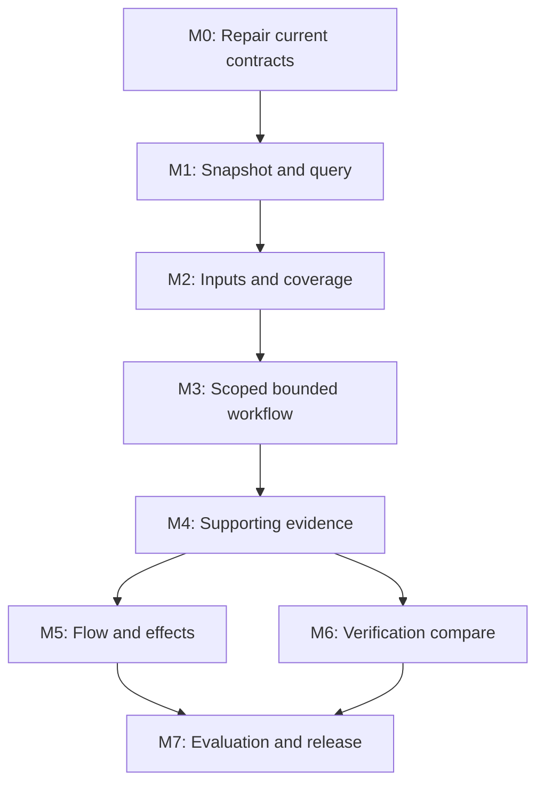

# Implementation plan: Srcly evidence-first agent CLI

**Implement a shared snapshot/query service, keep the existing analyzers, and ship correctness repairs first.** The target workflow is `catalog → audit → inspect → compare`, with immutable evidence, one repository/folder/file/symbol resolver, bounded output, explicit provider requests, and coverage-aware verification. This plan is grounded in Srcly commit [`aa56155c9268ce9da3a54180cb6a77ae6635d190`](https://github.com/byronwall/srcly/commit/aa56155c9268ce9da3a54180cb6a77ae6635d190), version 1.8.0. It proposes code changes; none have been made or executed during this mission.

Read [report.md](report.md) for the audit and source evidence; [recommendations.md](recommendations.md) for stable recommendation IDs and the craft ledger; [fixtures/contract-cases.json](fixtures/contract-cases.json) for 25 data-only acceptance cases. Source references use the same Sxx labels as the report and are linked at the end of this file.

## 1. Delivery boundaries

- **Use Python/uv for server work and pnpm for client/engine work.** Preserve the existing package tooling and generated-contract ownership. ([S25], [S51])
- **Reuse real service modules.** The CLI should call providers directly through Python service adapters; it should not require a running FastAPI server.
- **Keep the current metric catalog and native dataflow contracts.** Add a wrapper for source identity, coverage, and query output; do not duplicate analyzer rules or hand-edit emitted schemas. ([S03], [S20], [S25])
- **Ship vertical slices.** M0 repairs the current public commands. M1 adds a useful saved-snapshot JSON path. Later milestones add richer queries and retire the old reporting contract once the replacement is complete.
- **Separate analysis, projection, and rendering.** A byte limit changes what is shown, not what was measured or whether a gate passes.
- **No automatic refactoring or test execution.** This tool supplies evidence and suggested verification context. The coding agent/human still reviews and runs the appropriate checks.

### Proposed module ownership

These paths are proposed new files unless marked existing.

| Module | Responsibility | Existing source to reuse/change |
| --- | --- | --- |
| `server/app/services/audit/models.py` | Snapshot, provider result, coverage, selectors, evidence, response types | Adapt `app/models.py`; preserve original UI model. |
| `audit/inputs.py` | Source inventory, canonical paths, byte/config hashes, source-root binding, dirty state | `analysis.discover_files`, `cache`, compare ref helpers. |
| `audit/snapshot.py` | Read/validate/write immutable snapshots; derive snapshot with extra provider evidence | Current JSON/cache techniques, but complete integrity and atomic writes. |
| `audit/providers.py` | Small explicit dispatch for syntax/history/checks/imports/tests/flow/effects | `analysis`, `activity`, `findings`, `deps`, `dataflow`. No plugin framework. |
| `audit/context.py` | Categories, instruction references, package/script context, declared overrides | Current path discovery and `deps.common.is_test_path` as a starting hint. |
| `audit/query.py` | Scope resolution, evidence lookup, metric view, candidate construction, deterministic ordering | Extract useful logic from `reporting`, never copy its score semantics. |
| `audit/render.py` | Text/Markdown/JSON projections, escaping, byte caps, cursor output | Replace rendering responsibilities in `reporting`. |
| `audit/compare.py` | Snapshot compatibility/matching, measurement transitions, diagnostic matching/gates | Reuse `compare.diff`, `git_refs`, and side loading after correctness repairs. |
| `server/app/run.py` — existing | Parse/validate commands; invoke services; map response to streams/exit codes | Keep thin. Remove artifact assembly and ad hoc view-specific policy. |

Eight narrow modules are a proposed ownership map, not a requirement to create empty abstractions up front. M1 can start with models, snapshot, query, and a small provider adapter; split the remaining modules when their corresponding behavior lands. Ordinary JSON files and current caches are sufficient. No database, daemon, dependency injection framework, remote storage, or universal graph engine is required.

## 2. Concrete target contract

### 2.1 Source identity and evidence identity

`SourceManifest` must distinguish:

- **Analyzed root / output scope:** repository-relative paths for semantic data; a separate local root locator for resolving current bytes. A folder query does not redefine the analysis root.
- **Source files:** path, byte length, content digest, read/eligibility status, optional line count, discovery/category reason. Source metrics should consume the hashed bytes rather than reopening a mutable path without detection.
- **VCS context:** resolved full commit where applicable; index/worktree/untracked/conflict/submodule state; history window and fixed as-of date when history is requested. Record that Git state is contextual and content hashes identify dirty bytes.
- **Configuration inputs:** ignore/discovery rules, Srcly config, effective analyzer definitions, instruction references, package/tsconfig/pyproject metadata. Each optional provider declares its additional inputs.
- **Coverage limits:** files not enumerated/read/analyzed, reasons and counts; unknown denominators remain null rather than zero.

Use canonical JSON serialization to derive a source ID from the declared manifest. Normalize path separators to `/`, preserve case and exact filename spelling, and sort collections by their contract keys. Do not include an absolute checkout location, timestamp, or runtime cache hit in the content identity.

An `AnalysisSnapshot` carries source ID plus semantic producer/configuration identity, subjects, measurements and provider facts. Its snapshot ID changes when evidence changes. A view's limit/format does not change that ID. Deriving a snapshot with checks/imports keeps source ID only while the declared source manifest is unchanged; additional provider inputs have their own digest. Changing or expanding that source manifest requires a new source ID. Write a new file only: `--save` has no-clobber semantics for every existing destination, especially the input snapshot, unless a future explicit replacement operation is designed.

Subject IDs are deterministic within this source/analysis context. Files use structured relative paths; symbols add language, kind, declared qualified name where known, and exact source range/disambiguator. Keep original byte spans for exact source identity alongside canonical one-based Unicode-scalar ranges with exclusive ends. A separate matcher handles cross-edit correspondence. Never claim that a line number or name alone is a durable symbol identity.

### 2.2 Measurement and coverage semantics

| State | Value | Required explanation |
| --- | --- | --- |
| `measured` | Finite number, including 0 | Definition/catalog identity, basis and scope. |
| `partial` | Known observed number or null | Partial denominator or lower bound; reason and missing population. |
| `not-applicable` | null | No eligible population under the definition. |
| `not-requested` | null / absent provider facts | Provider omitted from the declared plan. |
| `unsupported` | null | Eligible question not supported for this language/configuration. |
| `excluded` / `too-large` | null for skipped analyses | Rule/budget and affected scope. Fallback LOC gets its own basis/status. |
| `failed` / `timeout` | null for failed analyses | Typed cause and bounded diagnostic detail. |
| `stale` | null as a current attachment | Which identity changed; retained historical evidence can still be inspected. |

A snapshot does not need to repeat a long status object for every zero-valued metric. It can encode shared applicability/coverage tables and normalized measurement records. A bounded response must nevertheless make each displayed value interpretable without treating omitted fields as zero.

Folder aggregation is a projection over declared members:

- Sum only compatible counts; show observed/eligible membership.
- Maximum names a stable primary witness and tied-witness count; do not fabricate an exclusive cause.
- Means retain sufficient statistics: numerator, denominator and basis. Function-weighted means cannot be reconstructed from a plain mean of per-file means.
- Partial maximum is the maximum observed, potentially a lower bound on the full population. Missing children do not make it a complete maximum.
- `commit_count` summed over files means file touches, not distinct repository commits. Fan-in uses distinct importer files under the graph's coverage contract, not runtime callers.

### 2.3 Example response shape

This is **synthetic proposed contract data**, not output from the current repository. Digest strings and measurements are illustrative. Final schema should encode the constraints above, with no non-finite numbers and no ambiguous number-or-string missing values.

```json
{
  "schema": "srcly.audit.response/v1",
  "artifact_kind": "view",
  "operation": "inspect",
  "source_id": "example-source-before",
  "snapshot_id": "example-snapshot-before",
  "request": {
    "path": "src/parse.ts",
    "symbol": "parseInput",
    "view": "summary",
    "providers": ["syntax"]
  },
  "status": "complete",
  "coverage": {
    "syntax": {"eligible": 1, "measured": 1, "failed": 0},
    "checks": {"status": "not-requested"},
    "imports": {"status": "not-requested"}
  },
  "data": {
    "subjects": [{
      "id": "example-symbol-parseInput",
      "kind": "function",
      "path": "src/parse.ts",
      "name": "parseInput",
      "location": {
        "start": {"line": 4, "column": 1},
        "end": {"line": 32, "column": 1},
        "precision": "character",
        "column_encoding": "unicode-scalar"
      },
      "measurements": [{
        "metric": "complexity",
        "value": 17,
        "status": "measured",
        "basis": "executable-function-ccn",
        "evidence_refs": ["E1"]
      }]
    }],
    "evidence": [{
      "id": "E1",
      "kind": "metric-witness",
      "provider": "syntax",
      "subject_id": "example-symbol-parseInput",
      "source_digest": "example-file-digest"
    }]
  },
  "page": {"total": 1, "returned": 1, "omitted": 0, "next_cursor": null},
  "budget": {"max_bytes": 16384, "truncated_by": null},
  "diagnostics": [],
  "run": {"cache": "hit"}
}
```

Do not include a response's self byte size unless its exact definition avoids self-reference. The renderer enforces the total UTF-8 stdout budget, including newline, outside the serialized body. Timing/run metadata can differ without changing semantic evidence identity.

### 2.4 Grammar and selectors

Proposed common flags: `--format text|markdown|json` (default text), `--limit K` (default 10), `--max-bytes B` (default 16384), `--cursor TOKEN`, and `--progress never|auto|always` (default never, stderr only). No TTY-dependent schema switch. `audit` adds root, `--save`, `--scope`, `--with`, and `--refresh`. `inspect` takes a saved snapshot plus `--path`, optional `--symbol` or `--line`/`--column`, optional `--id`, `--view summary|metrics|evidence`, metric/cohort, `--with`, `--save`, and `--root ROOT` for explicit source relocation. Ref-mode `compare` accepts explicit `--with checks,imports,history` and uses the same plan on both sides. Snapshot-mode compare is offline and rejects acquisition flags. Only applicable flags appear on each command; do not accept silently ignored options.

- A missing inspect path means repository scope. A folder path selects descendants without discarding outside analysis context.
- `audit --scope PATH` changes the initial output selection within its root, not the provider analysis universe. Queue views accept explicit `--category` and `--lane diagnostics|complexity|structure` filters; full metric views use `--metric` and `--cohort file|function`. Include these selections in query/cursor identity.
- `--symbol` is exact matching under a file. Duplicate names return bounded candidate IDs; `--id` is unambiguous and mutually exclusive with other subject selectors.
- Line and column use the declared one-based Unicode-scalar coordinates. Column requires line. Symbol and position are mutually exclusive. A position may produce multiple supported expression candidates; do not guess one for flow.
- `--direction forward|backward` is valid only with requested flow. `inspect --refresh` requires `--with`; a pure saved query never turns into acquisition. Requesting `tests` explicitly expands its declared provider plan to include imports, with that dependency visible before execution.
- History acquisition accepts `--history-window 30d|90d|1y|all` (default 90d) and `--as-of` with an explicit UTC timestamp; otherwise capture the actual current timestamp in provenance. Pure queries display the saved window rather than silently recomputing it.
- Validate selector syntax, numeric bounds, mutually exclusive compare forms and basic path existence before expensive provider work.
- `--limit 0` means counts/coverage only; a negative value is invalid. Related evidence/snippet caps are included in the normalized query so one row cannot hide thousands of edges.
- `--max-bytes` must fit a measured minimum envelope. Over-small values fail before acquisition. Whole atomic records plus their necessary evidence are budgeted together. Formats share the same ordered semantic selection; different escaped byte sizes may yield different returned-prefix lengths, which must be explicit.
- Ref compare keeps positional refs. Snapshot compare requires both `--before` and `--after`; the two forms cannot be mixed.
- Old snapshots remain valid historical evidence for pure queries. Current disk divergence matters only when requesting new evidence or current-source excerpts.

### 2.5 Derived evidence, cursors, and provider validity

A pure snapshot query can page deterministically. A transient on-demand result cannot promise stable future pages unless its complete fact set is preserved. A complete saved fact set can itself contain partial/failed analysis; preservation does not imply full coverage. Therefore:

1. `inspect INPUT --with imports --save DERIVED` validates input source, runs the provider, writes a new full snapshot with the provider facts, and returns a bounded view of DERIVED.
2. The input file is unchanged. A cursor binds DERIVED's digest, normalized query, sort version and last key.
3. Without `--save`, a transient view can return omitted counts and a replay-with-save command, but no cursor over unpreserved facts.
4. Pure queries and their cursors never rerun providers. A missing or mismatched derived artifact produces a named error, not a silent fresh scan.
5. Format/page size may change without invalidating continuation if the semantic selection/order is unchanged; filters/provider selection may not.

Provider validity protocol:

- Resolve the project's full context and capability before running.
- Re-enumerate relevant inputs and hash their bytes; include additions/deletions, not just previously known paths.
- Record provider binary/build/version, arguments, configuration closure, timeout/budgets and environment inputs that affect semantics.
- Run the provider and preserve native outcomes/results.
- Re-enumerate/re-hash relevant inputs after completion; require source and provider-input identity to match before attaching results.
- Record consistency as `revalidated`. Unknown dynamic config closure stays `input_closure=unknown`; equality is not an atomic snapshot proof and cannot exclude an edit-and-revert during execution.

For flow also bind engine build, session/process identity, native generation and native programHash. Preserve engine schemas inside an enrichment envelope. When exact immutable input execution is necessary, use retained read-only source materialization; do not claim this stronger guarantee from live revalidation alone. ([S20], [S21], [S22], [S23])

## 3. Milestones

### M0 — Repair the current CLI contract

**Shippable outcome:** current commands produce trustworthy transport and explicit missing-analysis behavior before users adopt new commands. Addresses D01–D03, D08–D11, D14; recommendations CLI-001–CLI-003, CLI-006, CLI-014–CLI-015.

**Files and changes:**

- `server/app/services/compare/diff.py`: remove null-to-zero max/mean verdicts; emit not-comparable coverage transitions; graph fan counts remain null when the file was not successfully in graph coverage. Preserve added/removed lifecycle and rename edge mapping.
- `deps/graph.py` and language dependency extractors: add the minimum per-file success/failure coverage needed for that compare repair. Discovered graph-node membership alone does not prove extraction succeeded. M4 can extend this to detailed resolution coverage. ([S17], [S18], [S19])
- `reporting.py`: carry analysis status/N/A reasons and measured zeros into relevant compact evidence; sort by full values plus explicit ties; give every output collection a declared limit. Remove stale refresh no-op comments and correctly forward bypass to used provider caches.
- `run.py`: resolve relative `--file` under target root; validate limits; select a real first artifact based on output format; keep zero-limit metadata semantics explicit. Do not let `--limit` truncate gate inputs during the temporary legacy period.
- `cache.py`, `activity.py`, `findings/runner.py`, `compare/snapshots.py`, dependency extractors: route provider warnings through a diagnostic/log sink to stderr, never stdout.
- `findings/builtin_ts.py` and overlay: unreadable files are not checked-clean; preserve successful diagnostics even if another covering provider fails, with partial completeness.
- `README.md`, `skills/srcly-code-quality/SKILL.md`: correct current compact/refresh and format claims immediately. Remove unsupported “safe first patch” wording from the legacy renderer.

**Meaningful tests:**

- In `test_compare_diff.py`, cover modified `12 → null`, `null → 12`, mixed A `10 → 11` plus B `100 → null`, graph-absent versus successfully isolated files, and a real deletion. Assert paired populations and null deltas.
- In `test_reporting.py`, use subprocess stdout capture with fault-injected checker/history cache writes. Entire stdout must parse as JSON; stderr can contain a bounded warning. Do not merely monkeypatch away `scan_tree` and then claim provider stdout is covered.
- Existing fixtures can remain small. A test doubles only the failing boundary, not the behavior being verified.
- Add cwd≠root `explain`, negative limits, limit zero, JSON-only/Markdown-only artifacts, limit=1 parity and the legacy gate's independence from display limits.
- In `test_findings.py`, a byte-read failure returns partial/failed file coverage rather than zero.

**Acceptance:** no unavailable max/mean is labelled better; no known cache warning reaches machine stdout; selector meaning is root-relative; every emitted artifact link exists; current useful witnesses and single-metric parity remain. No broad CLI redesign required to ship M0.

**Risk:** adding statuses may affect compare UI shape. Update `client/src/compare/types.ts`, metric wording and affected tests in the same change where that contract changes. A temporary legacy gate is only repaired until M3 removes it; do not expand it.

### M1 — Introduce the immutable snapshot and pure query slice

**Shippable outcome:** `audit --format json --save FILE` and `inspect FILE --path PATH --format json` work for repository/folder/file scopes, reusing a scan rather than rerunning it.

**Files and contracts:** new `audit/models.py`, `snapshot.py`, initial `query.py` and provider adapter; `run.py`; existing `reporting.scan_tree` split into scan acquisition versus overlays; existing `models.Node` adapted instead of replaced. Add generated JSON schema under a proposed `server/app/services/audit/contracts/` directory using Pydantic generation. A schema-current test checks it against the model; no engine Zod schema is changed.

**Implementation steps:**

1. Define source/analysis/view records and statuses; forbid NaN/Infinity and missing required provenance fields.
2. Serialize one canonical snapshot with an integrity digest; use an atomic no-replace destination commit from a sibling temporary file. Existing destinations and competing writers cause a named conflict without clobbering valid data. Report required-write failure distinctly from a best-effort cache failure.
3. Introduce repository-relative path and source-bound subject identity adapters. Preserve original UI Node paths internally until separate UI migration is warranted.
4. Index file/folder/subject IDs once per loaded snapshot using Python dicts. No SQL or daemon.
5. Basic queries use the saved records only. Old content is historical, not an error when no live provider is requested.
6. Add catalog discovery for schema and capabilities without starting analysis. Global help lists every command.
7. Until M2 makes syntax consume captured bytes, re-enumerate/hash before and after acquisition, reject detected drift, and record the weaker `revalidated` assurance. An immutable output file does not prove the scan saw an atomic source state; an edit-and-revert during execution can evade this check.

**Tests:** schema round-trip and corruption; same content at different checkout roots has identical semantic identity; changing a view limit does not change snapshot ID; changing source or analyzer-definition identity does; query from another CWD resolves identically; ambiguous physical/symbol paths are distinct; source output files cannot accidentally join their own manifest; detected acquisition drift is rejected; unwritable/conflicting saves leave previous files intact; two concurrent saves have at most one destination winner.

**Acceptance:** four sequential scope queries invoke syntax analysis once; no project checker/history/engine starts in the base slice; entire saved snapshot can be inspected after the original source root is unavailable; missing excerpts are named rather than invented. Existing GUI launcher still works.

**Risk/non-goal:** snapshots may be sizable. Measure load cost, but do not create a streaming database before representative measurements show it is needed. This slice need not yet claim an advanced work queue.

### M2 — Make acquisition, categories, and coverage honest

**Shippable outcome:** the new audit exposes complete eligible/discovered/failed/skipped populations and source-bound syntax evidence. Category/context records make subsequent queries relevant without deleting source from the analysis.

**Files:** `audit/inputs.py`, `context.py`, models/provider adapter; `analysis.py`, `analysis_types.py`, `scan_workers.py`; tree-sitter Python/TS analyzer entry points; `cache.py`; `config.py`; checker/dependency input helpers only as necessary.

**Implementation steps:**

1. Return a discovery manifest with per-reason exclusions and nullable unknown counts. Preserve Git discovery and walk fallback; do not silently merge nested repositories, submodules, or symlink escapes.
2. Pass a shared source-input object or captured byte buffer into analyzers so the measured bytes and hash agree. Stream-hash oversized files; avoid loading arbitrarily large skipped files into memory.
3. Record parse recovery (`ERROR`/missing nodes) as located partial analysis for tree-sitter. Keep useful observed metrics but exclude them from clean/full-coverage claims.
4. Give fallback LOC a basis and precision/lower-bound flag. Read failure is unknown, not zero; a cap is a named bound.
5. Use one case-normalized language dispatch table for applicability and analyzer selection.
6. Add deterministic category rules with cited reason and optional structured `.srcly.toml` overrides. Reuse installed `pathspec` for documented root-relative pattern semantics; do not guess “directory” by presence of a dot.
7. Discover instruction files and package scripts as cited context. Record actual file applicability, nesting/conflicts, and digest; no prose-to-rule compiler.
8. Build provider plans showing available/not-requested/unsupported and discovered/selected/omitted project configuration counts.

**Tests:** malformed TS/Python with located recovery; uppercase `.TSX`/`.PY`; binary/non-UTF-8/oversized files; permission denial; missing source during scan; same-size/restored-mtime mutation; changed ignore/config inputs; nested `.gitignore`; symlink inside/outside root; docs with executable examples; tests versus goldens; explicitly overridden classifications; a scan saved inside the source root does not include its own output.

**Acceptance:** every eligible source is accounted for, no unknown metric or unreadable LOC becomes measured zero, and folders carry denominators. Category changes affect view selection but do not delete valid evidence or alter the metric definition. Source-ID computation has documented completeness limits.

**Risks:** changing analyzer read boundaries could alter performance or error handling. Keep the existing bounded worker timeout/cancellation semantics and verify package mode. Source acquisition does not need to understand every language; unsupported facts remain explicit.

### M3 — Deliver the concise repository/folder/file/symbol workflow

**Shippable outcome:** the new CLI answers the four scope levels coherently, with deterministic task queues and explicit bounds. This additive milestone prepares the migration; retire old report verbs only after M4 supplies their optional checker/history/dependency replacement paths.

**Files:** `audit/query.py`, `render.py`, `models.py`, `run.py`; replace most of `reporting.py`; update `README.md`, `docs/CODE_MAP.md`, `skills/srcly-code-quality/SKILL.md`; remove the generated duplicate skill renderer and legacy action-plan fan-out.

**Candidate policy:**

- Create explicit complexity and structure lanes, plus the diagnostic-record interface consumed by M4. An unavailable/unrequested diagnostics lane is visible as such. Raw metric list is a separate requested view.
- Start with versioned seed triggers: complexity ≥10; nesting ≥4; component size ≥150 combined with hooks ≥5 or effects ≥2. These are inspection heuristics to calibrate, not proof of defects.
- Merge in documented round-robin order; sort within lanes by raw declared fields, then canonical path/range/ID. Dedupe repository work cards by file and retain distinct symbol witnesses/reasons.
- Default code categories are production/tooling/configuration/unknown. Preserve tests/docs/fixtures/generated/vendor in evidence and explicit views. Requested test diagnostics remain visible; do not confuse task relevance with the diagnostic gate's population.
- Folder cards summarize descendants and coverage; they are never assigned a default zero risk score because their own identity was unranked.
- Emit reason, exact location, uncertainty and a useful next inspection command. Do not emit a generic instruction to edit or call it a safe patch.

**Budget/format work:**

- Shared semantic projection drives text, Markdown and JSON.
- Proposed default 10 primary rows/16 KiB; enforce exact UTF-8 bytes after escaping. Declare per-row related-evidence caps in request metadata.
- Return total/returned/omitted and truncation reason. Pure saved-query cursor is keyset-based and bound to evidence/query/order identity.
- An oversized next card cannot cause an infinite zero-row page; return a named recovery using a narrower query when possible, a sufficient larger budget, or a saved-artifact reference.
- No default duplicate artifacts. `--save` writes a complete snapshot; `--format markdown` renders one explicit export. Help/catalog supplies reusable instructions/definitions.

**Prepared breaking removals, activated after M4 acceptance:** remove `scan`, `report`, `hotspots`, `explain`, reserved-but-rejected options, `--agent-compact`, profile composite priorities, rank-dependent finding IDs, and legacy metric `--fail-on`. Map old journeys to new syntax in one migration table. The short additive rollout is not an indefinite alias framework. Keep the interactive product entry and current GUI data contracts.

**Tests:** empty/tiny/all-zero cohorts; docs-only and unknown-language roots; shuffled input order; close raw values that round alike; tied maxima; focus selection versus full analysis universe; duplicate function names and same-line callbacks; Markdown metacharacters and non-ASCII paths; changed page size without duplicates; transient enrichment without saved facts must not issue a cursor. Test rendered semantics, not every whitespace token.

**Acceptance:** a useful repository → folder → file → symbol path requires one syntax capture and pure views until an explicit provider request. Output respects both caps with valid citations. No metric score is called severity or used as a gate. Migration documentation and installed-package examples agree with `--help`.

The single-JSON guarantee assumes a writable stream. Catch broken pipes without a traceback or additional stdout, stop emission, and return the documented I/O outcome (4). Normal provider failures with writable stdout still return one complete bounded response.

**Risk:** round-robin merge can down-rank one lane's long tail. The output must show per-lane available/returned counts and make the full lane one command away. This is a transparent relevance policy, not a universal optimal rank.

### M4 — Add targeted diagnostics, history, imports, and related tests

**Shippable outcome:** an agent can move from a metric witness to actual checker messages, importing files, and likely protecting tests without loading a whole graph or rerunning every provider unnecessarily.

**Files:** `audit/providers.py`, `query.py`; `findings/{model,runner,overlay,tools,typescript,ruff,builtin_ts}.py`; `activity.py`; `deps/{common,graph,typescript_deps,python_deps,tsconfig}.py`; relevant API adapters only where shared provider signatures change.

**Checker contract:**

- Preserve provider/rule/message/severity/location, invocation and selected configuration; record binary/version/config/dependency identity and known dynamic-input limitations.
- Enumerate discovered tsc/ESLint project configs, selected configs, and omitted configs. Existing six/three caps become explicit budget results, not invisible exclusions.
- Keep solution-tsconfig expansion and the difference between project and portable checks. A project that did not include a file does not cover it.
- Preserve successful diagnostics even when another covering tool fails. Total completeness may be unknown while known records remain useful.
- `--with checks` explicitly permits the selected read-oriented checker invocation; no autofix or arbitrary test command. Syntax-only default never starts project tools.
- `--refresh` bypasses every requested provider cache; runtime response records which caches were used, with cache warnings separate from result completeness.

**Import/test contract:**

- Extend `DepEdge` with import-source witness locations and resolution provenance; current `TsImport.line`/`PyImport.line` can feed these rather than rediscovering text later.
- Return covered/skipped/failed files and resolved/unresolved import counts. Record unsupported `extends`/resolution cases; do not turn missing edges into no dependencies.
- Include config and package-resolution inputs in graph identity, with canonical node/edge ordering.
- Name-based symbol-use edges remain syntactic/heuristic unless resolved correctly. Add shadowing-negative fixtures before attributing imported symbol use to a function.
- Related tests rank direct imports first, transitive import paths next, naming/path hints last, each labelled. No test-coverage percentage or claim of executed/asserted behavior.
- Folder queries resolve against the full root context and show boundary edges from outside the selected folder.

**History contract:** explicit window and as-of; distinguish file touches/churn from unique commits; no shallow/no-Git failure flattened to zero. Historical provider results are cached by source/history input and date window, not “whatever 90d means today.”

**Tests:** unreadable TS source; checker missing/timeout/malformed output/config failure; two successful and one failed covering providers; more than six tsc/three ESLint configs; solution refs and a loose unincluded file; config-only dependency invalidation; aliases/barrels/cycles/type-only/external imports; shadowed local parameters; oversized graph-excluded source; related test that imports but never asserts; callers outside a folder; shallow and non-Git history; exact history window anchor.

**Acceptance:** every useful diagnostic has a rule/tool/source location; graph zero requires successful eligible analysis; no silently omitted checker project; every test relation states its evidence strength; optional provider output obeys the same budget and snapshot validity contract.

**Command replacement gate:** after these acceptance checks and focused package/migration checks pass, activate M3's prepared removals in the documented headless command-contract release. This preserves a way to request evidence already exposed by the legacy commands. Keep legacy ref compare until its M6 replacement passes; do not silently change its contract in this milestone.

**Risk/non-goal:** complete TypeScript module-resolution parity, runtime call identity, and full dynamic configuration closure are out of scope. Make limits explicit; do not implement them accidentally in the reporting layer.

### M5 — Expose flow/effects on demand with native semantics

**Shippable outcome:** `inspect --with flow` and supported `--with effects` return concise native evidence, assumptions and frontiers, tied to the same source snapshot. No repository-wide flow computation is added to default audit.

**Files:** `audit/providers.py` plus a small proposed `audit/dataflow.py` adapter if useful; existing `services/dataflow/{availability,engine,models}.py`; extract reusable orchestration from `routers/dataflow.py` as needed. For new native provenance fields only: `engine/src/srcly/contracts/`, `session.ts`, `fingerprint.ts`, and protocol/operation code. Keep rule inference inside existing engine-owned modules.

**Implementation steps:**

1. Cheap capabilities state language/project root and available operations. Python effects are unsupported at this baseline; do not request a TypeScript-only op and misinterpret a no-result answer.
2. Resolve exact source selection. Use `selectExpression` where appropriate; return ambiguity with candidates rather than taking the first name/line hit. Convert CLI Unicode-scalar positions into native one-based UTF-16 positions using the captured source, and convert native result spans back for canonical locations. Preserve native spans/encoding inside native results. The current `selection.ts` explicitly uses UTF-16; forwarding CLI columns unchanged is incorrect. ([S53])
3. Capture provider input manifest and runtime/build identity. Existing metadata-based programHash is retained but not elevated to content proof.
4. Bind engine session identity and generation; verify native expectedGeneration, status.stale, content revalidation and witness digests.
5. Project a bounded set of known facts plus all critical frontiers/assumptions. `assumed` must stay distinct from `ok`; structural and auxiliary edges must not become proven reach.
6. Close request-owned engine resources on normal exit, cancellation, timeout, and exception. Reuse existing lazy registry/memory policies without inventing a resident CLI service.
7. Persist complete derived facts only with explicit save for paging; no native-program rerun on a continuation token.

**Generated contracts:** change Zod sources first when native output changes; run `pnpm emit-contracts`; update Pydantic mirrors; refresh the documented fake-engine outcome snapshots through the existing pytest pathway; verify generated-current/shape parity. Never hand-edit generated JSON schemas or client types. ([S20], [S25])

**Tests:** every outcome `ok|assumed|partial|not-analyzed|unsupported|stale|cancelled|budget`; node/engine/Python checker absence; timeout/crash/protocol mismatch/memory limit; engine restart reusing generation 1; dirty source with unchanged native generation; metadata-preserving content edit; new file/config/type declaration; witness file digest mismatch; nested ambiguous selection; non-BMP characters before selected expressions, multiline spans and CRLF with bidirectional coordinate conversion; Python effects refusal; preserved external-call assumptions; cancellation cleans up child work.

**Acceptance:** missing analysis never becomes zero/pure/safe. Every displayed effect or flow step has its native evidence strength and source reference. Stale attachments return exit 5 before any compare gate. Engine-contract tests pass without changing unrelated analysis rules.

**Risk:** dynamic TypeScript/project inputs may exceed the source manifest. A newly discovered provider input goes into its separate input digest. If the declared source manifest itself changes, issue a new source ID and refuse attachment to the old one; do not silently expand its identity.

### M6 — Make comparison a verification report

**Shippable outcome:** saved snapshots and Git refs produce the same coverage-aware comparison model, with optional explicit diagnostic gating.

**Files:** `audit/compare.py`; current `compare/{service,diff,snapshots,git_refs,sources}.py`; `run.py`; `client/src/compare/{types,metrics,rows}.ts` and callers if the shared API shape changes. Retain detached worktree cleanup, hooks-disabled checkout, rename alignment, worktree source support, and per-phase timings. ([S08], [S09], [S10], [S11])

**Comparison semantics:**

- Ref mode uses syntax only by default; `--with checks,imports,history` explicitly selects optional work, symmetrically on both sides. Thread that plan through `build_compare`, `load_side`, side cache keys and history overlays: their current implementations eagerly collect portable checks, graphs and history. Keep portable-versus-project checker coverage explicit. Snapshot mode never acquires providers. ([S08]:137–139; [S09]:281–285, 327–330)
- Require compatible source universe/metric definitions/provider choices, or return explicit incompatibilities. Snapshot comparison is offline and should not fetch/reanalyze behind the user's back.
- File lifecycle: added, removed, modified, renamed, unchanged, conflict/unavailable as needed. Zero is a measurement, not a substitute for absence.
- Measurement transition: measured→measured permits numeric delta; measured→missing is coverage lost; missing→measured is coverage gained; missing→missing is unavailable. Partial populations have descriptive observed values and explicit paired subsets.
- Max/mean summaries show both population coverage and comparable-pair interpretation. Function means use retained counts; do not average file means unless explicitly labelled that way.
- Sum changes are descriptive counts; remove the hidden “more files improved than worsened” global health judgment. Example two −1 files and one +100 file must not be summarized as an unqualified improvement.
- Dependency deltas use rename-aligned endpoints, preserve type-only/external distinctions, and state unresolved/omitted graph coverage. Do not claim a lower fan-out proves a safer design.
- Diagnostic matching uses compatible tool/rule identity, rename mapping, normalized message identity and a source-context anchor; line shifts alone do not create “new” diagnostics. Ambiguous matching is `uncertain`, not automatically new/resolved.
- `--fail-on new-check-errors` applies only when explicitly requested and both sides contain complete compatible diagnostics for the declared policy scope. It does not quietly acquire checks. Missing evidence or uncertain correspondence that prevents determining new errors returns exit 3; stale evidence returns 5. Gate input is independent of display caps/cursors/category triage defaults.
- A compare does not certify behavior preservation. Show tests invoked/results only when explicitly supplied as separately identified evidence, not inferred from filenames or a decreasing metric.

**Tests:** same source/different display; only a renamed file; deleted file; untracked working-tree file; conflict/binary diff with unknown line counts; portable versus project checker mismatch; null/asymmetric coverage; weighted-mean reversal; unrelated added extreme metric peer; diagnostics shifted by inserted lines; duplicate rule/message anchors; no gate bypass with limit zero; full-scope gate even when offending row is omitted; failed cache refresh without stdout pollution.

**Acceptance:** the response can state exactly which claims are comparable and which remain unresolved. M0 false-improvement fixtures remain fixed. Ref mode never changes the user's branch/index/stash and cleans temporary worktrees even on failure. A successful diagnostic gate is not described as safe refactoring.

### M7 — Evaluate, document, and release the new contract

**Shippable outcome:** measured usefulness/cost results against the immutable baseline; complete migration guidance; verified installed-package behavior. This is a release gate, not an excuse to defer tests until the end.

**Files:** `server/scripts/evaluate_metric_portfolio.py` for repaired scope identities and evaluation protocol; a new focused CLI task evaluation harness if necessary; `server/tests/test_evaluate_metric_portfolio.py`; `scripts/test_package.py`; `README.md`, `docs/CODE_MAP.md`, `docs/adding-a-metric.md`, `skills/srcly-code-quality/SKILL.md`; proposed `docs/cli-audit.md` and a dated evidence/results record. Update metric pilot references without rewriting historical results.

**Evaluation requirements:** use the protocol below, store raw measured outputs plus provenance, and publish failures/remaining limits. Keep useful catalog/parity tests. Add focused semantic golden responses for a tiny frozen corpus; do not snapshot every cosmetic whitespace change or rely on goldens alone.

**Acceptance:** hard correctness gates pass; source-bound citations resolve; no default extra execution; package command examples work with engine dev mode off; documentation uses one vocabulary and does not claim a speedup/usefulness gain that was not measured. Breaking release notes identify removed verbs/options/artifacts and exact replacements.

**Non-goals:** adoption studies, external-demand gates, a general AI evaluation platform, new dataflow rules unrelated to the CLI, or a UI redesign.

## 4. Dependency and release order



M0 can ship alone. M1–M3 are useful additive releases while existing report callers continue. M4 completes replacement provider paths and activates the prepared headless command break. M5 and M6 extend the new service independently; flow is not a dependency of basic comparison. M6 replaces the compare contract only after its own acceptance gate. Tests, documentation and applicable package checks accompany each slice, with final validation/evaluation consolidated in M7.

## 5. Verification run sheet

The commands below are for the **implementation/evaluation phase**, in a full repository checkout. They were not run during this read-only audit. Shell examples use the existing Python/uv and pnpm tooling. Run only the relevant group while iterating; run the required integrated/package checks once before release. Record both stdout and stderr because agents may consume both.

For the Srcly self-audit example below, prepare three existing directories: the exact baseline tool checkout, the candidate tool checkout, and a corpus checkout pinned to the same 1.8.0 source. Set `SRCLY_CANDIDATE_CHECKOUT` and `SRCLY_CORPUS_ROOT` to their absolute paths. Start in the baseline checkout. This separation prevents candidate source edits from silently changing the analyzed corpus. Other registered repositories use their own full corpus pins and task selectors. All setup and execution here belongs to the future authorized implementation/evaluation phase.

```bash
# A. Verify the existing tool/corpus checkouts; stop immediately on failure.
set -euo pipefail
srcly_eval_baseline_checkout="$(pwd -P)"
: "${SRCLY_CANDIDATE_CHECKOUT:?Set the existing candidate checkout path}"
: "${SRCLY_CORPUS_ROOT:?Set the existing immutable Srcly corpus checkout path}"
srcly_eval_candidate_checkout="$(cd "$SRCLY_CANDIDATE_CHECKOUT" && pwd -P)"
srcly_eval_corpus_root="$(cd "$SRCLY_CORPUS_ROOT" && pwd -P)"
srcly_eval_baseline='aa56155c9268ce9da3a54180cb6a77ae6635d190'
srcly_eval_candidate_ref="$(git -C "$srcly_eval_candidate_checkout" rev-parse HEAD)"
srcly_eval_results="$(mktemp -d /tmp/srcly-cli-eval.XXXXXX)"
test "$srcly_eval_baseline_checkout" != "$srcly_eval_candidate_checkout"
test "$srcly_eval_corpus_root" != "$srcly_eval_candidate_checkout"
test "$(git -C "$srcly_eval_baseline_checkout" rev-parse HEAD)" = "$srcly_eval_baseline"
test "$(git -C "$srcly_eval_corpus_root" rev-parse HEAD)" = "$srcly_eval_baseline"
test -z "$(git -C "$srcly_eval_baseline_checkout" status --porcelain=v1)"
test -z "$(git -C "$srcly_eval_candidate_checkout" status --porcelain=v1)"
test -z "$(git -C "$srcly_eval_corpus_root" status --porcelain=v1)"
git -C "$srcly_eval_corpus_root" status --porcelain=v2 -z > "$srcly_eval_results/corpus.before.bin"
git -C "$srcly_eval_candidate_checkout" rev-parse HEAD > "$srcly_eval_results/candidate.commit"

# B. Use the baseline checkout's locked Python environment and record imported source.
cd "$srcly_eval_baseline_checkout/server"
uv sync --frozen
uv run python -c 'import app.run; import sys; from importlib.metadata import version; print(sys.executable); print(app.run.__file__); print(version("srcly"))' > "$srcly_eval_results/baseline-tool.txt"
uv --version >> "$srcly_eval_results/baseline-tool.txt"
uv run python --version >> "$srcly_eval_results/baseline-tool.txt"

# C. Capture the 1.8.0 workflow on the frozen corpus, with separate streams.
# Record checker availability/configuration in the run manifest before comparisons.
SRCLY_CACHE_DIR="$srcly_eval_results/cache-baseline" uv run python -m app.run report "$srcly_eval_corpus_root" --out "$srcly_eval_results/baseline-report" --agent-compact --limit 10 > "$srcly_eval_results/baseline-report.stdout" 2> "$srcly_eval_results/baseline-report.stderr"
SRCLY_CACHE_DIR="$srcly_eval_results/cache-baseline" uv run python -m app.run explain "$srcly_eval_corpus_root" --file "$srcly_eval_corpus_root/server/app/services/reporting.py" --format json > "$srcly_eval_results/baseline-explain.json" 2> "$srcly_eval_results/baseline-explain.stderr"
SRCLY_CACHE_DIR="$srcly_eval_results/cache-baseline" uv run python -m app.run compare HEAD~1 WORKTREE --repo "$srcly_eval_corpus_root" --json > "$srcly_eval_results/baseline-compare.json" 2> "$srcly_eval_results/baseline-compare.stderr"

# D. Existing focused gates, first on the baseline for context.
uv run pytest tests/test_reporting.py tests/test_ranking_parity.py tests/test_metric_trust.py tests/test_compare_diff.py tests/test_findings.py tests/test_snapshot_portability.py

# E. Switch explicitly to the candidate environment; run its retained and new gates.
# This section is usable only after the corresponding new test files are implemented.
cd "$srcly_eval_candidate_checkout/server"
uv sync --frozen
uv run python -c 'import app.run; import sys; from importlib.metadata import version; print(sys.executable); print(app.run.__file__); print(version("srcly"))' > "$srcly_eval_results/candidate-tool.txt"
uv run pytest tests/test_reporting.py tests/test_ranking_parity.py tests/test_metric_trust.py tests/test_compare_diff.py tests/test_findings.py tests/test_snapshot_portability.py
uv run pytest tests/test_audit_contract.py tests/test_audit_inputs.py tests/test_audit_query.py tests/test_audit_cli.py tests/test_audit_compare.py

# F. Capture new progressive and equal-provider workflows on the SAME frozen corpus.
SRCLY_CACHE_DIR="$srcly_eval_results/cache-candidate" uv run python -m app.run audit "$srcly_eval_corpus_root" --save "$srcly_eval_results/candidate-syntax.snapshot.json" --format json --limit 10 --max-bytes 16384 > "$srcly_eval_results/candidate-audit.json" 2> "$srcly_eval_results/candidate-audit.stderr"
uv run python -m app.run inspect "$srcly_eval_results/candidate-syntax.snapshot.json" --path server/app/services/reporting.py --symbol rank_nodes --format json > "$srcly_eval_results/candidate-inspect.json" 2> "$srcly_eval_results/candidate-inspect.stderr"
SRCLY_CACHE_DIR="$srcly_eval_results/cache-candidate" uv run python -m app.run audit "$srcly_eval_corpus_root" --with checks,history --save "$srcly_eval_results/candidate-full.snapshot.json" --format json > "$srcly_eval_results/candidate-full.json" 2> "$srcly_eval_results/candidate-full.stderr"
SRCLY_CACHE_DIR="$srcly_eval_results/cache-candidate" uv run python -m app.run compare HEAD~1 WORKTREE --repo "$srcly_eval_corpus_root" --with checks,imports,history --format json > "$srcly_eval_results/candidate-compare.json" 2> "$srcly_eval_results/candidate-compare.stderr"

# G. Engine contract checks only when M5 changes the native contract.
cd "$srcly_eval_candidate_checkout/engine"
pnpm install --frozen-lockfile
pnpm emit-contracts
pnpm test
pnpm typecheck
pnpm lint
cd "$srcly_eval_candidate_checkout/server"
SRCLY_UPDATE_SNAPSHOTS=1 uv run pytest tests/test_dataflow_outcomes.py
uv run pytest tests/test_dataflow_models.py tests/test_dataflow_router.py tests/test_dataflow_engine.py

# H. Client checks when shared compare/dataflow payloads change.
cd "$srcly_eval_candidate_checkout/client"
pnpm install --frozen-lockfile
pnpm typecheck
pnpm test

# I. Existing survey gate only if engine analysis or its corpus changes.
# Follow AGENTS.md: one real-program survey process at a time across sessions.
cd "$srcly_eval_candidate_checkout/engine"
NODE_OPTIONS='--max-old-space-size=4096' pnpm survey-gate --base "$srcly_eval_baseline"

# J. Installed-wheel smoke once for the release candidate, with dev mode disabled.
cd "$srcly_eval_candidate_checkout"
unset SRCLY_ENGINE_DEV
bash build-srcly.sh
uv run --no-project --with ./server/dist/srcly-*.whl pytest scripts/test_package.py

# K. Record end state and inspect every generated change before freezing final results.
git -C "$srcly_eval_corpus_root" status --porcelain=v2 -z > "$srcly_eval_results/corpus.after.bin"
git -C "$srcly_eval_candidate_checkout" status --porcelain=v2 -z > "$srcly_eval_results/candidate.after.bin"
```

Run optional groups G–I only when their stated surfaces changed; the block is a run sheet, not a reason to execute every expensive gate after every small edit. Group G deliberately regenerates contract snapshots. Review and commit intended candidate changes through the normal implementation workflow, then re-freeze the candidate identity before publishing benchmark results. If a legacy test file is deliberately removed with its implementation, map its surviving invariants to the replacement suites instead of treating a missing filename as a product failure.

The `set -e` form is for expected-success smoke checks. Fault-injection and partial-coverage evaluation must use a harness that records every exit code and continues to the next registered case; an expected 3, 4 or 5 is not a harness crash. Use fresh output names per trial because `--save` never clobbers an existing snapshot. Cold/warm experiments differ only in their registered cache state, not in tool/corpus identity. Hold checker binaries/configuration and the history time window constant; if baseline's moving window crosses the evaluation cutoff, rerun that pair within a common anchor or report it as not comparable.

The script names and package smoke commands were verified statically against package files and repository guidance. Fresh worktree initialization and required `build`/`browser` checks must still follow `AGENTS.md`; they are future implementation steps, not commands executed during this audit. ([S25], [S51], [S54], [S55], [S56])

## 6. Immutable-baseline evaluation protocol

### 6.1 Corpus registration

Create a small committed evaluation manifest with full repository revision, clean/dirty fixture state, source tree content digest, supported languages, package locks, effective configuration, history cutoff, and known expected cases. Do not commit private source or machine-specific absolute roots into results.

| Corpus | Why include it | Pinning requirement |
| --- | --- | --- |
| Srcly | Python server, Solid/TSX client, engine, large docs and golden fixtures; directly exercises the reported contamination | Exact audit baseline `aa56155…`; full SHA above. |
| Historical pilot Srcly | Isolates historical metric findings from the newer much larger baseline | Resolve recorded `284876d` to a full commit; retain as historical corpus if available. |
| recipes-modern | React/TSX with project tsc/ESLint and many components | Pilot recorded `7a798f2`; resolve full SHA, do not substitute main. |
| explorEDA | Large mixed code/docs tree and multiple projects; scalability/category stress | Pilot recorded `db1875b`; resolve full SHA and lock relevant project configs. |
| context-recorder | Swift/JS/HTML/Python with incomplete language-specific graph support | Pilot recorded `76afc4f`; preserve unsupported coverage rather than calling it zero. |
| Small Python service | Straightforward low-complexity project, errors and no-error variants, test relations | Select a public primary-source repository and record its full SHA before the first run; selection is proposed, not already accessed. |
| Synthetic adversarial repository | Exact oracles for false positives, ties, paths, nulls, partial coverage, races and symbols | Commit the finalized fixtures; record full tree digest, including non-Git copy variant. |

The pilot's source table and its one-reviewer/nonblind limitations are historical evidence. Its short refs are not invented full pins and were not remotely resolved or executed in this audit. ([S36])

### 6.2 Experimental arms and fairness

- **A: 1.8.0 current workflow.** Current report → targeted explain → current compare, with actual stdout/stderr and files read.
- **B: M0 repairs only.** Same workflow/evidence providers after direct correctness repairs. This measures how much value came from fixing defects rather than changing architecture.
- **C: new workflow.** Audit → several inspect scopes → optional providers → compare.

Run two comparisons:

1. **Equal evidence:** C requests the same history/checker scope as A/B, with comparable provider versions/configuration. Do not claim an end-to-end speedup by omitting their work.
2. **Progressive first answer:** C returns syntax triage first, then explicitly acquires needed evidence. Measure time/tokens to the first useful decision and total cost for a completed task separately.

Report cold cache, warm cache, no-project-tools, installed-project-tools, denied-cache, and no-Node variants where relevant. Bind caches to each arm, tool/corpus input and run; a warm result must not be an accidental baseline/candidate cache collision. Freeze the history `as_of` date (use the pilot's 2026-10-15 only for historical reproduction), window, Git depth and revision. Match environment/hardware and cap concurrency, especially compiler/dataflow programs.

### 6.3 Task cards and adjudication

Use 24 paired tasks initially: four scope levels and verification/coverage tasks across representative corpora, including negative cases. Each card specifies the question, immutable root, allowed tools/providers, output budget and success rubric. Examples:

- Identify three **distinct** production/tooling refactor candidates with exact witnesses, without treating goldens/docs as app defects.
- Explain why a folder contains important evidence and identify an outside importer.
- Resolve a same-name or same-line symbol unambiguously.
- Name an actual diagnostic and its provider/rule/source location, distinguishing a project config failure.
- Identify a likely protecting test and say what the relationship does and does not establish.
- Recognize partial coverage and refuse a clean conclusion.
- Compare a rename/refactor without false metric improvement from missing data.
- Correctly return no warranted refactor task in a tiny uniformly simple project.

Hide workflow labels in review packets and randomize pair order. Score candidate usefulness against cited source, not the model's confidence or amount of output. Use a second reviewer for a meaningful subset or explicitly record single-reviewer limitations. Classify disagreement as unresolved until adjudicated; do not average away missing evidence. The owner can adjudicate ambiguous utility calls without an outside-demand study.

### 6.4 Metrics and exact definitions

| Measure | Definition | Interpretation |
| --- | --- | --- |
| Candidate precision@K | Useful distinct returned candidates / reviewed returned candidates, with numerator/denominator and category | Empty queue is N/A precision plus an explicit correct-empty score, not 100%. |
| Citation precision | Valid, matching source locations / all asserted source locations | Check exact content digest, range, and claimed witness. |
| Unsupported-claim rate | Claims exceeding their evidence strength / reviewed substantive claims | Examples: import→runtime caller, no-checks→clean, metric→defect. Target zero in contract fixtures. |
| Coverage recognition | Missing/partial cases correctly surfaced / known missing/partial cases | Synthetic fixtures establish exact denominator. |
| Queue diversity | Distinct useful file/symbol work units; duplicate rows / returned rows | Multiple metric reasons on one unit should consolidate. |
| Utility per 1,000 tokens | Useful distinct adjudicated targets / all workflow-consumed tokens ×1,000 | Include report, stderr, source reads, follow-up tool text, and schemas actually opened. |
| First-useful-result latency | Start → first source-supported useful answer | Separate from full requested-analysis completion. |
| End-to-end latency | Start → task complete under equal evidence requirements | Report cold/warm, provider times, p50 and descriptive tail, hardware and run count. |
| Resource footprint | Peak resident memory, processes spawned, bytes read/written, snapshot size | Do not equate disk artifact size with tokens actually consumed. |
| Reuse efficiency | Syntax/provider invocations across repository→folder→file→symbol queries | Pure queries should add zero provider invocations. |
| Correct abstention | Correct no-refactor/insufficient-evidence responses / known such tasks | Prevents rewarding more allegations. |

Fix one tokenizer implementation/version for token measurements; store exact byte counts too. Count full transcripts using the same rules for all arms. Use five cold and ten warm repetitions per selected latency scenario as an initial practical budget; report sample sizes and avoid strong tail claims from small samples. Any 10×/100× language remains an aspiration about structural simplicity/craft until actual measurements justify a numerical performance claim.

### 6.5 Hard gates and provisional improvement targets

**Hard release gates:**

- Zero invalid JSON under the fault-injected provider/cache failure suite when stdout is writable.
- Zero missing→zero or missing→better conversions in fixtures.
- Every displayed source claim resolves to its declared content/range; every known partial/unavailable case is named.
- No stale enrichment attached to a snapshot; no cursor silently resumes recomputed evidence.
- Semantic output is stable under input permutation, different CWD/root relocation, and process hash seed.
- No default project checker/history/flow execution; a requested provider's incompleteness returns the declared exit/status.
- No diagnostic gate bypass by display limit, category triage, pagination, byte budget, or missing project coverage.

**Provisional targets to validate, not present as measured:**

- At least 30% fewer consumed tokens for completed paired tasks without lower useful-candidate precision.
- At least 50% fewer provider invocations across the multi-scope investigation journey; pure snapshot drill-downs add none.
- Warm pure-view latency under 1 second on the registered medium corpus and hardware; if snapshot load dominates, report that separately before proposing storage changes.
- Equal-evidence end-to-end latency no worse than the repaired baseline; syntax-only first result earlier than the full eager baseline.
- High-value new source/context evidence should improve at least one measured task outcome, not merely increase output size.

If utility or cost misses a target, investigate the specific cause and refine the design. Do not suppress a corpus, change its ref, or loosen correctness gates to make results appear favorable.

## 7. Risks, non-goals, and handoff

Primary risks are provider input closure, race handling, category errors, identity ambiguity, and migration of existing compare/UI consumers. Each has explicit fixtures and contract wording above. A missing checker or unsupported language is an expected state, not a reason to manufacture zeros. A byte budget should preserve the smallest useful evidence rather than silently hiding uncertainty.

Do not implement automatic refactoring, whole-program safety proofs, universal policy extraction, a graph database, remote uploads, new language inference rules unrelated to reporting, or default test execution. Defer advanced SARIF/SCIP adapters and a resident service until a demonstrated workflow needs them.

**Access status:** exact baseline available. **Files read:** required route plus supporting source/tests in [source-inventory.json](evidence/source-inventory.json). **Checked:** source behavior, test coverage, current primary sources, and deliverable/fixture structure. **Proposed:** all milestones, commands in this plan, tests, measurements and acceptance targets. **Deliverables:** [report.md](report.md), this plan, [recommendations.md](recommendations.md), [contract-cases.json](fixtures/contract-cases.json), source inventory, and the ZIP. **Open questions:** threshold tuning, provider-closure limits, largest-snapshot cost and optional export priority; none blocks M0–M2.

## Source references

All repository links are pinned to the baseline commit. For complete review coverage and blob verification, see [source-inventory.json](evidence/source-inventory.json).

### Pinned repository sources

| Ref | Repository path | Reviewed subject |
| --- | --- | --- |
| [S03] | `server/app/services/metric_catalog.py` | Metric definitions, applicability, aggregation and profiles |
| [S08] | `server/app/services/compare/service.py` | Comparison orchestration, history and timings |
| [S09] | `server/app/services/compare/snapshots.py` | Side caches, portable checks, graphs and worktrees |
| [S10] | `server/app/services/compare/diff.py` | Metric totals, null guards, summaries and graph counts |
| [S11] | `server/app/services/compare/git_refs.py` | Ref resolution and changed-file/rename inputs |
| [S17] | `server/app/services/deps/graph.py` | Graph inventory, edge collection and cache signature |
| [S18] | `server/app/services/deps/typescript_deps.py` | TS-family imports, source lines, symbols and failures |
| [S19] | `server/app/services/deps/python_deps.py` | Python imports, source lines, symbols and failures |
| [S20] | `server/app/services/dataflow/models.py` | Native operation/result/outcome mirrors |
| [S21] | `server/app/routers/dataflow.py` | Available API operations, selection and generation handling |
| [S22] | `server/app/services/dataflow/engine.py` | Child lifecycle, request protocol, limits and state |
| [S23] | `engine/src/srcly/fingerprint.ts` | Native metadata-based program fingerprint |
| [S25] | `AGENTS.md` | Build/test/tooling and generated-contract ownership rules |
| [S36] | `docs/research/metric-pilot-2026-10/README.md` | Pilot methods, results, limitations and corpus refs |
| [S51] | `server/pyproject.toml` | Python package metadata, dependencies and tooling |
| [S53] | `engine/src/srcly/selection.ts` | Native one-based UTF-16 selection spans |
| [S54] | `engine/package.json` | Verified engine pnpm script names |
| [S55] | `client/package.json` | Verified client pnpm script names |
| [S56] | `build-srcly.sh` | Package build and dependency setup pathway |

[S03]: https://github.com/byronwall/srcly/blob/aa56155c9268ce9da3a54180cb6a77ae6635d190/server/app/services/metric_catalog.py
[S08]: https://github.com/byronwall/srcly/blob/aa56155c9268ce9da3a54180cb6a77ae6635d190/server/app/services/compare/service.py
[S09]: https://github.com/byronwall/srcly/blob/aa56155c9268ce9da3a54180cb6a77ae6635d190/server/app/services/compare/snapshots.py
[S10]: https://github.com/byronwall/srcly/blob/aa56155c9268ce9da3a54180cb6a77ae6635d190/server/app/services/compare/diff.py
[S11]: https://github.com/byronwall/srcly/blob/aa56155c9268ce9da3a54180cb6a77ae6635d190/server/app/services/compare/git_refs.py
[S17]: https://github.com/byronwall/srcly/blob/aa56155c9268ce9da3a54180cb6a77ae6635d190/server/app/services/deps/graph.py
[S18]: https://github.com/byronwall/srcly/blob/aa56155c9268ce9da3a54180cb6a77ae6635d190/server/app/services/deps/typescript_deps.py
[S19]: https://github.com/byronwall/srcly/blob/aa56155c9268ce9da3a54180cb6a77ae6635d190/server/app/services/deps/python_deps.py
[S20]: https://github.com/byronwall/srcly/blob/aa56155c9268ce9da3a54180cb6a77ae6635d190/server/app/services/dataflow/models.py
[S21]: https://github.com/byronwall/srcly/blob/aa56155c9268ce9da3a54180cb6a77ae6635d190/server/app/routers/dataflow.py
[S22]: https://github.com/byronwall/srcly/blob/aa56155c9268ce9da3a54180cb6a77ae6635d190/server/app/services/dataflow/engine.py
[S23]: https://github.com/byronwall/srcly/blob/aa56155c9268ce9da3a54180cb6a77ae6635d190/engine/src/srcly/fingerprint.ts
[S25]: https://github.com/byronwall/srcly/blob/aa56155c9268ce9da3a54180cb6a77ae6635d190/AGENTS.md
[S36]: https://github.com/byronwall/srcly/blob/aa56155c9268ce9da3a54180cb6a77ae6635d190/docs/research/metric-pilot-2026-10/README.md
[S51]: https://github.com/byronwall/srcly/blob/aa56155c9268ce9da3a54180cb6a77ae6635d190/server/pyproject.toml
[S53]: https://github.com/byronwall/srcly/blob/aa56155c9268ce9da3a54180cb6a77ae6635d190/engine/src/srcly/selection.ts
[S54]: https://github.com/byronwall/srcly/blob/aa56155c9268ce9da3a54180cb6a77ae6635d190/engine/package.json
[S55]: https://github.com/byronwall/srcly/blob/aa56155c9268ce9da3a54180cb6a77ae6635d190/client/package.json
[S56]: https://github.com/byronwall/srcly/blob/aa56155c9268ce9da3a54180cb6a77ae6635d190/build-srcly.sh
