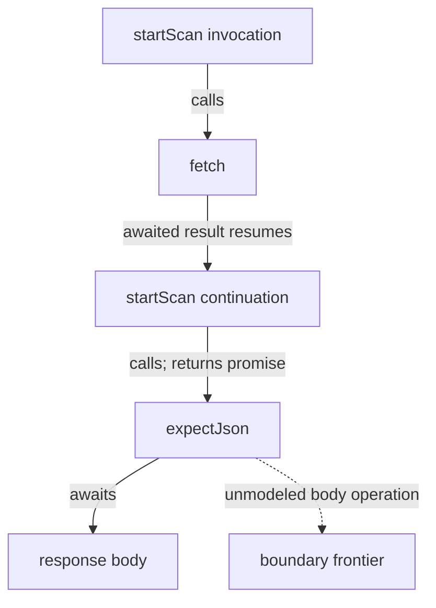
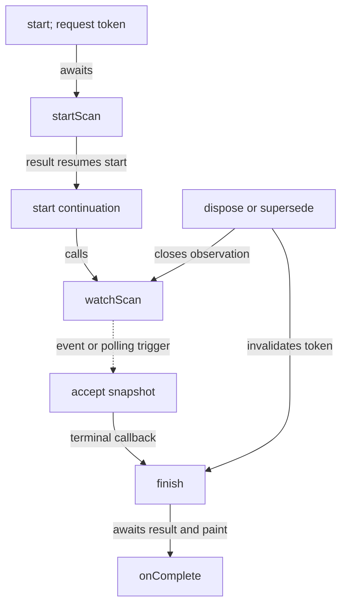

**Decision. Build a small, evidence-bearing function-effects analysis inside tsx-data-flow, expose it through a direct library entry point and a one-shot JSON CLI, and let Srcly present the results in its existing code inspector.** Start with TS/TSX, finite transitive summaries, exact call-site witnesses, explicit uncertainty, and separate invocation and deferred-callback channels. The first proof should explain `extractFilePath`, `rankHotSpots → metricDef`, and `startScan → expectJson`, including honest partial results. Add a bounded execution view only after that inspector is useful. Keep Srcly's import/usage graph, numeric metrics, and the neighboring value-flow investigation separate. Do not first extract a framework, require a resident service, introduce persistence, instrument runtime execution, or advertise general JavaScript purity.

# Effects, async boundaries, and test seams in Srcly

Design research for the authoritative attached source snapshot. Prepared 23–24 October 2026.

## Reading guide

- **Question 1:** §2 defines the meaning and limits of pure, simple, and safe to test.
- **Question 2:** §3 distinguishes calls, async continuations, scheduled work, and concurrency.
- **Question 3:** §4 audits current capabilities and decides ownership.
- **Question 4:** §5 works through real chains; §6 turns them into testing and architecture decisions.
- **Question 5:** §7 designs the inspector; §8 specifies the analysis; §9 defines the delivery boundary.
- **Companion documents:** [implementation-plan.md](implementation-plan.md) contains the worker run sheet and exact proposed fixture expectations. [recommendations.md](recommendations.md) assigns stable EAT recommendation IDs and dispositions.

## 1. Access, evidence, and mission boundary

### 1.1 What was available

The attached `source-packet(6).zip` was readable. Its `SNAPSHOT.md` records **297 selected Srcly files** at `aea1015258f56dd45b8e175f7288e2fef3abc6cf`, and **322 selected tsx-data-flow files** at `b4f1ba4f0df402251f4b666cddf5312efa4a62be` **plus the supplied local edits**. These are separate repositories. All code conclusions below use those extracted bytes, not a newer GitHub branch.

This is a selected-source audit, not a claim to have audited every file in either repository. Source, examples, documentation, and test assertions were inspected. **No application, build, test suite, target-code execution, commit, push, or implementation change was performed.** The worked outputs are source deductions or proposed acceptance expectations, never reported runtime observations.

Three bounded access gaps remain:

- The requested Srcly `server/app/services/focus_overlay.py` is absent from the packet; a supplementary fetch at the exact recorded Srcly commit returned 404. Historical design references are not evidence that this module exists now. The active graph endpoint, code viewer, markers, and navigation were available.
- TSX `docs/application-structure.md`, `bin/tsx-dataflow.ts`, and its standalone license file were absent from the selected packet. Supplementary GitHub requests at the recorded TSX ref returned “No commit found for ref.” This says nothing about their existence in another checkout.
- Installed dependencies and actual runtime versions were not available as verified execution facts. Manifest ranges are not installed versions.

None prevents this design decision: the live source boundaries and required examples were present. Before implementation, a worker must obtain the full authoritative working checkout, read its missing structure guidance, and inspect packaging. Do not substitute another ref or invent an existing CLI layout.

### 1.2 Citation and certainty conventions

- `S/` means the attached `srcly/` repository; `T/` means the attached `tsx-data-flow/` repository. Paths, symbols, and line ranges refer to this snapshot.
- **Source fact** means directly inspected code or a checked-in test assertion.
- **Inference** means a reasoned implication of that code under stated runtime assumptions.
- **Proposal** means new behavior that is not implemented in this snapshot.
- External references `E01–E32` are primary documentation, implementation source, or original research. The source catalog states what was inspected and does not imply every linked paper was reproduced or fully evaluated.

### 1.3 Keep the neighboring investigation separate

This mission asks: **What work can this function cause, under which activation conditions, through which calls, and where is a useful test boundary?**

The neighboring value-flow mission asks how a selected value or field reaches a consumer. Its route membership, exact field path, transfer, and consumer proof are not an effects engine. A function can preserve a field's value while logging, mutating a cache, starting a worker, or registering a callback. Conversely, a complex field transformation can have no external effects.

There is a narrow overlap: project loading, compiler-backed identity, precise source spans, explicit frontiers, source navigation, and evidence display. Reuse these mechanics where their contracts fit. Do not add effect categories to route-field “proven” records, use field lineage as a call graph, or make the first inspector depend on the major rewrite's field-flow UI.

## 2. Question 1 — What can pure, simple, and safe to test honestly mean?

### 2.1 The practical answer is a vector of facts

“Pure” has several useful meanings that diverge in JavaScript. For this product, the strongest useful everyday claim is:

> For the analyzed invocation and its possible continuations, no external effects or ambient dependencies were found within the supported scope, under the displayed input and platform assumptions; separately scheduled work and latent returned functions are shown independently.

That is deliberately conditional. A positive absence claim needs complete coverage of the supported scope. A known network witness remains useful even when other behavior is unresolved.

These are **may-effect summaries**: “known” means a supported operation is present/reachable in the model, not that every invocation executes it. Branch feasibility, frequency and successful completion are separate questions.

| Facet | What the inspector should distinguish | Why it changes the decision |
| --- | --- | --- |
| Determinism | Same explicit inputs give the same observable result under a fixed environment; environment-dependent or unknown otherwise | A clock read can be write-free but unsuitable for an exact-output assertion without a clock seam. |
| Observable effects | Network, filesystem, output, DOM, storage, externally visible state, scheduling, resource creation/release | Effects identify contracts and lifecycle obligations; their existence is not a defect. |
| Ambient reads | Module/captured mutable cells, environment, clock/randomness, reactive getters, host state | A function can read without writing and still depend on more than its parameters. |
| Input mutation | Writes to parameters, receiver objects, or objects reachable through their aliases | A local variable name or shallow copy does not establish ownership. |
| Local mutation | Writes to proven fresh, unexposed storage during construction | Scratch arrays and result construction can be excellent transformation seams. |
| Exceptional completion | Explicit throw sites, potential synchronous escape, async rejection, unknown exception behavior | A deterministic validator may be useful and isolated while deliberately rejecting bad input. |
| Allocation and identity | Fresh arrays/records/functions; identity reuse; returned borrowed references | Allocation is observable through identity but is often harmless for value-oriented testing. |
| Termination | No loop/recursion seen, bounded under assumptions, or not established | A side-effect-free recursive loop is not a safe total computation. SCC closure is not a termination proof. |
| Resource ownership | Creation, owner, transfer, close/dispose/cancel request, and unestablished completion | Correctness may depend on cleanup after success, failure, cancellation, or disposal. |
| Uncertainty | Unresolved target, missing body, unsupported operation, assumption, incomplete project, budget, stale source | Absence of evidence must not become evidence of absence. |

Use **“transformation candidate”** for the narrow, assumption-qualified useful case. Do not label it “mathematically pure,” “safe,” or “proven deterministic.” The write-free result also says nothing about excessive cost or adversarial input.

### 2.2 Three different product questions

**Simple** is a size/control-flow judgment. Existing LOC and executable-scope complexity can help find a short function to inspect. A one-line `fetch`, `Date.now`, module getter, or input mutation can be simple. A longer tree traversal can be locally deterministic and effect-free for ordinary finite input.

**Pure enough for a transformation test** is an effect/ownership/assumption judgment. Fresh local `sort` can be acceptable; sorting a parameter in place changes the caller. Reading a shared catalog changes the input contract even if the function only returns a ranking.

**Safe and useful to test** is a harness judgment. It depends on import-time behavior, injected dependencies, cleanup, finite inputs, and what assertion protects a meaningful behavior. Srcly's stateful `createClickIntent` already has a better test seam than many nominally pure UI helpers: its clock and handlers are injectable, and the checked-in tests assert observable timing decisions. See §5.6.

These should remain separate fields. Do not combine LOC, effect count, and testability into a risk number.

### 2.3 Why a boolean is insufficient

| Representation | Value | Failure mode |
| --- | --- | --- |
| `pure: true/false` | Easy filtering | Conflates actual effects with unsupported analysis and hides ambient reads, latent behavior, and assumptions. |
| Conservative multi-state badge | Fast overview: effects, ambient-dependent, candidate, unknown, not analyzed | A single exclusive state still loses “known network effect and incomplete target set.” |
| Fact summary plus coverage, projected into badges | Inspectable evidence and useful filters without erasing uncertainty | Requires disciplined semantics and a compact UI; this is the recommendation. |

The summary is authoritative; badges are projections:

- **Known effects:** one or more supported external-effect facts.
- **Ambient-dependent:** known ambient read, whether or not writes also exist.
- **Transformation candidate:** no active external effect or ambient read; supported-scope coverage is closed; ownership and input assumptions are explicit. Show local mutation, throws/rejection, and output identity separately.
- **Partial/unknown:** a relevant frontier remains. This can coexist with either of the first two badges.
- **Not analyzed / unavailable:** wrong language, excluded source, missing compiler/configuration, or analysis not requested. This is not an empty result.

Defer a whole-project “pure chain” filter until callable coverage is trustworthy. In the first inspector, follow a short chain and see which link remains open.

### 2.4 Direct effects, transitive effects, and activation

A direct effect has an operation and a source span in the callable being inspected. A transitive effect has a call-site path to that seed. For `rankHotSpots`, the read of catalog state is transitive through `metricDef`; the imported name itself is not the witness.

Nested callable syntax must be indexed separately:

```ts
function factory() {
  return () => console.log("later");
}
function invokeNow() {
  (() => console.log("now"))();
}
function schedule() {
  setTimeout(() => console.log("when triggered"), 0);
}
```

- `factory` allocates and returns a callable. It does not log merely because its arrow body exists.
- `invokeNow` invokes the arrow; logging propagates through an eager invocation edge.
- `schedule` registers timer work. Logging belongs to the callback's invocation summary and `schedule`'s **deferred-triggered** channel, contingent on a trigger.

Capture alone does not read the captured object's properties. `() => state.value` retains access; `const saved = state.value; return () => saved` reads at construction. A closure that later mutates an escaping cell creates stateful behavior across calls. Treating every capture as an immediate effect is as misleading as treating every capture as harmless forever.

Use two finite propagation channels initially:

1. **Invocation-caused:** possible effects of actually calling this function, including its own async continuations. This does **not** mean “all before return.”
2. **Deferred-triggered:** possible effects of separately registered/scheduled callbacks. Triggering and order remain explicit conditions.

Returned callable references do not propagate body effects into either channel solely through containment. Their own summaries are available on selection. Generator/iterator bodies require a further “activated by iteration” relationship, or an explicit unsupported frontier in the first pass.

### 2.5 Ownership, aliasing, and local state

Classic pointer/purity analysis distinguishes mutation of pre-existing state from mutation of freshly allocated state; that distinction is useful here even though Java proofs do not transfer automatically to JavaScript. [E05] Modular abstract transformers are a better inspiration than a flat list of banned syntax. [E06]

Minimum useful origins are: primitive/local binding, fresh allocation site, parameter/receiver-reachable region, captured cell, module cell, and unknown. Preserve sets of origins through supported aliases:

```ts
const alias = input;                // still input-owned
const copy = { ...input };          // fresh outer object
copy.count = 1;                     // local outer write, under plain-data assumptions
copy.child.count = 1;               // borrowed child: input write or unknown
const rows = [input];               // fresh container, borrowed element
rows[0].count = 1;                  // not made local by the fresh array
```

Returning a completed fresh result should not retroactively turn its earlier construction into external mutation. Passing that result to an unknown call before further writes can expose it; retain an escape/unknown frontier. A first implementation may conservatively stop tracking it after that call. It must not continue asserting nonescape.

Parameter substitution matters across calls. If `mutate(xs)` writes parameter zero, a caller passing its own parameter inherits an input write; a caller passing a proven private scratch array may inherit only local mutation. Without this substitution, a transitive effect engine either misses mutations or makes every useful builder look externally effectful.

Do not begin with unbounded heap paths, context-sensitive object histories, or whole-program escape analysis. Bounded root sets and explicit widening to unknown provide a credible first slice. For `rankHotSpots`, fresh wrapper provenance through `push` and `for...of` is extra precision, not a free consequence of a local variable.

Do not turn every cross-file identifier into ambient state: a stable callable declaration or immutable primitive constant can be resolved without a mutable-state dependency. A const object binding does not make its reachable contents immutable. If a callable binding can be reassigned in the analyzed scope, preserve that target uncertainty rather than treating its original declaration as the complete runtime target.

### 2.6 Hard cases and the honest initial policy

| Case | Practical treatment now | What would require deeper analysis |
| --- | --- | --- |
| Getters, proxies, coercion | State ordinary-record/standard-intrinsic assumptions; explicit accessors/proxies/custom coercion become frontiers | Property reads and operators can execute user code. ECMAScript defines accessor and proxy dispatch. [E10] |
| Higher-order calls | Bind literal callbacks for a short identity-checked model list; unknown callback parameters remain open | General callback flow through containers, factories, decorators, and arbitrary libraries |
| Dynamic dispatch | Preserve known candidate targets and separate incomplete/imprecise status | A method signature or interface member is not a known implementation |
| Recursion | Compute finite summary fixed points over SCCs; show recursive group | Termination, feasible recursive paths, path-sensitive preconditions |
| Third-party code | Known identity-specific model or “external body not analyzed” | Broad dependency analysis and native/browser semantics |
| Lazy iterators/generators | Record creation versus iteration, otherwise frontier | Full iterator protocol, `return`/`throw`, cleanup and cancellation semantics |
| Import-time work | Analyze module initialization as its own owner or disclose unmodeled initialization | Full loader order, dynamic import, package side effects and cycles |
| Reassignment/escape | Const aliases when justified; mutations invalidate precise targets/origins | Flow-sensitive alias restoration or temporal object publication |
| Reflection/`eval`/prototype replacement | Explicit frontier; never suppress it because types look ordinary | General runtime object model proof |

TypeScript's checker improves binding and module identity, but its type system intentionally permits unsound behavior. A `readonly` type is neither runtime immutability nor a guarantee that an object is not a proxy. [E02], [E03] Therefore the badge must name its model assumptions, not merely display “TypeScript checked.”

## 3. Question 2 — Sync, async, and concurrency boundaries

### 3.1 Keep syntax, activation, completion, and coordination separate

| Construct or operation | Required meaning | Inspector consequence |
| --- | --- | --- |
| `async function` | Promise result; body activation is distinct from later continuation | Declaration badge, not a concurrency badge |
| Promise-returning non-async function | Can execute substantial synchronous work before returning | Show result type/disposition separately from declaration |
| `await` | Suspends this async continuation around a value/thenable | Exact await span; not a second call or universal new task |
| `new Promise(executor)` | Executor is invoked synchronously | Eager callback edge |
| `.then/.catch/.finally` | Callback reactions occur through promise jobs | Chain/continuation relation, not ordinary nested stack |
| `Promise.all` | Fulfillment requires all; rejection can settle early | Input-producing calls initiate work; the combinator aggregates results |
| `Promise.allSettled` | Waits for every settlement | Join-all-settlements relation |
| `Promise.race` | First settlement determines result | Selection, not completion of remaining work |

These distinctions follow the ECMAScript algorithms; none of the combinators universally cancels its remaining inputs. A generator object is likewise distinct from executing its body through iteration. [E09] The table defines labels, not a promise of complete static scheduling reconstruction.

The current source contains both easy counterexamples:

- `S/client/src/viz/deps/layout.ts:422–424 :: layoutView` is declared async but immediately returns `layoutViewSync(vm, opts)`. The CPU layout work is not moved to a worker by the declaration.
- `T/src/server/analysis-service.ts:119–179 :: request` is not async, yet creates and returns a promise while synchronously allocating cancellation state, publishing progress, updating maps, and posting a worker message.

Track promise disposition at each occurrence: **awaited, returned/adopted, chained, passed to a modeled aggregate, explicitly discarded, or unknown**. `return expectJson(res)` in `startScan` is adoption of a promise, not a floating result and not an await syntax site.

An actual async call contributes its possible invocation-caused effects even if its result is discarded. Otherwise `void save()` would falsely hide later writes. `void` does not handle a rejection; typescript-eslint explicitly treats runtime handling as separate from ignoring a result. Conversely, a `.then(success, failure)` handles the original rejection, although a derived promise can still reject if a handler throws. [E12], [E09]

### 3.2 Callback invocation and scheduling

`Array.forEach` invokes callbacks synchronously and ignores their return values. An async callback can therefore start its prefix during iteration and continue later without the caller joining it. The callback can mutate even though the iteration operation itself is not inherently a mutation of the receiver. [E11]

```ts
items.forEach(async item => {
  await save(item);
});
// Reaching here does not mean all saves completed.
```

The useful diagnosis is not “forEach is async.” It is **eager callback invocation + promise result discarded + effects in possible continuations**. This warrants a lifecycle or result-completion assertion if the enclosing API promises completion.

Timers create scheduling relationships and cancellation handles; a requested delay is not an exact execution timestamp. [E18] Listener registration is not invocation. Some triggers arrive later from an external source; explicit dispatch can invoke listeners in the current execution. A generic callback model needs a trigger kind, not a single universal “async callback” edge.

Cancellation and cleanup also differ:

- **Request cancellation:** signal/flag/message asks participating work to stop.
- **Stop delivering results:** ignore stale callbacks or detach observers.
- **Release resource:** close EventSource, remove listener, clear timer, terminate worker.
- **Observe completion:** await/join termination or settlement where the API provides it.

Abort behavior depends on the participating API; a promise alone does not provide universal cancellation. [E19] Srcly's request-generation guards suppress stale updates, but do not by themselves abort every HTTP request. The diagram should expose the actual operation, not infer that a method named `cancel` stops all descendants.

### 3.3 Solid requires owner- and operation-aware models

Treating all `create*` calls alike would erase the behavior Byron wants to inspect.

| Solid operation | Useful model | Source-specific implication |
| --- | --- | --- |
| Signal getter/setter | Read reactive state / write state and potentially notify observers | State access is an ambient dependency even when the getter looks like a zero-argument helper. [E31] |
| `createMemo` | Compute derived value; callback is expected to avoid side effects | The API expectation is not evidence that the supplied callback obeys it. [E20] |
| `createEffect` | Register reactive computation; initial timing depends on render/owner context | Show triggers and owner; do not promise a universal callback order. [E21] |
| `createResource` | Fetcher has value-or-promise result; source controls invocation | Resolve loader-only, loader-plus-options, and source-plus-loader overloads by API signature, not argument count/index. [E22] |
| `onCleanup` | Register cleanup with the current owner | Registration is not proof that cleanup ran or released everything. [E23] |

Solid's implementation matters: initial memo computation normally runs during setup; resource setup can call its loader immediately, then rerun later; `createEffect` can queue or update depending on the current effect context. These are not all deferred callbacks. Current implementation source supports that distinction, but the analyzer must validate a model against the installed Solid version before claiming version-specific behavior. [E32]

Reactive dependency tracking is synchronous; a later timer read does not automatically become part of an earlier effect's tracked dependency set. [E24] That makes a static “reads this signal” edge different from a proven “this effect subscribes to this signal” edge.

For this snapshot, inspect `S/client/src/viz/deps/DependencyView.tsx` (`createResource`, memos, layout effect, stale-layout token), `S/client/src/state/scanStore.ts` (signals, request guards, timers), and TSX's `examples/solid-full-stack`. Do not put full Solid lifecycle inference on the first-slice critical path.

### 3.4 Actual parallelism in the supplied code

**Node:** `createAnalysisService` constructs a `Worker`, sends messages, and shares an atomic cancellation buffer. Node workers can run JavaScript in parallel; cloned, transferred, and shared memory have different coupling. `unref()` changes process-liveness behavior, not resource termination. [E25] Source: `T/src/server/analysis-service.ts:57–65,129–169,181–186`.

**Python:** Srcly starts a background scan thread and separate analysis processes. `Thread(...)` construction and `.start()` are different sites. `run_file_analyses` is a synchronous Python API that supervises concurrent children, IPC, timeout/replacement, cancellation, and cleanup. `_list_with_git` uses executor submission followed by blocking `.result()` joins. Futures documentation distinguishes submission, blocking result retrieval, and cancellation of work that has not already started; the GIL is not a general race-freedom argument. [E26], [E27] Sources: `S/server/app/services/scan_jobs.py:292–319`; `scan_workers.py:127–132,173–317`; `analysis.py:557–565`.

Python coroutine/async-generator creation also differs from JS async function activation. Srcly's streaming event generator is driven by its consumer. A language-neutral “async count” cannot express these semantics. The first TS pass should show Python **unavailable**, while the report and UI vocabulary leave room for explicit future thread/process edges.

### 3.5 Which graph answers which question?

| Representation | Question it can answer | What it cannot establish by itself |
| --- | --- | --- |
| Import/usage graph | Which modules/symbols reference other modules/symbols? | Whether a function was called, when, or with which arguments |
| Static call graph | Which callable targets may be invoked at each site? | Exact runtime target/order or path feasibility |
| Intraprocedural CFG | Which branches/transfers may follow within a body? | Complete interprocedural task causality or races |
| Data flow | Which abstract values may reach uses? | The effect or timing of every use |
| Causal/event model | Which operation registers, starts, resumes, joins, or cleans up work? | A complete happens-before relation without stronger models |
| Runtime call stack | What is nested right now in one execution? | Prior asynchronous causality or unexecuted paths |
| Async trace | Which observed tasks/events caused observed continuations? | Untested behavior or proof that absent effects cannot occur |

ECMAScript separates execution contexts from jobs and resumption; an async explanation should preserve that distinction. [E28] A static witness is a **possible explanatory chain**, not an actual stack trace. Branches along it may be mutually infeasible. The first pass should not infer a race merely because two effects share a variable, or race freedom merely because code lacks `async`.

**Static first** fits spot-checking, works without running the application, and can expose untested branches. Optional tracing later could mark observed edges, durations, and concrete request/task IDs. It would need instrumentation, attribution, and reproducibility; Node's `AsyncResource` illustrates why task identity needs explicit care. [E29] Tracing should augment the possibilities, never delete unobserved static paths or become the default prerequisite.

### 3.6 Visual vocabulary

Use explicit edge labels and shapes, not color alone:

- **calls / may call:** solid arrow, exact occurrence; target completeness displayed.
- **registers / schedules:** dashed arrow to callback or task; trigger note.
- **awaits:** relation to a result/continuation marker; no duplicate invocation.
- **joins all on success / waits all settlements / first settlement:** distinct aggregation labels.
- **returns callable:** thin reference relation; no effect propagation merely from this edge.
- **requests cancel / closes / awaits termination:** separate lifecycle labels.
- **unknown target / unmodeled boundary:** dotted frontier with a reason and source span.



This sketch summarizes source relations. It does not claim that both branches of `expectJson` execute, that response parsing is fully modeled, or that the first pass has built a precise continuation CFG.

## 4. Question 3 — Reuse and ownership

### 4.1 Capability audit against the actual snapshot

| Area | Verified capability | Gap for this mission |
| --- | --- | --- |
| Srcly graph endpoint and contract | `GET /api/analysis/dependency-graph` in `S/server/app/routers/analysis.py:66–77`; `DepGraphEdge` in `models.py:192–201` carries importer/target, type-only/barrel flags and symbols | No call-site identity, occurrence span, callback activation, or callee completeness |
| TS/TSX graph extraction | `deps/typescript_deps.py:429–466 :: collect_ts_usages` collects imported-name identifier/type/shorthand/member uses | Textual usage is not a `CallExpression`; nested attribution and shadowing are insufficient for callable semantics |
| Edge aggregation | `deps/common.py:140–191 :: emit_symbol_edges` keeps unused imports as file-origin edges, possibly targeting symbols, and excludes same-file edges; graph identities use file/name and merge pairs | Local helper calls, nested callables, repeated occurrences and temporal roles cannot be reconstructed from these edges |
| Resolution and coverage | `deps/tsconfig.py`, TS import/barrel/workspace resolution, and Python usage resolution exist | Not full compiler export conditions; some unresolved/skipped/parse-failed sources disappear from graph results rather than producing semantic frontiers |
| Python dependency extraction | `deps/python_deps.py:359–402 :: collect_py_usages` records names/attributes, including annotation usage | No general call target, descriptor, coroutine, thread or process semantics |
| Graph cache | `deps/graph.py:27–34` signature includes source metadata/count | Config, declaration, compiler/model changes are not a semantic cache key |
| Metric trust | `analysis_types.py`, `metric_catalog.py`, `models.py` distinguish measured zero from N/A and executable scopes from display scopes; max metrics retain witnesses | Effect sets are categorical evidence, not additive complexity measurements |
| Component effect metric | TS syntax analysis counts named `createEffect/useEffect` occurrences | It does not measure all effects, transitive behavior, callback purity, or runtime executions |
| Markers and code viewer | `markers.py` produces local source marks; `CodeModal.tsx` and `CodePane.tsx` show overlays, gutters, line navigation and findings | Reuse rendering; do not expect the metric-marker collector to discover transitive semantics |
| Dependency UI | `viz/deps/{contract,hierarchy,viewModel,layout,DependencyView,DependencyCanvas}` support bounded neighborhood, layout, interaction and graph filters | Folder rollups and endpoint merges intentionally discard occurrence detail; importer/imported lanes do not mean time |
| Navigation | `navigation/location.ts` has canonical location helpers; `App.tsx` and `dataProcessing.ts::findScopeForSymbol` resolve names/nearby lines | Fuzzy scope lookup is not an exact semantic identity; source jump needs snapshot and exact span |
| TSX project/compiler | `T/src/project/typescript.ts:88–108 :: buildProgram`, routing and tsconfig support provide compiler-based projects | Existing args are mutated; config diagnostics/selected compiler must be surfaced deliberately; do not silently fall back and claim full coverage |
| TSX render/helper tracing | `source-trace.ts:194–307,365–448` resolves first-party cross-file helpers, bindings and returns under limits | Historical “file-local/no binding” docs are stale; this remains a render-path analysis, not complete effect closure |
| TSX occurrence evidence | `program-evidence-collector-call-support.ts:122–175` records actual calls and some `invokes` targets; new expressions are handled separately | Catalogued compiler symbol targets are useful but not general points-to/dynamic-dispatch resolution |
| TSX effect-like categories | `source-call-classification.ts:202–274`, `program-evidence-boundary-support.ts:73–303` label opaque calls and boundaries | Some rules are name-based, including a `fetch` case; `host-call` means boundary classification, not pure/impure semantics |
| TSX evidence spans | `program-evidence-support.ts:306–317,351–368` provides compiler-derived IDs and 1-based line/column locations | IDs are generation-local; UTF-16 columns differ from Python tree-sitter byte offsets |
| TSX callback/resource evidence | `program-callback-return.ts:5–19` recognizes a narrow exact return shape; resource evidence and relation/frontier structures exist | Return shape is not a purity proof; one collector's second-argument loader assumption misses one-argument resources |
| TSX current local edits | Exact route/field membership and dependency work is present in supplied modified/untracked files | Its proof vocabulary must not be promoted to effect proof; it belongs to the neighboring mission |
| TSX service | `src/server/analysis-service.ts` already manages a Worker, request lifecycle, cancellation and shared work | Running that service is unnecessary for a first Srcly effect query and expands deployment/lifecycle obligations |

The decisive negative finding is specific: **Srcly does not currently have the call graph required for this feature, and TSX does not currently have the effect summaries required for it.** Both have valuable components. Neither current graph can honestly be relabeled as the requested capability.

### 4.2 Important source corrections to older descriptions

- The older Srcly dependency-view implementation plan is useful historical intent. The active route is `/api/analysis/dependency-graph`; a missing `focus_overlay.py` must not drive the new architecture.
- TSX `docs/analyzer.md` understates present cross-file helper tracing. Current `source-trace.ts` and tests supersede that description.
- The product capability audit predates the supplied local route/field work. Those local edits are included in this analysis, but their scope is exact value/field evidence, not all callable effects.
- `classifyUnresolvedCall` distinguishes render-relevant opaque cases; suppressing an “unknown” label for `console`, `Array`, a Solid API, or a getter is not evidence that the operation is effect-free.
- Some direct boundary records use “proven” to mean a particular relation was recognized. A heuristic name match still cannot prove that a shadowed `fetch` performs network I/O.
- `program-evidence-loading.ts:5–12 :: programForRoot` and `project/tsconfig.ts:63–100` need deliberate error/coverage treatment. A fallback file walk or ignored parse diagnostic cannot silently earn a complete summary.

### 4.3 Ownership alternatives, scored for one developer

Scores are **design judgments**, not measured accuracy or delivery estimates. Five is favorable. The score vector is **target accuracy / propagation fit / evidence fit / ease of implementation / ease of maintenance**. All options still require new semantics; none gets credit for effects it does not currently compute.

| Option | Score vector | Assessment |
| --- | --- | --- |
| Extend Srcly Python/tree-sitter for TS effects | 2 / 2 / 3 / 3 / 2 | Good spans and syntax proximity, but recreates TS lexical/module/type machinery and leaves difficult targets unresolved. Suitable for syntax facts, not the main transitive engine. |
| New TypeScript compiler worker owned by Srcly | 4 / 4 / 4 / 2 / 2 | Technically viable; duplicates TSX project/evidence work and gives one developer two TS analyzers to maintain. |
| **TSX pass + direct library API + one-shot JSON CLI** | **4 / 4 / 5 / 4 / 4** | Best fit: existing compiler work, inspectable data, simple subprocess boundary, and no mandatory resident service. |
| Reuse TSX resident HTTP/worker service | 4 / 4 / 5 / 2 / 2 | Same semantic potential, extra process discovery, lifecycle, generation coordination and deployment. Explore only if repeated-query cost justifies it. |
| Extract a shared kernel before delivering | 4 / 4 / 5 / 1 / 2 | Premature contract/package/release work before actual shared requirements are known. No first-slice user value. |

**Recommended responsibilities**

- **TSX:** compiler/project selection, callable identity, supported target resolution, direct effects, local origins, callback models, summary fixed point, source evidence, frontiers, serialization.
- **Srcly backend:** validated project/request scope, one subprocess adapter, timeout/cancellation, response validation, current-selection state, and explicit unavailable/failed states. Reusable caching is deferred until cost is measured.
- **Srcly frontend:** candidate selection using existing views, effects inspector, exact source navigation, callers/callees, later bounded execution view, testing/refactor action notes.
- **Python:** current syntax/import analysis remains useful. A future Python-specific pass can produce the same presentation concepts with a declared language-specific support envelope. Do not infer Python semantic coverage from shared JSON field names.

Keep the semantic contract beside the TSX pass. Srcly mirrors only the transport shape it needs. No new shared package or version coexistence layer is justified. A single schema revision can reject incompatible output explicitly.

### 4.4 Research that changes the implementation

| Method or tool | Useful lesson | Adoption decision |
| --- | --- | --- |
| Koka effect types | Latent callable effects and multiple effect labels express distinctions a boolean loses. [E04] | Borrow the vocabulary; do not claim Koka's theorems for inferred TS labels or require rewriting application code. |
| Pointer/escape purity | Fresh local writes and pre-existing-state writes are different. [E05] | Implement bounded origins for the named traps, not a whole-heap analysis. |
| Abstract interpretation and modular summaries | Finite domains, monotone joins and abstract transformers make propagation explainable. [E06], [E07] | Use a small worklist/SCC algorithm with an explicit abstraction boundary. |
| IFDS/interprocedural reachability | Finite facts and call/return discipline enable tractable analyses under specific distributive assumptions. [E08] | Preserve call-site substitution; no general IFDS framework until a concrete precision problem needs it. |
| Program slicing | A relevant dependence slice is more useful than every reachable node | First deliver a bounded effect witness/causal neighborhood; do not call it a complete semantic slice. WALA offers the deeper comparison. [E15] |
| CodeQL JS | Calls and target uncertainty are separate concepts; its library exposes incomplete/imprecise/uncertain callee information. [E01] | Copy the honesty of the contract, not a database/toolchain dependency. |
| Jelly | JS/TS approximate call graphs and points-to analysis can improve difficult target sets; its README explicitly disclaims full soundness and treats Node library code as unknown. [E14] | Later benchmark selected unresolved cases. It does not supply browser/Solid/Python effects automatically. |
| WALA | Mature call graph, pointer, interprocedural and slicing infrastructure | Useful research baseline, costly JVM/IR integration for this particular first slice. [E15] |
| Approximate JS IDE call graphs | Useful interactive answers can deliberately choose approximation. [E30] | Publish limits; do not transfer another tool's benchmark to this product. |
| typescript-eslint promise rules | Discard, handling and incompatible callback positions are distinct. [E12] | Reuse conventions and targeted checks; a clean lint result is not lifecycle correctness. |

A sound may-analysis can still be too imprecise to help if every operation becomes unknown. Conversely, a fast underapproximation is useful for positive witnesses but cannot certify absence. The proposed middle ground is **closed results for a small supported language fragment, positive witnesses plus frontiers elsewhere**, with the contract making that distinction unavoidable.

### 4.5 Licenses and deployment

TypeScript's compiler is Apache-2.0; the attached TSX package manifest declares MIT. Using the compiler already employed by TSX avoids adding another analysis product to the first deployment. Verify the full checkout's license and actual dependency installation before redistribution. [E16]

CodeQL's query/library repository is MIT, but its CLI binaries have separate terms governing eligible use, redistribution and hosted availability. Official documentation distinguishes public-repository use from separately licensed private organization use. That separation is enough to reject a mandatory bundled/hosted CLI dependency for this personal first slice; it is not a legal opinion about a future specific use. [E13], [E17]

Jelly is BSD-3-Clause and WALA is EPL-2.0. They remain viable comparison tools, with integration and maintenance costs independent of license permissiveness. [E14], [E15] No empirical evaluation of their output on this packet was performed.

## 5. Question 4 — Worked chains from the supplied source

These are manual source explanations. Proposed analyzer outputs are identified separately; no existing analyzer report was executed to obtain them. Snippets are short, annotated and sometimes reformatted/abridged; omitted statements are not claimed to be absent from the source.

### 5.1 Isolated transformations: Srcly leaf and TSX report core

**Small first anchor:** `S/client/src/utils/dataProcessing.ts:81–91 :: extractFilePath`.

```ts
if (!rawPath) return null;
if (type === "folder") return null;
const [filePath] = rawPath.split("::");
return filePath || null;
```

- **Classification:** transformation candidate for declared primitive string/undefined inputs, standard unmodified primitive `String.split` with a string separator, and ordinary execution. It allocates the split array, writes no external state, and has no callback/scheduling boundary.
- **Witness:** definition → exact split call → identity-checked primitive model. Absence is justified only within this stated model.
- **Useful assertion:** missing/folder inputs yield null; a scope suffix is removed; the path prefix is preserved. This is a small anchor for semantic correctness and exact navigation, not a reason to add redundant tests for every trivial helper.
- **Limit:** structurally typed or hostile runtime values outside the declared primitive contract, patched intrinsics, and process resource exhaustion are not discharged.

**Longer core across TSX:** `T/examples/node-cli/src/cli.ts:104–117 :: run` orchestrates `loadRecords`, `validateRecords`, `selectReportRows`, and `packReport`, then prints/saves. Each is called directly by `run`; the sequence between stages is value handoff and source control order, not nested calling. The transformations live in `records.ts:28–90`.

```ts
// records.ts, excerpts
return value.map((entry, index) => validateRecord(entry, index));

return records
  .filter((record) => record.total >= minimumTotal)
  .map((record) => ({
    id: record.id, customer: record.customer, total: record.total,
  }));

return {
  minimumTotal, recordCount: rows.length,
  total: rows.reduce((sum, row) => sum + row.total, 0), rows,
};
```

| Part | Classification and boundary | Seam and assertions |
| --- | --- | --- |
| `loadRecords`, lines 23–26 | Filesystem read, await, JSON parsing; may reject | Contract/integration for file decoding and failures; use a tiny temporary file if testing real I/O |
| `validateRecords → validateRecord → readText`, lines 28–65 | Ordinary-data transformation with intentional throws; property access on arbitrary `unknown` still needs getter/proxy assumptions | Assert rejection of invalid status/total/text and preservation of accepted fields, not “never throws” |
| `selectReportRows`, lines 67–79 | Filter/map with eager callbacks; fresh row objects | Assert threshold boundary, order, projection, and no input mutation under DTO assumptions |
| `packReport`, lines 80–90 | Aggregate plus borrowed `rows` reference | Assert count/sum and documented identity; it does not deep-copy rows |
| `run` | Effectful shell around those operations | Assert orchestration only where CLI/output/storage behavior matters |

The checked-in example data has totals 245, 80 and 510. A threshold of 100 selects two rows totaling 755. **This is arithmetic from source data, not an executed example result.** A good property candidate is that selected rows all meet the threshold and preserve input order; a sum assertion should allow the numeric domain the application actually supports.

The shell/core split already exists. Do not refactor it merely because the graph has several calls. The sample ledgers are explanatory artifacts, not analyzer-produced proof. Importing the CLI also deserves care: `cli.ts:120–144` contains environment/default argument behavior and an entry guard.

### 5.2 Mixed chain: ranking is locally mutating and ambient-dependent

Sources: `S/client/src/utils/hotSpotRanking.ts:57–82 :: rankHotSpots`; `metricsStore.tsx:104–117,144 :: metricDef/setMetricCatalog`.

```ts
const def = metricDef(metric);
// ...
else ranked.push({ node, value, score: 0 });
// ...
ranked.sort(/* comparator using def.direction */);
// ...
item.score = def.direction === "higher-worse" ? share : 1 - share;

// metricsStore.tsx
export const metricDef = (id: MetricId): MetricDef | undefined => byId.get(id);
```

**Source fact:** `byId` is a module `let` Map and catalog updates replace it. The ranker's direction is therefore not determined solely by `nodes` and `metric`.

**Effect witness:** `rankHotSpots` at line 58 → `metricDef` at line 144 → module `byId` read at line 144; declaration/update at lines 105/109 explain the shared state.

**Ownership inference:** `ranked` and `na` are fresh arrays. Ranking rows are fresh wrappers; `item.score` changes wrappers, and `na.sort` changes its fresh container. The referenced input nodes remain borrowed. Under ordinary DTO assumptions, the inspected body does not mutate the input nodes. This is a manual source conclusion, not a capability of the current analyzer.

**Initial analyzer acceptance:** require the known ambient witness. Preserve `mutation-target-unknown` for `item.score` unless a specific element-origin rule proves the wrappers fresh. Also preserve unmodeled `Number.isFinite`, `reduce`, `Math.max`, property/iterator behavior, or comparator targets as applicable. Do not expand the first pass simply to make this entire function green.

**Testing seam:** current tests already assert descending complexity order, path ties, measured zero, N/A separation, neutral metrics, and parity with a server snapshot. They do not directly establish the lower-worse branch or start-line tie-break. A later small refactor could pass the metric definition/direction into a pure ranking core and leave catalog lookup in a facade. Add such a seam only if catalog setup makes independent tests or reuse awkward. Then an input nonmutation property and direction-specific cases would protect the intended boundary.

**Related traversal:** `cohortNodes:16–27` mutates fresh `out`/`stack` arrays and returns borrowed node references. It is a useful transformation candidate for a finite acyclic ordinary tree. Its loop is not proved terminating for arbitrary cyclic objects, and a narrow analyzer needs `pop` plus borrowed element provenance to close it.

**Contrast within one file family:** `dataProcessing.ts:3–29 :: filterNoise` assigns `node.children` and `node.metrics.loc`, so it is an input mutator. `filterTree:32–69` builds changed branches and reuses unchanged ones for ordinary data. Its checked-in tests explicitly protect source children and identity reuse. A common “filter” name says nothing about purity.

### 5.3 Srcly async orchestration: scan start, progress, finish and disposal

Sources: `S/client/src/services/scanJobs.ts:70–98,122–200`; `S/client/src/state/scanStore.ts:80–98,127–225`.

```ts
// startScan
const res = await fetch("/api/scans", {
  method: "POST",
  headers: { "Content-Type": "application/json" },
  body: JSON.stringify({ path: path || null, force: Boolean(options.force) }),
});
return expectJson<ScanSnapshot>(res);
```

**Required first-slice explanation**

- `startScan` directly invokes network I/O, has **one direct await site** at fetch, and calls/returns the promise from `expectJson`.
- `expectJson` has two `res.json()` await occurrences on different branches. Its explicit throw is in an async function, so it rejects the result; do not report it as a synchronous exception thrown to the immediate caller.
- Known fetch evidence must remain visible even if `Response.json`, serialization, coercion, or exception escape are unmodeled. `JSON.stringify` is not universally pure for arbitrary objects with getters or `toJSON`.

**The larger lifecycle**

1. `scanStore.start` increments `activeRequest`, stops current observation, may discard a cancellation promise, resets signals, and awaits `startScan`.
2. If that result is stale, it requests cancellation of the newly returned job and stops using it.
3. It calls synchronous `watchScan`, which creates an EventSource or invokes async polling and returns a stop closure.
4. Event/poll callbacks call `accept`; terminal acceptance stops observation and invokes `onDone`.
5. `onDone` discards `finish(...)`'s result. `finish` awaits the result fetch and `nextFrame`, obtains the optional paint promise **before** `setData`, then awaits that promise before `onComplete`.
6. `cancel` sets the cancelling state and requests backend cancellation while observation remains active to receive the terminal result. Disposal and a superseding `start` invalidate the request token and stop current observation. These operations do not abort every HTTP request already in flight.

The exact ordering in step 5 comes from `scanStore.ts:134–147`; a generic “fetch then render” summary would miss the paint seam.



This is a source-grounded causal sketch, not an actual trace or complete CFG.

**Precise limits:** `accept` rejects versions strictly less than `lastVersion`, so equal nonterminal versions are not universally deduplicated. `stop` closes EventSource and clears a poll timer; a fetch already underway can continue, though acceptance checks can suppress delivery. Unknown `handlers`, `options.waitForPaint`, and `options.onComplete` are callback boundaries. Module-level `scanStore = createScanStore()` and storage reads make import setup relevant.

**Recommended seam and assertions:** use a small controllable API/event/timer harness around the controller, without trying to prove the whole UI pure. Protect stale-request suppression, terminal completion once for a watcher, disposal preventing delivery/rescheduling, cleanup after failure, and paint-before-completion ordering. Use contract tests separately for POST shape/error mapping. Do not add sleeps as a substitute for explicit deferred promises or event gates.

**Existing evidence:** selected `scanProgress` tests protect progress calculations. No direct `scanStore` or `scanJobs` lifecycle test was found in the selected packet. That is a scope-limited absence, not a claim about all files in the full repository.

### 5.4 TSX worker service: stateful, promise-returning, concurrent

Source: `T/src/server/analysis-service.ts:57–205 :: createAnalysisService`, especially `request`, `shutdown`, `publish`, `close`.

```ts
const requestPromise = new Promise<T>((resolve, reject) => {
  // pending state, abort registration, cancellation callback
  pending.set(requestId, { /* handlers and lifecycle fields */ });
  // ...
  worker.postMessage(message);
});
return requestPromise;
```

**Classification:** resource-owning stateful factory. Worker creation happens during construction; the returned methods share maps, counters, listeners and shutdown state. The returned `request` callable has latent behavior relative to factory creation, but some factory effects are immediate. The Promise executor in `request` is eager; worker replies happen through separately registered callbacks.

**Witnesses**

- Factory → `new Worker` at lines 62–64 → worker resource; `unref` is not cleanup.
- `request` → immediate Promise executor → `pending.set`/abort listener/`postMessage`.
- Worker `message` callback at lines 96–109 → pending lookup/removal → abort cleanup → resolve/reject.
- `cancel` at lines 134–147 → `Atomics.store/notify` → remove pending → reject; this is cooperative cancellation, not proof that the worker stopped.
- `close` at lines 181–186 → `shutdown` → `worker.terminate`, with a cached termination promise.

**Mixed unresolved boundary:** `publish` synchronously invokes supplied listeners. A listener body can have additional effects or throw. Shared-buffer behavior and worker implementation also exceed a simple caller/callee tree. Workspace requests coalesce by epoch and promise identity; a clear operation checks that the same promise is still retained. The two-handler `.then` cleanup is not equivalent to an entirely unhandled original promise.

**Recommended seam:** a lifecycle contract around a controllable worker port plus a small real-worker integration check if that behavior is changed. Assert request correlation, late reply handling after cancellation, cleanup/removal, same-epoch coalescing, refresh separation, shutdown rejection of pending work, and idempotent close. Use explicit messages and barriers, not timing luck. Do not extract every map into a separate class.

No direct lifecycle test for this service was found in the selected test packet. Existing server tests cover other boundaries, including source generation/root validation; they are not evidence that worker cleanup is correct.

### 5.5 Python scan ownership: synchronous surface, concurrent implementation

Sources: `S/server/app/services/scan_jobs.py:244–261,292–319`; `scan_workers.py:78–111,127–132,173–317`.

```python
# scan_jobs.py, start
thread = threading.Thread(target=job.run, name=f"srcly-scan-{job.id}", daemon=True)
thread.start()

# scan_workers.py, worker creation
# Process(target=_worker_main, ...) is constructed, then started.
# _worker_main later invokes analyze_fn(path) in the child.
```

The comment lines summarize the process path rather than claiming to reproduce the entire constructor statement.

**Classification:** manager state, locks, thread creation/start, process creation/start, IPC, timeouts, cancellation and cleanup. `ScanJob.run` starts findings work beside scanning; scan completion is not a join of every best-effort follow-up/cache operation. `run_file_analyses` is synchronous to its caller: it supervises concurrent children, stops them in `finally`, then returns or propagates failure.

**Seam already present:** an injectable, picklable, module-level `analyze_fn` lets tests force slow work, crashes and payload shapes. The checked-in worker tests assert timeout/crash recovery, recycling via process IDs, cancellation responsiveness, no surviving children, large payload handling, startup grace, and bounded startup failure. Job tests use event-controlled fake scans.

One test named for concurrent starts invokes `start` sequentially while a job is running. Its assertions protect deduplication of an active job; they are not proof of simultaneous-call race freedom. This distinction matters more than the test's name.

**Architecture implication:** preserve the supervisor/worker boundary and cleanup contract. A “pure Python function” filter would miss the useful seam. First TS/TSX delivery should not imply Python coverage; a later Python model can begin with these exact lifecycle operations if needed.

### 5.6 Stateful but easy to test: click intent

Source: `S/client/src/viz/deps/interaction.ts:37–69 :: createClickIntent`; tests in `interaction.test.ts`.

```ts
const schedule = opts.schedule ?? ((fn, ms) => setTimeout(fn, ms));
let pending: { target: T; handle: unknown } | null = null;
// returned click method:
const handle = schedule(() => {
  pending = null;
  opts.onFocus(target);
}, windowMs);
```

Constructing the controller does not schedule the timer merely by constructing the fallback function. Invoking returned `click` mutates captured state and can schedule work; the callback invokes a supplied handler. `cancel` changes state and may clear a timer. This is intentionally stateful.

The checked-in fake-clock tests assert delayed focus at the double-click window, double-click open without focus, latest-target behavior, immediate modified/middle clicks, and cancellation suppressing pending focus. These are useful lifecycle assertions with deterministic control. No purity refactor is needed. The inspector should recommend “exercise scheduler/handler seam,” not “remove side effects.”

## 6. Testing and architecture decisions supported by the evidence

### 6.1 What the inspected tests actually establish

These are assertions read in source, not passing-test claims.

| Test group | Assertions present | Limit of the evidence |
| --- | --- | --- |
| Srcly `server/tests/test_dependency_graph_symbols.py` | Symbol edges for imported reads, type annotations, namespace uses and barrel metadata; unused imports remain at file level | Confirms a usage/import graph, not a call graph |
| Srcly `test_dependency_graph_ts.py`, `test_dependency_graph_py.py` | Resolution/graph behavior for representative modules, language patterns and caching | Does not validate transitive effects or precise callable targets |
| Srcly `test_metric_trust.py`, `test_metric_catalog.py`, `test_markers.py` | N/A versus zero, executable scope applicability, max witnesses, catalog coverage, marker/count/source-line correspondence | A lexical metric marker is not a semantic effect witness |
| Srcly `hotSpotRanking.test.ts`, `hotSpotRanking.parity.test.ts` | Descending complexity order/path ties, zero/N/A/neutral behavior and cross-language fixture parity | Does not establish the lower-worse/start-line branches, independence from catalog state or arbitrary-input nonmutation |
| Srcly `dataProcessing.test.ts` | Filter behavior, preservation of original children, unchanged identity where appropriate | Covers ordinary test objects, not proxies/getters or all filter helpers |
| Srcly dependency view/layout tests | Focus neighborhoods, rollup/budgets, filters, edge/geometry properties and crossings | Graph layout is not execution order; older fixture names are not current production symbols |
| Srcly `interaction.test.ts` | Fake-clock click/open/focus/cancel behavior | Strong controller seam; not a proof of arbitrary browser event ordering |
| Srcly `test_scan_jobs.py`, `test_scan_workers.py` and helpers | Controlled fake scans; timeout/crash/recycle/cancel/startup/payload/cleanup behavior | Inspect individual schedules; names alone do not prove simultaneous races were exercised |
| TSX `core-analyzer-unknowns.test.ts` | Expected opaque/unknown labels for selected calls; some builtins/accessors/factories omitted from unknowns | Omission means render-analysis policy, not absence of effects |
| TSX `core-shapes-helpers.test.ts` | Cross-file helper entry/return, helper-off behavior, junction/caller labels | One “useX” titled test only checks options/depth; do not infer a full hook-semantics fixture |
| TSX `route-data-resource.test.ts` | Resource source/options/loader relationships in specific cases | Not every overload, alias, callback phase or lifecycle |
| TSX project/server tests | Config discovery/errors, report consistency, source root/generation rejection, refresh behavior | Not new function-effects coverage or analysis-service lifecycle proof |
| TSX current route-field tests | Positive/negative exact field proof and explicit partial/frontier cases | A valuable precision discipline for the neighboring mission, not effects evidence |

### 6.2 Pick a test because of the behavior it protects

| Test type | Best fit here | A useful assertion |
| --- | --- | --- |
| Unit | Small deterministic rule or state transition with controlled dependencies | Ranking ties and N/A; click decisions under a manual scheduler |
| Property | Many values obey an invariant not tied to one implementation | Transform preserves input, selected rows satisfy threshold, ranking order is stable |
| Contract | Boundary shape/semantics across independently changing parts | TSX JSON response spans/coverage; scan API payload and error mapping |
| Integration | Actual wiring, serialization, filesystem/process/library behavior | Subprocess returns valid JSON; worker message/reply correlation and cleanup |
| Concurrency/lifecycle | Ordering, cancellation, stale results, shared state, disposal | A superseded request cannot publish; every started worker is reaped; close is idempotent |

Do not generate one test per function or snapshot the entire analysis graph. A compact semantic fixture should catch the few errors that would make the feature untrustworthy; a transport contract should catch integration drift; a source-jump check should catch misleading evidence. Existing application tests need not be duplicated to test an analyzer.

### 6.3 Pure regions and dependency cuts

A useful **pure region** is a connected set of transformations with explicit inputs and outputs, closed modeled calls, no external effects/ambient reads, and declared input/ownership assumptions. It need not correspond to a folder. A pure region can contain scratch mutation and validators that throw.

An **imperative shell** owns I/O, state transitions and resource lifecycle. Extracting a transformation can improve tests when it removes an actual setup dependency, such as `rankHotSpots` reading catalog direction. It can worsen design when it merely splits a coherent controller into tiny functions while leaving state and cleanup scattered.

Choose a dependency cut when a boundary provides a meaningful contract:

- Inject clock/scheduler for timing behavior already exemplified by `createClickIntent`.
- Separate decoding/validation from file/network acquisition, as in the TSX CLI example.
- Keep start/cancel/dispose together with the state they govern.
- Pass an immutable catalog snapshot or required direction into ranking if ambient setup is a real problem.
- Keep a persistence invariant at the persistence boundary; an isolated mapper test cannot protect it.

For example, `T/examples/http-service/src/storage.ts:13–23 :: appendRecord` reads a collection, derives an ID from length, pushes a record, and writes it back across awaits. Two overlapping invocations could read the same old state and overwrite one another. This is a **source-supported possible lost-update scenario, not an observed race**. If concurrency is supported, the right decision is a storage/serialization contract and an interleaving test, not a purity badge on the row constructor.

### 6.4 Explainable tangle signals

Use a short reason and navigable evidence for each signal; never an arbitrary aggregate score.

- **Effect boundary inside a transformation chain:** a ranking/calculation path reads module state or performs I/O. Show the exact crossing; ask whether explicit input would simplify the contract.
- **Shared mutable cell with dispersed readers/writers:** show the declaration and relevant callable accesses. Captured controller state can be appropriate; dispersion and unclear ownership are the review prompts.
- **Recursive call group with externally visible state:** collapse the SCC and identify the seeded effect and shared cell. Recursion alone is not a defect.
- **Resource lifecycle spread across owners:** creation, callbacks, cancellation and cleanup live in different scopes without a clear owner. “Cleanup unresolved” is evidence to inspect, not a leak finding.
- **High fan-in into an effectful adapter:** a useful consolidation point may exist, or the adapter may already be the right boundary. Count resolved call sites/functions with coverage stated.
- **Many activation changes in a short path:** eager call → schedule → callback → await → callback can be hard to reason about. Show those transitions rather than dumping every descendant.

Fan-out, folder clusters, callback count and long traces are context, not architectural verdicts. A well-owned worker supervisor can be complex for a good reason.

## 7. Question 5 — What Byron should see in Srcly

### 7.1 The first spot-check workflow

1. **Find a candidate.** Use the existing tree, Hot Spots, search, graph or complexity view. Size helps find a short sample; it does not establish isolation.
2. **Open code.** Select the exact callable, including nested callbacks when known. The Effects tab requests semantic analysis on demand.
3. **Read the verdict with scope.** Show known effects, ambient dependence, partial status, async declaration/result information, assumptions, and analyzed snapshot.
4. **Inspect one witness.** A direct operation or a short transitive path opens the exact source occurrence. Keep the code and evidence visible together.
5. **Follow callers/callees.** Call-site list first; distinguish exact supported targets, candidate sets and unknowns. Do not substitute import neighbors.
6. **Inspect an execution slice when necessary.** A later view shows the bounded lifecycle around a selected effect/callback, with typed relations and recursive groups.
7. **Choose an action.** Spot-check a transformation, exercise a boundary contract, use a scheduler/worker seam, inspect shared state, or leave the design alone.

The first delivery should not require discovering a new top-level graph mode. A useful CodeModal panel is a complete reviewable boundary.

### 7.2 Example inspector content

The following is **proposed screen content**, not current analyzer output. Suggested actions illustrate reviewer interpretation of the evidence, not function-name-specific analyzer rules or automatic refactoring.

| Code pane | Effects panel |
| --- | --- |
| `rankHotSpots`, line 58 highlighted | **Ambient-dependent · Partial** |
| `const def = metricDef(metric)` | Reads catalog state through `metricDef → byId` |
| Call-site gutter mark | Open witness: call → callee read → module declaration |
| Local `ranked.sort` and `item.score` visible | Local container mutation identified; wrapper mutation target unresolved unless origin rule is supported |
| Source remains navigable | Assumptions: ordinary input records/arrays; standard intrinsics |
| Existing metric overlays remain selectable | Suggested seam: provide direction explicitly if catalog setup obstructs isolated tests |

| Selection | Proposed facts and next action |
| --- | --- |
| `extractFilePath` | **Transformation candidate**; no modeled external effects; closed primitive-string model; inspect a few path cases |
| `startScan` | **Network · Async · Partial**; fetch call + await; returned promise to `expectJson`; response-body/coercion frontiers; inspect API contract |
| `watchScan` after second delivery | **Resource owner · Deferred work · Partial**; EventSource/polling alternatives, terminal stop, callback frontier; inspect cleanup/stale-result seam |
| Python `run_file_analyses` initially | **Effects unavailable for Python**; keep source and existing metrics; do not show zero effects |

A neutral visual tone is appropriate for I/O and state. `CodePane.tsx` currently exposes hot/good overlay tones; add a neutral evidence tone rather than coloring every effect as a problem. The metric catalog should keep defining numeric metric meaning; the Effects panel owns categorical semantic facts.

### 7.3 Reuse boundaries

- **Reuse code and marker rendering:** add semantic marks from evidence spans; do not rerun the numeric marker collector to invent effect witnesses.
- **Reuse navigation infrastructure:** preserve current repository/file context and history. Add an exact source selection carrying snapshot, file and UTF-16 span; use symbol names only as display labels. If source changed, request refresh instead of silently jumping to a nearby namesake.
- **Reuse graph presentation where suitable:** node cards, selection, camera, and orthogonal layout can inform the later view. Keep a dedicated execution relation model; the current dependency `viewModel` merges endpoint pairs and rolls symbols into folders.
- **Do not overload existing metrics:** no `purityScore`, no increase-is-bad effect weights, and no automatic Hot Spots ranking for side effects.

The later execution view is warranted when the panel cannot explain branching callbacks, joins and cleanup. Initial design defaults could be 20 nodes, 30 displayed relations, depth 6 and two witness examples. Those are **reviewable UI caps, not measured optimal values or limits on semantic propagation**. Show omitted counts/frontiers; do not infer an empty effect set from a collapsed display.

### 7.4 Valid rollups and N/A

At function level, retain exact evidence/fact sets and status. At file/folder level, if a later feature needs rollups:

- Count **analyzed functions with known network effects**, not predicted network executions.
- Count direct effect **sites** separately from transitive affected **functions**; do not sum the same transitive seed along many paths.
- Union effect families for a qualitative “contains” view; preserve partial/unavailable denominators.
- Category counts can overlap: a function may be both known-effectful and partial. Do not present them as disjoint percentages.
- N/A means unsupported/not analyzed/failed/excluded as specified; measured zero requires completed coverage for the measured property.
- A max or count must name what it measures and, where useful, its witness. Never average enum labels.

This follows Srcly's existing measured-zero/N/A discipline without pretending categorical evidence is a conventional risk metric.

## 8. Minimum contract, algorithm, cost, and correctness limits

### 8.1 Minimum useful contract

The transport must contain enough evidence that the UI never has to infer calls, timing or confidence from names. The companion plan fixes the first request/response behavior.

| Record | Required fields | Important invariant |
| --- | --- | --- |
| Analysis scope | Snapshot ID; root/configs; compiler/model identity; included/excluded sources and reasons; assumptions; diagnostics; coverage | Missing config/source/budget is visible; no silent complete fallback |
| Callable | ID; module/file; kind; display name; definition span; enclosing callable/module; async/generator flags | IDs are unique within one snapshot, not durable names across edits |
| Call occurrence | Site ID; owner; exact span; target IDs/model or unresolved reason; completeness/imprecision; argument origins | Import/type/reference occurrences are not calls |
| Direct evidence | Seed ID; operation family; region; activation; source span; support kind and model preconditions | Every known fact has a source/model basis |
| Summary | Finite fact keys; propagated frontiers with effective activation; local mutation/allocation; completion facets; latent callable references | Known facts and uncertainty coexist; no path arrays in the fixed point |
| Relationship | Source/target/site; calls, eager callback, schedule/register, returns-callable, await/adoption, join, cancel/cleanup as supported | Reference edges do not automatically propagate effects |
| Witness | Requested summary fact; ordered site/evidence IDs; SCC note; truncation | A possible causal/call explanation, not an actual execution trace |
| Unknown frontier | Source site; reason; activation; known candidates; missing information; scope | Unresolved callee does not become a known IO fact or an empty summary |

Use 1-based line/column positions with **UTF-16 code-unit columns**, plus 0-based UTF-16 start/end offsets and end-exclusive spans. Reuse the indexing convention of the TSX location helper, but define public coordinates over canonical display text: LF line endings with a leading BOM removed. Map compiler-source positions into that representation once during serialization; compare/display the same normalized text in Srcly. Python must not interpret UTF-16 offsets as UTF-8 byte offsets or Python code-point indices.

A useful internal summary shape is:

```ts
type Activation = "invocation" | "deferred";
type Coverage = "complete-for-supported-scope" | "partial" | "not-analyzed";

type Summary = {
  facts: Array<{ family: string; region: string; activation: Activation }>;
  frontierFacts: Array<{ frontierId: string; activation: Activation }>;
  allocationSites: string[];
  localMutationSites: string[];
  returnedCallableIds: string[];
  completion: {
    explicitThrowSiteIds: string[];
    mayReject: boolean | "unknown";
    exceptionEscape: "site-only" | "modeled" | "unknown";
    termination: "not-established" | "bounded-under-assumptions";
  };
  coverage: Coverage;
  assumptionIds: string[];
};
```

This is illustrative vocabulary, not a license for arbitrary strings in an implementation. Define the handful of actual enums required by the first models. Unknown reason IDs should be typed. JSON must not contain compiler nodes, Maps, cycles, or runtime objects.

### 8.2 Call collection and supported targets

Index declarations, function expressions, arrows, methods and module initializers with exact source spans. When collecting one body's executed operations, skip nested callable bodies and index them independently.

First resolve:

- Direct declarations and compiler-resolved imports with source bodies.
- Const aliases to those known callable values when not invalidated.
- Literal immediately invoked functions and modeled literal callback arguments.
- A short canonical host/builtin list with identity and receiver/input preconditions.

Keep property dispatch, callback parameters, external declarations without a body/model, mutable aliases, overload-only signatures and unsupported JSX/framework invocation as frontiers. A type-checker signature is evidence about a declaration, not a general points-to proof. A shadowed local `fetch` must resolve to its local body; an unknown parameter named `fetch` must not become network evidence.

Make module-initializer nodes separate. Invoking a previously loaded function does not replay its module initialization. The UI can warn that importing the module has additional/unmodeled work relevant to test setup. The first slice may leave most dependency initialization outside scope, provided it says so.

### 8.3 Finite abstract state

Let `V` be callable/initializer nodes, `E` propagation edges, `R` the bounded region universe, and `F` the finite family × region × activation facts.

- Regions use source allocation sites, parameter slots, receiver roots, module/captured declarations, host roots and an unknown top.
- Bound field depth and origin alternatives. Widen unsupported nested/escaped regions to unknown with a frontier.
- A write fact keeps its region; projection classifies it as local, input, captured, module or unknown. This permits call-site substitution to change a parameter write into a caller-local mutation.
- Unknowns are a separate finite set keyed by source-frontier ID and effective activation. A scheduled edge can retain the same source reason but lift its channel to deferred; both channels may coexist. They propagate without erasing known facts.
- Provenance stores direct seeds and transfer edges. It does not store every expanded call path.

The transfer algebra is small:

- Eager call/callback preserves callee activation and substitutes parameter/receiver origins.
- A scheduled/registered callback lifts its body facts into deferred activation.
- Deferred composed with deferred remains deferred.
- Contains/returns-callable references do not propagate effects.
- Calling an async function uses the ordinary invocation transfer even if its result is discarded.
- Await/adoption/join relations describe result dependencies; they are not additional calls of the producer.

This intentionally does not promise precise pre-await/post-await partitions. A later CFG-aware pass may improve phase labels; the initial phase is “unspecified within invocation.”

### 8.4 Summary propagation with recursion

```text
program = loadConfiguredProjectOrReturnExplicitFailure()
index = collectCallablesAndModuleInitializers(program)

for each owner in index:
    direct[owner], unknown[owner], sites[owner] =
        collectOwnBodyFactsSkippingNestedCallableBodies(owner)
    edges[owner] =
        resolveSupportedInvocationsAndCallbackActivations(sites[owner])

components = stronglyConnectedComponents(propagatingEdges(edges))
summary = copyEachOwnerSet(direct)       # direct seeds remain immutable
frontier = copyEachOwnerSet(unknown)     # retain original frontier evidence

for each component in callee-before-caller order:
    queue = all members of component
    while queue has members:
        caller = pop(queue)
        changed = false
        for each propagation edge caller -> callee:
            incomingFacts = substituteRegionsAndActivation(edge, summary[callee])
            incomingUnknowns = transformActivation(edge, frontier[callee])
            changed |= joinInto(summary[caller], incomingFacts)
            changed |= joinInto(frontier[caller], incomingUnknowns)
        if changed:
            enqueue affected callers inside this component
    # Predecessor components consume the now-stable summaries.

deriveCoverageAndBadges(summary, frontier, scope, assumptions)
```

Accumulate changes across every outgoing edge; a later unchanged edge must not erase an earlier insertion. The outline describes the worklist discipline, not executable code.

Recursion is handled by monotone finite joins, not by a traversal-depth cutoff. A recursive component with an output seed makes that output reachable in its callers. A closed, supported recursive component with no effect seed can have no modeled external effects while **termination remains unestablished**. Do not add “unknown effect” merely because recursion exists.

If collection or propagation is stopped by a genuine analysis budget/cancellation, retain the known results and mark partial. A UI witness cap alone does not make an otherwise completed summary partial.

### 8.5 Bounded witness retrieval

```text
explain(function, requestedFact, budget):
    queue = [(function, requestedFact, emptyPath)]
    visited = set()
    answers = []

    while queue and budget remains:
        owner, fact, path = breadthFirstPop(queue)
        state = (owner, fact.family, fact.region, fact.activation)
        if state in visited: continue
        visited.add(state)

        if direct seed at owner supports fact:
            append path + seed to answers
            stop when enough representative witnesses exist

        for each actual call/activation site whose transfer can produce fact:
            for each compatible callee fact:
                enqueue(callee, calleeFact, path + exactSite)

        retain explicit unknown boundaries and collapsed SCC notes

    return answers, omitted/truncated status, relevant frontiers
```

Choose deterministic shortest representatives, then source order. Preserve the concrete site and argument substitution at each hop; do not splice paths from unrelated calls. A visited set keyed only by function is insufficient when region or activation differs. Do not enumerate all paths around cycles.

The witness may show only one of several possible sources. Say “representative witness,” not “the only way this happens.” A separately displayed frontier explains why an absence conclusion remains open.

### 8.6 Cost and cache policy

There is no measured performance result for this design. Compiler/program construction may dominate a small effect pass, but that is a hypothesis to measure.

- Each owner can acquire only finitely many known fact and frontier keys. Cost depends on edges, summary growth and transfer cost; the simple full-set worklist above can rescan growing summaries. A delta-fact implementation with bounded per-fact substitution can approach `(V + E) × (F + U)`, where U is the frontier-key universe, but that is not a measured or unconditional bound for the proposed prototype.
- Analyze the configured first-party project, excluding dependency bodies initially. Imported declarations can resolve identity/models; unmodeled bodies are frontiers.
- Load/index once per request, compute summaries once, and project only the requested function, immediate callers/callees and bounded witnesses.
- M1 rebuilds the configured program per cold selection and retains only the displayed response; it adds **no reusable semantic cache**. If repeated cost justifies caching later, start with whole-snapshot invalidation keyed by relevant source/declaration bytes, tsconfig/package resolution inputs, compiler, models and assumptions.
- Do not reuse Srcly's current dependency-graph metadata signature as a proof that semantic inputs are unchanged.
- On a source refresh, use a new snapshot ID and discard stale selection evidence. A failed analysis must not serve an old result as current.
- If repeated startup cost is unacceptable after measurement, choose one next step: reusable whole-snapshot results or a resident worker. Fine-grained reverse-call invalidation comes only after evidence that coarse invalidation is the remaining cost.

No service discovery, persistent database, shadow implementation, or multi-version coexistence scheme is needed.

## 9. Smallest vertical proof and staged direction

### 9.1 First delivery: a function inspector with trustworthy boundaries

The buildable proof is **one TSX analysis pass, one JSON CLI boundary, one Srcly adapter, and one CodeModal Effects panel**.

Required real anchors:

1. `extractFilePath`: one closed primitive transformation candidate under explicit assumptions.
2. `rankHotSpots → metricDef → byId`: a known transitive ambient read, retaining all other unsupported frontiers.
3. `startScan → expectJson`: a known network witness, one direct await in startScan, returned promise adoption, branch-specific await sites in expectJson, and honest response-body/exception limits.

The compact fixture in the plan requires direct/imported/const-alias calls, noncall references, shadowing, fresh versus input/borrowed mutation, inert returned closures, eager IIFEs/Promise executors, timer-deferred work, unawaited async effects, unresolved callbacks, and recursive fixed points. These cases guard the design's central false positives and false negatives; they are not a broad language conformance suite.

Delivery is useful even if the ranker and network chain remain partial. Making them appear complete by suppressing unknowns is a failed proof.

### 9.2 One justified subsequent boundary

After the inspector works, add a **bounded typed execution slice** for `watchScan` and a small promise-coordination fixture. This is a separate delivery boundary because it adds event/resource lifecycle and visual edge semantics, not merely more badges.

Keep Solid owner timing, Node worker details, Python semantics, richer container-element origins, and external-tool comparisons as targeted explorations. Their research value is clear, but none must block the first useful delivery. A future choice to build one should bring a named source case and exact expected evidence.

### 9.3 Stop criteria

Stop and correct the implementation before claiming the first slice if:

- A returned closure's body is counted as executed by its factory.
- A dropped async result makes later callee effects disappear.
- A local variable or shallow copy is treated as proof of private ownership.
- A name match such as `fetch` or `map` overrides compiler identity/shadowing.
- Missing source/config/unsupported operations receive a complete transformation badge.
- Effect facts disappear when an unknown target is added.
- A recursive SCC requires infinite witness expansion or loses its seeded effect.
- Source selection can silently open stale or byte/UTF-16-misaligned evidence.
- Numeric metrics or folder import rollups erase occurrence semantics.

These are correctness boundaries, not a reason to construct a general analysis platform.

## 10. Essential questions and known limits

No unanswered preference blocks the design. The plan uses these defaults:

- **Runtime/deployment:** optional local Node/TSX command configured for Srcly; explicit unavailable state if absent. Confirm packaging before a distributed release.
- **Trust model:** ordinary DTOs/arrays and standard unmodified intrinsics where a model requires them; explicit code violating those assumptions creates a frontier.
- **First user value:** code inspector and exact witnesses before a new canvas.
- **Python:** unavailable initially, with syntax/import metrics unaffected and no implied effects proof.
- **Analysis scope:** configured first-party source, not complete dependency/native/runtime semantics.

Essential implementation questions are narrowly operational: where the full authoritative checkout and missing structure guidance are available; how the TSX CLI will be installed/invoked in Byron's Srcly setup; whether the three anchors reveal enough value before expanding models; and which lifecycle case merits the next delivery. None requires inventing a cross-repository framework.

## Appendix A — Files and source families inspected

The audit read the mandated guidance and core paths below, plus targeted related helpers and tests. Large UI files were inspected for their contracts, data transformations and lifecycle hooks; this is not a statement that every line of every selected file received equal scrutiny.

| Repository | Reading route | How it informed the decision |
| --- | --- | --- |
| Both | `AGENTS.md`, `README.md`, manifests; packet `SNAPSHOT.md` | Scope, workflow, current dependencies, local edits and constraints |
| Srcly docs | `docs/CODE_MAP.md`; `docs/intent/dependency-view/implementation-plan.md` | Feature routing; historical plan checked against source |
| Srcly backend graph | `server/app/services/deps/{common,graph,typescript_deps,python_deps,tsconfig}.py`; `server/app/models.py`; `routers/analysis.py` | Usage-vs-call conclusion, resolution, schema, cache and real endpoint |
| Srcly metrics/markers | `services/typescript/typescript_analysis.py`; `analysis_types.py`; `metric_catalog.py`; `markers.py`; associated analysis helpers | N/A, executable scopes, lexical effect metric and source-mark reuse |
| Srcly dependency UI | `client/src/viz/deps/{contract,hierarchy,viewModel,layout,DependencyView,DependencyCanvas,interaction}` with actual `.ts/.tsx` extensions | Lossy import rollups, geometry, interaction, callback seams |
| Srcly code/navigation | `components/CodeModal/{CodeModal,CodePane,MetricsSidebar}.tsx`; `navigation/{location,store,history,resolveTree,nodeActions}`; relevant `App.tsx` call paths | Exact navigation requirement, overlay reuse and stateful import behavior |
| Srcly examples/lifecycle | `utils/{hotSpotRanking,dataProcessing}.ts`; `utils/metricsStore.tsx`; `state/scanStore.ts`; `services/scanJobs.ts`; server `scan_jobs.py`, `scan_workers.py`, `analysis.py`, `routers/scans.py` | Worked chains, mutation, resources, concurrency, lazy execution |
| Srcly tests | Dependency graph, metric/catalog/marker, ranking/filter, dependency view/layout/interaction, scan jobs/workers/progress tests and helpers | Assertions catalogued in §6.1; no execution |
| TSX docs | `docs/analyzer.md`; `docs/product-pillars/{02-current-capability-audit,03-core-semantic-primitives}.md`; `docs/plans/major-rewrite/README.md` | Stale-vs-current distinction and neighboring mission boundary |
| TSX compiler/tracing | `src/{types,core}.ts`; `project/{typescript,tsconfig}.ts`; `analysis/source-trace.ts`; `source-call-classification.ts`; related helper/resolution code | Compiler reuse, helper reach and opaque-call limitations |
| TSX evidence | `analysis/program-evidence.ts`; collector, call-support, boundary-support, support/loading modules; `program-callback-return.ts`; relation provider and relevant route/resource/field helpers | Occurrences, spans, callbacks, heuristic versus exact evidence |
| TSX lifecycle/examples | `src/server/analysis-service.ts`; `examples/node-cli`, `http-service`, `solid-full-stack` | Functional core, worker/request lifecycle, storage race possibility, Solid overloads |
| TSX tests | Core analyzer/shape/helper/project, resource, evidence/field, server analyzer/routes tests | Actual assertions and gaps, not assumed capability |

Missing requested `focus_overlay.py` and supplementary TSX files are disclosed in §1.1. No missing decisive design input was found after the bounded exact-ref checks.

## Appendix B — Primary sources

Primary sources were consulted on 23–24 October 2026. Current docs/implementation can differ from the versions installed in these repositories; model implementation must pin that distinction. Research papers supplied concepts, not measured results for these repos. The pointer/purity and modular-purity papers were inspected at abstract/introductory-definition level; the IFDS and approximate-JS work at author-hosted abstract level. The Koka publication page and abstract were used, not a reproduced proof. A blocked Weiser PDF and an unavailable indirection-paper page were not used as evidence.

| ID | Primary source | Decisive use |
| --- | --- | --- |
| E01 | [CodeQL JavaScript library: call graph](https://codeql.github.com/docs/codeql-language-guides/codeql-library-for-javascript/#call-graph) | Candidate targets and explicit imprecision/incompleteness |
| E02 | [TypeScript Compiler API](https://github.com/microsoft/TypeScript/wiki/Using-the-Compiler-API) | Program/checker/symbol reuse |
| E03 | [TypeScript compatibility: soundness](https://www.typescriptlang.org/docs/handbook/type-compatibility.html#a-note-on-soundness) | Types are not runtime effect/alias proofs |
| E04 | [Leijen: Koka effect types](https://www.microsoft.com/en-us/research/publication/koka-programming-with-row-polymorphic-effect-types/) | Latent effects and effect vocabulary |
| E05 | [Salcianu/Rinard: pointer and purity analysis](https://people.csail.mit.edu/rinard/techreport/MIT-CSAIL-TR-949.pdf) | Fresh versus pre-existing state |
| E06 | [Madhavan et al.: abstract interpretation of purity](https://www.microsoft.com/en-us/research/wp-content/uploads/2011/09/purityAbstInt.pdf) | Modular abstract summaries |
| E07 | [Cousot/Cousot: abstract interpretation](https://www.di.ens.fr/~cousot/COUSOTpapers/POPL77.shtml) | Finite approximation/fixed points |
| E08 | [Reps/Horwitz/Sagiv: interprocedural graph reachability](https://research.cs.wisc.edu/wpis/abstracts/popl95.abs.html) | Finite facts, summaries, call/return discipline |
| E09 | [ECMAScript control abstractions](https://tc39.es/ecma262/multipage/control-abstraction-objects.html) | Async, await, promises, combinators, generators |
| E10 | [ECMAScript ordinary/exotic objects](https://tc39.es/ecma262/multipage/ordinary-and-exotic-objects-behaviours.html#sec-ordinaryget) | Accessor/proxy behavior |
| E11 | [ECMAScript Array.forEach](https://tc39.es/ecma262/multipage/indexed-collections.html#sec-array.prototype.foreach) | Eager callback and ignored result |
| E12 | [no-floating-promises](https://typescript-eslint.io/rules/no-floating-promises/), [no-misused-promises](https://typescript-eslint.io/rules/no-misused-promises/) | Result disposition conventions |
| E13 | [GitHub CodeQL CLI documentation](https://docs.github.com/en/code-security/concepts/code-scanning/codeql/codeql-cli) | Database/deployment and eligibility |
| E14 | [Jelly](https://github.com/cs-au-dk/jelly), [license](https://github.com/cs-au-dk/jelly/blob/master/LICENSE) | Approximate call graphs, limits, BSD-3-Clause |
| E15 | [WALA](https://github.com/wala/WALA), [license](https://github.com/wala/WALA/blob/master/LICENSE) | Pointer/call graph/slicing comparison, EPL-2.0 |
| E16 | [TypeScript license](https://github.com/microsoft/TypeScript/blob/main/LICENSE.txt) | Apache-2.0 compiler dependency |
| E17 | [CodeQL library license](https://github.com/github/codeql/blob/main/LICENSE), [CLI terms](https://github.com/github/codeql-cli-binaries/blob/main/LICENSE.md) | Distinct distribution/use terms |
| E18 | [WHATWG timers](https://html.spec.whatwg.org/multipage/timers-and-user-prompts.html#timers) | Scheduling and timer cancellation |
| E19 | [WHATWG DOM aborting activities](https://dom.spec.whatwg.org/#aborting-ongoing-activities) | API-participating cancellation |
| E20 | [Solid createMemo](https://docs.solidjs.com/reference/basic-reactivity/create-memo) | Derived callback expectations |
| E21 | [Solid createEffect](https://docs.solidjs.com/reference/basic-reactivity/create-effect) | Effect timing/ordering context |
| E22 | [Solid createResource](https://docs.solidjs.com/reference/basic-reactivity/create-resource) | Overloads, source and fetcher |
| E23 | [Solid onCleanup](https://docs.solidjs.com/reference/lifecycle/on-cleanup) | Owner cleanup registration |
| E24 | [Solid synchronous tracking](https://docs.solidjs.com/advanced-concepts/fine-grained-reactivity#synchronous-nature-of-effect-tracking) | Tracking versus later callback reads |
| E25 | [Node worker_threads](https://nodejs.org/api/worker_threads.html) | Parallel workers and memory/termination |
| E26 | [Python concurrent.futures](https://docs.python.org/3/library/concurrent.futures.html) | Submit, result, cancel and processes |
| E27 | [Python threading](https://docs.python.org/3/library/threading.html) | Shared-memory concurrency limits |
| E28 | [ECMAScript contexts and jobs](https://tc39.es/ecma262/multipage/executable-code-and-execution-contexts.html) | Stack/context versus asynchronous execution |
| E29 | [Node AsyncResource worker-pool example](https://nodejs.org/api/async_context.html#using-asyncresource-for-a-worker-thread-pool) | Optional later causal attribution |
| E30 | [Feldthaus et al.: approximate JS call graphs](https://research.ibm.com/publications/efficient-construction-of-approximate-call-graphs-for-javascript-ide-services) | Deliberate interactive approximation |
| E31 | [Solid createSignal](https://docs.solidjs.com/reference/basic-reactivity/create-signal) | Reactive reads and writes |
| E32 | [Solid reactive implementation](https://github.com/solidjs/solid/blob/main/packages/solid/src/reactive/signal.ts) | Initial callback activation differs by API/context |

[E01]: https://codeql.github.com/docs/codeql-language-guides/codeql-library-for-javascript/#call-graph
[E02]: https://github.com/microsoft/TypeScript/wiki/Using-the-Compiler-API
[E03]: https://www.typescriptlang.org/docs/handbook/type-compatibility.html#a-note-on-soundness
[E04]: https://www.microsoft.com/en-us/research/publication/koka-programming-with-row-polymorphic-effect-types/
[E05]: https://people.csail.mit.edu/rinard/techreport/MIT-CSAIL-TR-949.pdf
[E06]: https://www.microsoft.com/en-us/research/wp-content/uploads/2011/09/purityAbstInt.pdf
[E07]: https://www.di.ens.fr/~cousot/COUSOTpapers/POPL77.shtml
[E08]: https://research.cs.wisc.edu/wpis/abstracts/popl95.abs.html
[E09]: https://tc39.es/ecma262/multipage/control-abstraction-objects.html
[E10]: https://tc39.es/ecma262/multipage/ordinary-and-exotic-objects-behaviours.html#sec-ordinaryget
[E11]: https://tc39.es/ecma262/multipage/indexed-collections.html#sec-array.prototype.foreach
[E12]: https://typescript-eslint.io/rules/no-floating-promises/
[E13]: https://docs.github.com/en/code-security/concepts/code-scanning/codeql/codeql-cli
[E14]: https://github.com/cs-au-dk/jelly
[E15]: https://github.com/wala/WALA
[E16]: https://github.com/microsoft/TypeScript/blob/main/LICENSE.txt
[E17]: https://github.com/github/codeql-cli-binaries/blob/main/LICENSE.md
[E18]: https://html.spec.whatwg.org/multipage/timers-and-user-prompts.html#timers
[E19]: https://dom.spec.whatwg.org/#aborting-ongoing-activities
[E20]: https://docs.solidjs.com/reference/basic-reactivity/create-memo
[E21]: https://docs.solidjs.com/reference/basic-reactivity/create-effect
[E22]: https://docs.solidjs.com/reference/basic-reactivity/create-resource
[E23]: https://docs.solidjs.com/reference/lifecycle/on-cleanup
[E24]: https://docs.solidjs.com/advanced-concepts/fine-grained-reactivity#synchronous-nature-of-effect-tracking
[E25]: https://nodejs.org/api/worker_threads.html
[E26]: https://docs.python.org/3/library/concurrent.futures.html
[E27]: https://docs.python.org/3/library/threading.html
[E28]: https://tc39.es/ecma262/multipage/executable-code-and-execution-contexts.html
[E29]: https://nodejs.org/api/async_context.html#using-asyncresource-for-a-worker-thread-pool
[E30]: https://research.ibm.com/publications/efficient-construction-of-approximate-call-graphs-for-javascript-ide-services
[E31]: https://docs.solidjs.com/reference/basic-reactivity/create-signal
[E32]: https://github.com/solidjs/solid/blob/main/packages/solid/src/reactive/signal.ts
