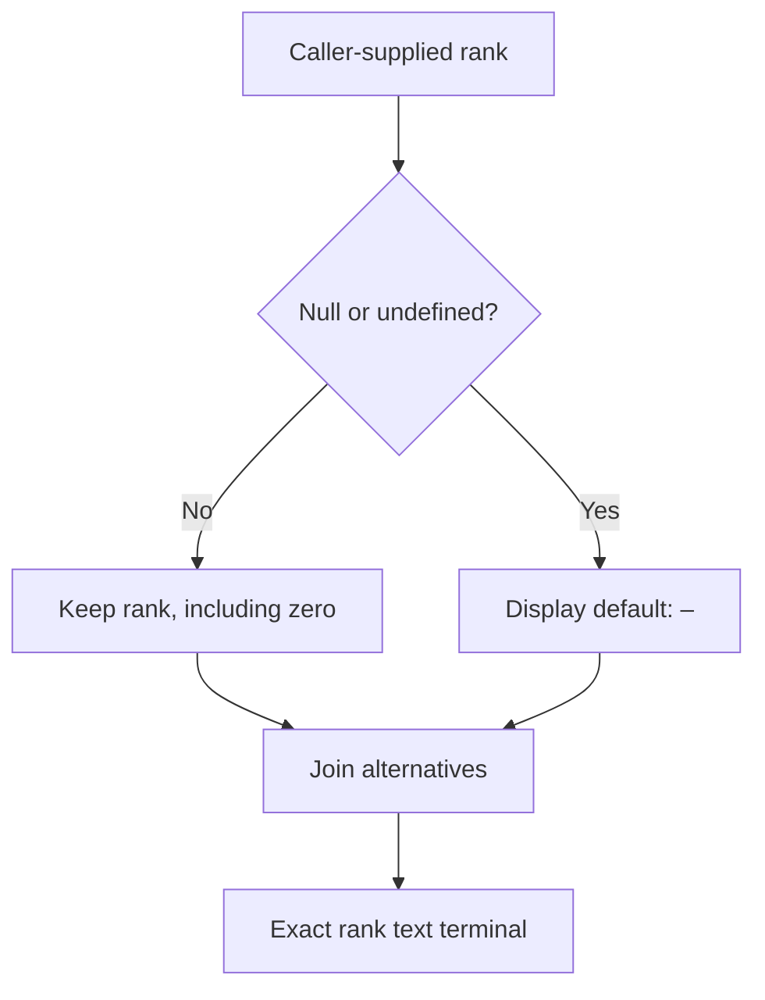

**Decision.** Build a dedicated value-investigation workspace inside Srcly, reached through a pinned source preview and backed by a lazily started, Python-owned tsx-data-flow Node process. Keep Srcly’s repository map as the orientation surface. Make an ordered, source-linked evidence ledger the primary explanation; use a small graph only for a selected branch or join. Reuse tsx-data-flow’s compiler, evidence provider, proof records, and validators, while adding a deliberately bounded expression-selection API. Do not treat its current route-field proof as an already general expression-to-terminal engine: the supplied local edits contain narrow source recognizers and project-specific carrier rules. The first proof should follow an actual Srcly property occurrence into an exact JSX terminal, preserve valid fallbacks, expose unsupported boundaries, and restore the original overview precisely. Then earn cross-file depth on the real HotSpotList → row → HotSpotItem name path, keeping the more complex metric-display chain as an honest partial example.

# Srcly overview → exact value-flow investigation

Design research packet · prepared October 23, 2026, America/Indianapolis  
Mode: **Design only** · analyzed projects: **Srcly and tsx-data-flow only**

## Reading this report

- **Snapshot fact** means directly supported by the supplied source or a supplied test’s assertions. A test assertion is not a passing test result.
- **Documented observation** means an earlier author-reported result, not reproduced in this research.
- **Inference** means a conclusion drawn from source structure, not observed browser behavior.
- **Proposal** means intended future behavior. All integration endpoints, new modules, UX behavior, budgets, and sample result IDs below are proposals unless explicitly identified as existing.

Code citations name the repository-relative path, relevant symbol, and often snapshot line numbers. Linked code opens the inspected bytes in this conversation’s workspace. Paths and symbols remain usable with the original source packet after download. GitHub identifies the projects and baseline commits; it is not substituted for the local edits.

Companion files: [implementation-plan.md](implementation-plan.md) and [recommendations.md](recommendations.md).

## Access and evidence boundary

Both source trees were present and readable. The ZIP contains **239 Srcly files, 380 tsx-data-flow files**, plus `snapshot-notes.json` and a bundled prompt. The separate attached `srcly-pro-prompt.md` governed this mission.

| Source | Authoritative snapshot information | What was verified |
|---|---|---|
| Srcly | [byronwall/srcly](https://github.com/byronwall/srcly), baseline `aea1015258f56dd45b8e175f7288e2fef3abc6cf`; snapshot notes report a clean main | Extracted source bytes, implementation paths, proposal documents, representative assertions, and the concrete HotSpotItem chains below |
| tsx-data-flow | [byronwall/tsx-data-flow](https://github.com/byronwall/tsx-data-flow), local baseline `b4f1ba4f0df402251f4b666cddf5312efa4a62be`; notes report main ahead by three commits plus substantial modified/untracked files | Those supplied edited bytes, current compiler/evidence/field-proof paths, API projections, frontend state/layout, and focused assertions |

The archive SHA-256 is `ffb11d59152b21d0311383f5c2debac758121190c35e44a08bb5cb3dabdf8bec`. Source trees contain no `.git` directories, so commit/status information above comes from the packet metadata, not a Git command against a checkout.

This is a **curated source snapshot, not a runnable checkout**. It omits Srcly’s client tsconfig files, tsx-data-flow’s server/root tsconfigs, several imported test helpers/example fixtures, and `tsx-data-flow/docs/design-preferences.md`. The included frontend tsconfig is not a substitute for all those configurations. No missing input prevents the design decision or the decisive code comparisons; implementing or measuring the proposal requires the complete working checkouts and their governing configurations. The missing design-preferences document should be obtained before a later UI change.

**Executed in this research:** safe archive extraction, file enumeration, source/document/test-assertion reading, text searches, content checksums, and public primary-source research.  
**Not executed:** either application, either analyzer against a target project, browser journeys, tests, acceptance runners, lint/typecheck, benchmarks, dependency installation, builds, commits, or pushes. No repository files were edited. Local edits are treated as in-progress implementation, not accepted or verified behavior.

# 1. Exact overview → preview → investigation → return workflow

## 1.1 Product division of responsibility

**Srcly answers where to look.** It already has a file/scope metrics tree, treemap, dependency view, hotspots, rule diagnostics, and a code modal. Its navigation model is `Location = {repo, at, view, open?}`; graph expansion IDs can survive URL navigation. These are useful foundations for orientation. They do not yet identify a concrete compiler expression or preserve every UI state needed for an exact return. [S-NAV], [S-APP], [S-PREVIEW]

**tsx-data-flow answers what the inspected evidence supports.** It supplies compiler identities, cross-file tracing, program elements and relations, selected-source field attachments, exact consumers, transformations, typed frontiers, and bounded coverage. Different pipelines establish different claims. The integration should preserve those distinctions instead of turning all evidence into one score or one edge type. [T-CORE], [T-PROVIDER], [T-FIELD], [T-CONTRACT]

The user’s unit of work is **one selected value occurrence, refined to a field and terminal when useful**. A repository import edge, a hotspot witness, a component occurrence, and a value-transfer relation are different things.

## 1.2 Entry points and their exact handoff

All entry points use one pinned preview component and one selection resolver.

| Entry point | Preview anchor | What the primary action does |
|---|---|---|
| Treemap file or scope | File and existing scope line range; metric witness when applicable | Opens source preview; the user selects an expression. A folder first chooses a file/scope. The metric itself is context, not a guessed value source. |
| Dependency node or edge | File/symbol declaration; for an aggregate edge, the concrete importer/imported declaration choices | Opens the relevant source span. The import graph stays structural. An aggregated edge cannot become a proven value edge. |
| Hotspot or rule finding | Hotspot’s metric witness, or finding’s path/line/column/range when supplied | Preserves why the location was interesting, then resolves a concrete expression. A line-only diagnostic may produce several choices. |
| Source expression | Raw-source file/span and selected token/expression | Resolves that occurrence against the current compiler Program. If several containing expressions are legitimate, presents explicit choices with highlighted spans. |

Existing behavior is close enough to supply the anchors, but not the final identity:

- Treemap file activation and hotspot rows already open code; Shift+Enter on a hotspot opens its maximum-metric witness. [S-PREVIEW]
- Dependency `onOpenNode` opens files or symbols through `App.openAt`. The current name-plus-line scope matching is a navigation convenience, not a proof identity. [S-DEPS], [S-APP]
- `FileFindings` exposes a column in the title but calls `onJump(f.line)`; exact columns must be carried further. [S-FINDINGS-UI]
- The current treemap tooltip is `pointer-events-none`. It is not the place for an actionable button without a new pinned, focusable surface. [S-TOOLTIP]
- `CodePane` displays highlighted source; it has no compiler expression selector. Selection must map to original source text, not Shiki’s rendered/indentation-adjusted DOM. [S-CODE]

## 1.3 Preview contents and analysis timing

**Proposal: no compiler startup on incidental hover.**

Hover continues to show Srcly’s existing cheap metadata. Clicking or keyboard-opening the pinned preview loads source text through Srcly and displays:

1. Repository, file, enclosing symbol, exact highlighted range, and the overview origin.
2. Approximately 3–8 useful source lines; expand to full source without losing the preview.
3. The metric, witness, or diagnostic that led here, clearly labeled as context.
4. Selected expression or a request to choose one; support status for TS/TSX.
5. A matching cached semantic summary if available: exact consumer count, known frontier count, and freshness. Otherwise **Not analyzed**—never “0 consumers.”
6. **Inspect value flow**, **Open full source**, and **Close preview**.

Selecting **Inspect value flow** captures the return state, starts or reuses the analyzer, and resolves the selection. The workspace can open immediately in a cancellable loading state while preserving the origin. Ambiguity is resolved before showing a proof claim. Failed startup, unsupported syntax, changed bytes, or no exact AST match remains an actionable state, not an empty graph.

A warm cache may enrich the preview without new work. A stale cached result can be named as earlier evidence, but cannot supply a current “proven” badge. Changing a selected field or terminal within an already returned slice should be local projection; expanding beyond the slice is an explicit bounded request.

## 1.4 Investigation workspace

The workspace has a stable header:

**Back to overview · repository / file / symbol / selected value / field / terminal · content status**

Below it:

- **Locator and consumers:** small repository locator, original focus, current file, grouped terminal list, and a separate unresolved-frontier group.
- **Ordered ledger:** the selected path, with source, alias/helper transfer, branch/default, transform, join, and exact terminal or frontier rows.
- **Evidence inspector:** selected row’s raw source, input/output compiler types, relation/proof records, assumptions, and why analysis stopped.

The initial query defaults forward from the selected occurrence. **Where did this come from?** switches to a bounded backward investigation. For a terminal expression, the UI can offer the backward direction explicitly. Direction is part of the semantic selection and cache key.

Every terminal retains its own ID, kind, source span, and call/occurrence context where available. “Two uses of name” can be a group heading; it cannot erase the distinction between a title attribute and text content. An ordinary return is a terminal only under the chosen terminal policy; a local helper return may instead be an intermediate transfer.

Opening source is temporary. Closing it restores the initiating ledger row and scroll. **Continue from this value** creates a new semantic navigation entry with a parent breadcrumb, rather than silently changing the meaning of the existing source.

## 1.5 History and exact return

Current Srcly history does not fulfill this contract:

- `go` pushes, `replace` replaces, and popstate reparses the URL.
- `HistoryRing` records recent places, deduplicated by repository/focus/view, retaining the most recent open set. It is not a complete UI timeline.
- Graph filters live in a module signal; code-modal selection, explorer expansion/sort/scroll, treemap filters, and metrics/exclusions have other owners.
- `HistoryRing.fromJSON` accepts treemap/graph while current `View` also includes scatter. Extend the affected serializer deliberately when adding investigation state. [S-NAV], [S-APP], [S-METRICS]

**Proposal: distinguish durable semantic selection from a tab-local return snapshot.**

| Durable URL / handoff identity | History/session snapshot |
|---|---|
| Registered repository; file/span; content identity; resolved expression/symbol; direction; optional source/field/terminal; compact origin location | Original view, scope, expansions, graph selection/camera/filters, explorer mode/sort/scroll, metric/exclusions, treemap filters, pinned preview/code selection, focused control, ledger disclosure and scroll |

Before a deliberate navigation, update the current history entry’s snapshot, then push the new semantic entry. Branch expansion, camera movement, and inspector scrolling update that entry without creating dozens of Back steps. Keep the snapshot bounded per tab; a small direct record is enough.

**Back to overview and browser Back use the same restore function.** Forward restores the investigation’s selection, expansion, and focus. Preserve the overview’s mounted state where practical, but do not make component survival the only restoration mechanism.

A copied URL restores semantic focus and a useful repository origin. It cannot recreate another tab’s lost camera/filter snapshot; say that plainly. After source or configuration changes, retain the origin but mark semantic IDs stale. Re-resolve against fresh bytes. Never silently remap an old ID to the nearest same-named field.

## 1.6 Surface options and scores

Scores are design judgments, not measurements. Each dimension is 1–5, higher is better. **O** orientation/return; **F** semantic fidelity; **D** distribution simplicity; **E** implementation ease; **V** visual tractability. Weights: O 30%, F 25%, D 15%, E 15%, V 15%.

| Option | O / F / D / E / V | Weighted result |
|---|---|---:|
| Dedicated Srcly detail consuming retained analyzer evidence | 5 / 5 / 3 / 3 / 5 | **4.40 / 5** |
| Separate tsx-data-flow deep link | 2 / 5 / 2 / 4 / 2 | **3.05 / 5** |
| Embed the current frontend or extract a shared UI implementation | 4 / 5 / 2 / 2 / 2 | **3.35 / 5** |

- **Choose dedicated detail.** A new narrow renderer costs work, but directly addresses orientation and explanation. Fidelity is high only if canonical evidence, identities, omissions, and validators are retained.
- **Reject separate-tool navigation as the main journey.** It is a useful manual diagnostic comparison, but adds service/session management, splits orientation, and preserves the visual difficulties the mission is meant to resolve. A new tab preserves Srcly’s state; browser Back does not then become a cross-tab return.
- **Reject iframe/shared-frontend extraction as the first integration.** It combines two navigation systems and imports a component-oriented canvas into a narrower workspace. A shared UI package, compatibility layer, or plugin registry has no present justification. Direct reuse of existing semantic contracts and a few pure selectors is sufficient.

# 2. What the analyzers can and cannot prove

## 2.1 Three evidence layers, not one analyzer capability

1. **Srcly metrics, import structure, and diagnostics.** It can locate code, count measured properties, identify import references, and attach checker diagnostics. It does not prove an ordered value path.
2. **tsx-data-flow render-sink analysis.** It traces backwards from render sinks, descends into supported helpers/callbacks, records defenses and unknown hops, and ranks cleanup opportunities. Its representative paths and scores are not the same as exact field-transfer proof.
3. **tsx-data-flow program/route/source/field evidence.** It builds compiler-backed elements/relations, bounded slices, route occurrences, selected-source field paths, transformations, exact consumers, and typed frontiers. This is the richest integration seam, but its current exact proof lanes are narrower than its type vocabulary suggests.

**Important correction:** `docs/analyzer.md` describes an earlier file-local helper limitation and absent parameter binding. Current `report-builder.ts` creates shared cross-file state with context/catalog caches and a 20,000-descent budget. Current source and embedded tests demonstrate imported-helper and callback binding mechanisms. Do not repeat the earlier limitation as a current blanket fact. [T-REPORT], [T-LEGACY-TESTS]

## 2.2 Source-linked capability table

“Implemented” below means code exists in this snapshot. It does not mean this research ran it successfully.

| Capability | Snapshot evidence | Claim boundary |
|---|---|---|
| Repository metrics and N/A | Srcly `analysis.py:analyze_single_file/_scan_codebase/aggregate_metrics`; `analysis_types.py`; `metric_catalog.py`; `models.py`. [S-ANALYSIS] | Measured structure and ranked review signals. Missing/failed/nonapplicable measurements remain N/A; no whole-value semantic proof. |
| Import aliases and re-exports | Srcly `deps/typescript_deps.py:collect_ts_usages` and resolver; `deps/graph.py`; client `contract.ts`. [S-DEPS-BACKEND] | Importer→imported and top-level symbol references. Endpoint aggregation and `file#name` IDs do not establish exact argument, return, field, or terminal flow. |
| Rule findings | Srcly `findings/runner.py`, `typescript.py`, `builtin_ts.py`, `overlay.py`. [S-FINDINGS] | Project tsc/ESLint and Ruff/fallback TS diagnostics. Nullability diagnostics and assertion warnings are not general runtime-validity proofs. |
| Local and imported helpers | tsx `report-builder.ts`, `source-trace.ts`, `source-file.ts`; embedded imported-helper tests. [T-REPORT], [T-LEGACY-TESTS] | Supported compiler-resolved bodies, arguments and returns can be traced. External, unresolved, cyclic, budget-limited, or unsupported calls remain limits; not arbitrary JS execution. |
| Callback parameters | tsx `program-callback-return.ts`, `source-trace*`, `program-evidence-collector-field-transfers.ts`; `core-analyzer-unknowns.test.ts`. [T-CALLBACK], [T-LEGACY-TESTS] | Supported array/Solid patterns bind values to parameters. Arbitrary callback APIs and dynamic dispatch cannot inherit those guarantees by name. |
| Nullish fallbacks and valid defaults | `source-trace.ts` fallback handling; `source-defenses.ts:defenseRecord/getNullishStatus/fallbackOrigin`; `core-shapes-defenses.test.ts`. [T-DEFENSE], [T-DEFENSE-TESTS] | `??` and `\|\|` are recorded as fallback syntax; the reviewed `defenseRecord` path assesses nullish types, not every falsy or invalid value. Optional-prop/API-choice/runtime-boundary exceptions exist. |
| Type-impossible guard | `source-defenses.ts:getNullishStatus`; `project/tsconfig.ts:resolveProjectConfigs`. [T-DEFENSE], [T-TSCONFIG] | “Impossible” is conditional on the modeled type and compiler configuration. It is not runtime validation or permission to delete a guard automatically. |
| NaN/non-finite values | No reviewed general numeric-validity transfer domain; real `HotSpotItem.value` explicitly uses `Number.isFinite`. [S-HOTSPOT], [T-DEFENSE] | Null checks and `number` types do not establish finiteness. Recognizing a call/guard is not a proof that every downstream occurrence is protected. |
| Shape change and evidence loss | `program-value-summary*`, program operation kinds, route shapes/field effects; assertion-unwrapping in `program-evidence-support.ts`. [T-SUMMARY], [T-PROGRAM] | Supported operations carry shape/effect evidence. Operation names such as map/reduce/validate in types are not proof of full implementations. Assertions/any/widening are not yet a complete evidence-loss ledger. |
| Bounded evidence slices | `queryEvidenceSlice`, lazy provider, coverage projection. [T-SLICE], [T-PROVIDER], [T-PRIMITIVES] | Explicit elements, relations, origins, terminals, gaps, budgets/truncation. Source-backed structural/reference edges are not automatically value-transfer edges. |
| Exact selected-source field paths | `queryRouteTotalityFieldProof`, proof index/carrier/transfer verifiers; field-lineage contracts/projection/validators. [T-FIELD], [T-FIELD-INDEX], [T-FIELD-CONTRACT] | Strong exact-identity checks within supported lanes. Current selected source requires a precise proven `node:fs/promises.readFile` fact; not an arbitrary source-expression API. |
| Collection membership | Cross-collection policy/dependency modules and compiler-resolved filter/map/includes transfer collection. [T-COLLECTION] | Membership support is separate from target field value flow. Predicate reads must not become direct field-use counts. |
| Terminals | Program terminal roles and `program-evidence-collector-jsx-support.ts:addTerminal`; exact field consumer identity. [T-JSX], [T-PRIMITIVES], [T-FIELD-CONTRACT] | Intrinsic JSX text and attributes can have exact occurrence/span links. Broader stdout/file-write/HTTP/side-effect vocabulary does not prove every language construct or expose it through the route UI. |
| Unknown/budget states | Typed gaps, lineage frontiers, provider coverage, cancellation. [T-SLICE], [T-FIELD-CONTRACT] | A bounded completed query can still have unknowns. Zero attachments may mean no discovery, unsupported syntax, stale selection, or exhausted work, not “no consumers.” |

## 2.3 Actual code paths

### Srcly

`scan_codebase/_scan_codebase → analyze_single_file → language analyzer → attach_file_metrics/convert_function → aggregate_metrics` builds the repository tree. The catalog drives frontend applicability, labels, ranking and rendering. N/A is intentionally distinct from measured zero. [S-ANALYSIS], [S-METRICS]

Separately, `services/findings/runner.py` plans and runs diagnostic tools, then overlays counts. `reporting.py:build_findings` produces **weighted metric review suggestions** in the report’s `findings.json`. These are two different meanings of “finding”; neither is tsx-data-flow’s ordered proof artifact. [S-FINDINGS], [S-REPORT]

The dependency extractor uses tree-sitter and its own resolver. It skips unresolved relative imports, represents unresolved bare imports as externals, follows selected static/re-export patterns, and collects imported uses by top-level declaration. Edge assembly merges endpoint pairs; original import spans and completeness are not in the public `DepGraphEdge` contract. This is appropriate repository structure, not a value-flow graph. [S-DEPS-BACKEND], [S-DEPS-CONTRACT]

### tsx-data-flow legacy render tracing

`analyzeProject/createAnalyzer → buildProgram → buildReport → source-file/source-trace processing → sink metrics, identities, summaries, rankings`.

`createAnalyzer` reuses a TypeScript Program and an identity index. `buildReport` shares cross-file state between traces. The embedded legacy tests exercise imported methods, destructured Solid For parameters, custom iterable render props, and array-map parameters. Those assertions contradict a blanket “file-local only” description, but are not a complete language-coverage guarantee. [T-CORE], [T-REPORT], [T-LEGACY-TESTS]

`file-page.ts:mergeExpressionEvidence` retains the longer upstream/downstream path while unioning terminals. This is useful explanatory summary data, not a complete per-terminal proof ledger. Do not reconstruct an exact path merely by aligning the longest path with every merged terminal. [T-FILE-PAGE]

### Current route/source/field proof

`analyzeRouteData(ts, program, root, sinks) → createLazyProgramEvidenceProvider(ts, program, root) → route inventory + totality session → buildRouteDataDetail(route, flow, source) → routeTotalityForRoute → queryRouteTotalityFieldProof → transfer verification → field-lineage projection + validation`.

The session caches by route and exact selected-source evidence identity. `projectRouteTotality` validates projected records; the field projection preserves attachment origin, full segment path, exact consumer/terminal, ordered element/relation paths, dependencies, transformations, proof locations, and typed frontiers. This is the depth to preserve. [T-ROUTE], [T-SESSION], [T-FIELD-PROJECTION]

The decisive current limitations are concrete:

- `RouteTotalityFieldProofIndex.selectedFilesystemInput` checks exact evidence span and element, and `isSelectedFileInputFact` requires `file-input`, proven `host-api`, operation `readFile`, module `node:fs/promises`. Unresolved selection returns no specialized field proof; ambiguity is represented explicitly. [T-FIELD-INDEX]
- `program-evidence-carrier.ts` includes exact named/path recognizers for `migrateSoccerStore`, `getSnapshot`, and a `snapshot`/latest carrier. These are facts about tsx-data-flow’s own implementation; the referenced application was not analyzed. They cannot be presented as generic cross-project carrier support. [T-CARRIER]
- `discoverScalarFieldProofCandidates` looks for a particular optional `.snapshot()?.field` shape and contains special display labels for two named fields. Generalizing source selection is therefore more than adding a link parameter. [T-FIELD-CANDIDATE]
- The generic provider can accept an existing `ts, program, root`; its options do not carry the full multi-tsconfig routing object. Use the correct owning Program/checker. The root-only overload loads package TypeScript and `programForRoot`, which can fall back to default compiler options when no tsconfig is found. That is not equivalent to `buildProgram`’s validated-config path. [T-PROVIDER], [T-PROGRAM-LOADING], [T-TSCONFIG]
- Generic source-backed evidence includes structural facts. Assertions are unwrapped, and a remaining expression may be represented as a proven literal/value AST fact. “Proven node” does not mean its runtime value, transformation semantics, or safety are proven. [T-PROGRAM-SUPPORT], [T-EXPRESSION]
- Generic call collection connects arguments to shared target parameters and shared returns to each resolved call. The slice traversal does not carry an invocation stack. **Inference:** unrestricted closure can combine separate calls or imply an argument affects an output when it does not. M2 must verify exact invocation, argument position, parameter and return-to-call pairing. Destructured/default/rest parameters and conditional fallthrough need explicit support or a frontier; one syntactic return is not proof of a total return. [T-JSX], [T-SLICE], [T-CALLBACK]

The first integration must add an exact expression resolver and a small, explicitly supported value-path projection. It must not fake a route identity or repurpose the specialized filesystem proof for arbitrary property reads.

## 2.4 Nullability, fallbacks, invalid values, and runtime truth

Use three independent questions in the inspector:

1. **Connectivity:** is this occurrence connected to this consumer by the recorded transfer evidence?
2. **Coverage:** which paths, operations, boundaries, and budgets were explored?
3. **Value property:** what does the evidence establish about nullability, finiteness, schema validity, or domain constraints?

A good answer to one does not answer the others.

| Source operation | What it means | What it does not establish |
|---|---|---|
| `x ?? fallback` | Uses fallback only for null or undefined | Rejects neither zero, empty string, NaN, nor Infinity |
| `x \|\| fallback` | Uses fallback when the left side is falsy | It is not equivalent to a null check; valid zero/empty string/false can be replaced |
| `x !== null` | Excludes null on the appropriate branch | Does not exclude undefined unless separately checked; does not establish finite number or valid domain value |
| `typeof x === "number"` | Narrows the JS primitive category | Does not exclude NaN or infinities |
| `Number.isFinite(x)` | Tests for a finite Number | Does not establish positivity, integer range, schema membership, or downstream preservation through transforms |
| Type assertion / non-null assertion | Alters compiler-facing type interpretation | Adds no runtime check |
| Schema/parser validation | Can establish the predicates actually implemented and executed on a path | Does not establish unrelated domain invariants or all subsequent transforms |

These language distinctions follow TypeScript’s explanations of nullish coalescing, truthiness, erased assertions and `strictNullChecks`, and the ECMAScript definition of `Number.isFinite`. [E-OPERATORS], [E-TRUTHINESS], [E-TS], [E-NULL], [E-FINITE]

Current `defenseRecord` examines nullish type flags, treating any/unknown/type parameters as unknown. It also recognizes some parser/runtime boundaries, optional props, API-choice defaults, and compatibility comments. Those exceptions are useful protections against indiscriminate cleanup. They are heuristic classification, not a universal validator. The reviewed `source-trace` fallback branch records both `??` and `||`, but creates the nullish defense record only for `??`. [T-DEFENSE], [T-TRACE]

**UI language:** show “excluded by declared type under this configuration,” “possible nullish default,” “intentional display default,” “finiteness unassessed,” or “unknown across this boundary.” Avoid a single “safe/unsafe” light. A fallback is not a defect merely because it increases trace complexity.

Static evidence stops at unmodeled library bodies, mutable state behavior not modeled across time, dynamic keys/dispatch, unsupported syntax, untrusted external data absent validated provenance, recursion/budget limits, and compiler ownership uncertainty. Do not promise a complete interpreter, dynamic execution trace, or domain validator.

**Shape widening and lost evidence need a consequential path.** Srcly's metric read casts the metrics object to `Record<string, unknown>`, while `loadMetricCatalog` casts `res.json()` to `MetricCatalog`. These are real assertion/boundary facts, not runtime validators. The evidence-loss proposal describes a richer transition model for showing where precise structure becomes broad and is later reconstructed; that detector is not an established current capability. Current bounded summaries retain some member provenance and partial/cycle/budget states, but unwrapping assertions loses the before/after transition unless it is recorded separately. Do not label every `Record`, `unknown`, cast, or deliberate projection a defect. A recommendation needs a supported downstream consequence, such as erased field identity later reconstructed with unverifiable access. [S-METRICS], [S-HOTSPOT], [T-EVIDENCE-LOSS], [T-SUMMARY]

## 2.5 Collection membership and exact field identity

A field’s **value provenance** and a collection’s **membership dependence** must stay separate.

For a schematic chain within a proposed fixture:

```tsx
const selectedIds = input.membership.map(x => x.entityId);
const visible = input.entities.filter(x => selectedIds.includes(x.id));
return <For each={visible}>{entity => <span>{entity.displayName}</span>}</For>;
```

The displayed value is rooted in `entities[*].displayName`. Membership depends on `membership[*].entityId` and `entities[*].id`. Do not relabel the displayed field as the membership key or count predicate support as another displayed use.

The supplied field-lineage contract has dedicated `collection-membership` dependency records with source field, supporting path/transformation IDs, and target consumer/terminal identity. Current cross-collection code checks compiler-resolved library/Solid bindings and exact owners. Preserve this distinction even if the initial UI renders it as a short “Shown when membership matches” disclosure. [T-COLLECTION], [T-FIELD-CONTRACT]

Same spelling is never enough. A stable selection includes source/root identity, ordered property/index/collection segments, compiler/occurrence context where available, and terminal identity. A dynamic index gets an honest unknown frontier unless a particular key is proven for that occurrence.

## 2.6 Real source investigation from the packet

### Small positive and precision control

In Srcly `client/src/components/HotSpotItem.tsx`:

```tsx
// Line 130: a valid nullish display default.
{props.rank ?? "–"}

// Lines 134–135: the same field, two distinct consumer occurrences.
<span title={props.node.name}>
  {props.node.name}
</span>
```

The exact text occurrence at **line 135, columns 14–29, end-exclusive** is an excellent first seed. The property path is `props → node → name`; the immediate consumer is that intrinsic text terminal. The title occurrence on line 134 must not be silently merged into it. Switching from occurrence scope to field-wide uses can show both, explicitly.

`addTerminal` already records an exact expression→intrinsic-terminal relation. M1 needs exact selection, field-path identity, a bounded verified path, source match, and a UI—not a new general AST engine. The origin above the selected prop remains an input boundary until separately traced. [S-HOTSPOT], [T-JSX]

### Ambitious real chain and honest limits

The actual metric display chain is:

1. `hotSpotRanking.ts:valueOf/rankHotSpots` reads the dynamically chosen metric, accepts a finite number or null, partitions N/A rows, and computes score.
2. `HotSpotList.tsx` iterates ranked entries and passes `item.node`, score, metric, and rank into `HotSpotItem`.
3. `HotSpotItem.value` **rereads the metric from the node**, independently applying `typeof raw === "number" && Number.isFinite(raw)`. It does not simply display the ranking entry’s stored value.
4. The exact terminal at line 145 uses `props.valueText ?? (value() === null ? "N/A" : formatMetricWithUnit(props.metric, value()!))`.
5. Imported `metricsStore.tsx:formatMetricWithUnit` looks up the metric definition and delegates to `formatMetricValue`, optionally appending singular/plural units.
6. `formatMetricValue` handles null, undefined/non-number, bytes, fractional/integer formatting; `formatBytes` chooses B/KB/MB. [S-RANK], [S-HOTSPOT-LIST], [S-HOTSPOT], [S-METRICS]

This was manually traced from source, not produced by an analyzer run. It deliberately stresses the requested behavior: callback binding, component props, imported helpers, aliases/accessors, branching, fallback, dynamic fields, transforms, and terminal identity.

Required truthful outcomes:

- Zero remains a legitimate measured value; a null metric yields N/A when no `valueText` override takes precedence.
- An empty-string `valueText` override survives `??`.
- `value()!` is an assertion, not additional runtime evidence. The predicate and formatter argument invoke `value()` separately; propagating a guard between those calls requires a justified stability model, not identical expression text.
- A direct caller of `formatMetricValue` cannot inherit a finite-number guard merely because HotSpotItem has one.
- Computed metric identity, mutable catalog `Map.get`, Solid reactivity, and external formatting semantics remain frontiers unless the implementation proves the relevant transfer/property.
- The display policy can be sensible even when upstream type/runtime evidence is incomplete.

## 2.7 What the supplied tests establish—and do not

The focused source tests are useful design oracles:

- `test/core-analyzer-unknowns.test.ts` embeds imported-method, callback-binding, and unknown-boundary cases.
- `test/core-shapes-defenses.test.ts` embeds valid optional defaults, compatibility/API-choice handling, and nullish-defense distinctions.
- `test/route-totality-field-proof.test.ts`, `route-totality-generic-field-proof.test.ts`, and `route-totality-schedule-field-proof.test.ts` assert exact field/consumer/owner/path and membership behavior.
- `scripts/accept-route-field-proof.ts` is the maintained semantic authority for named field obligations and rejects zero positive attachments. AGENTS and acceptance guidance additionally require a real positive, a negative precision case, and normal user-control activation. The runner checks evidence/obligations; it does not operate the browser control.
- Some tests depend on absent example/helper files or an absolute path to another project. Those application bytes were neither available nor analyzed. Included older frontend tests also describe state fields/components absent from the current frontend. These are static mismatches, not reported test failures. [T-ACCEPT], [T-FIELD-TESTS], [T-FRONTEND-TESTS]

The later implementation must follow current AGENTS: no test edits or test/verify execution until explicitly approved, and no build commands as agent verification. A design plan can specify those checks without claiming authorization or success now.


# 3. Smallest concrete integration boundary

## 3.1 Boundary comparison

The output needs to preserve evidence depth, not merely transport a score or a screenshot.

| Boundary | What it buys and costs | Decision |
|---|---|---|
| Import an evidence artifact | No live Node process for viewing; reproducible if it includes full evidence, identities, coverage, and input hashes. Existing Srcly report artifacts and ordinary tsx report views are not automatically that artifact. On-demand expansion and changed-source queries require regenerating it. | **Defer as a portable export/import path.** Useful later; an artifact-only first delivery would not validate the requested live investigation. |
| One Node CLI child per request | Clear ownership and simple teardown; Python invokes a fixed command with an argv vector. A new focused command would be needed to expose the right query, and each cold request otherwise rebuilds compiler state. | **Reject as the primary interactive boundary.** Useful for an isolated diagnostic, but do not make every terminal/field selection a fresh compiler process. |
| One lazily started, long-lived Node child owned by Srcly | Reuses the existing HTTP server, worker, cancellation primitives, Program cache, and lazy provider. Adds explicit readiness, lifespan, stale-input and crash handling. Keeps memory while active. | **Choose.** One active target/configuration first; no globally installed daemon or service platform. |
| Shared TypeScript library | Reuses source-level functions inside Node; potentially useful to another TS caller. Python still needs a Node host or a foreign-runtime bridge. A published package alone does not solve process ownership or compiler setup. | **Use existing functions internally; avoid a new cross-repo library extraction.** |
| Merge the tools | One codebase could eventually simplify ownership, but Python distribution, TypeScript semantics, and frontend histories remain different. A merge introduces broad migration work before proving the workflow. | **Avoid for this mission.** |

The child-process choice is justified by existing reusable server/cache code and the interaction model. It is **not** a claim that the historical benchmark proves a persistent process is necessary. Measure startup, memory, and warm queries separately before tuning lifecycle.

## 3.2 Runtime installation and ownership

**Snapshot facts.** Srcly’s Python package is `srcly` 1.2.0, requires Python ≥3.13, and serves bundled frontend assets. Its runtime dependencies include `httpx`, but not Node or the TypeScript compiler. tsx-data-flow’s package declares Node ≥18, TypeScript, tsx and Zod, and bin entries under `dist/bin`. The declared Node floor is a snapshot packaging fact; record the actual supported runtime used for the future integration. Its `prepack` invokes build scripts. Do not use packing/building as an agent-verification shortcut. [S-PACKAGE], [T-PACKAGE]

uvx runs Python tools in isolated environments. Installing Srcly through uvx therefore does not establish that a prepared Node analyzer and the target’s compiler dependencies exist. [E-UV]

**First supported setup, proposal:**

- Add one explicit `--value-analyzer /absolute/path/to/tsx-data-flow` option to Srcly. Resolve it before `run.py` changes the working directory to the analyzed repository.
- Use an already prepared analyzer checkout and a supported installed Node runtime. Launch its known server entry through its installed tsx runtime, with explicit target root/source/configuration. Do not invoke an arbitrary shell string.
- Require target dependencies/configuration where compiler resolution needs them. Record whether TypeScript came from the target, an explicit `--typescript-from` directory, or the analyzer fallback. Record the actual version/module.
- Do not download/install on hover, preview, or investigation click. A missing prerequisite produces **Analyzer unavailable**, with a concrete setup explanation; Srcly’s overview remains usable.
- No claim is made here that the edited snapshot is published to npm. A future deploy uses a known paired runtime artifact or a prepared local checkout, not an assumed public package version.

**Ownership:** FastAPI’s lifespan owns one analyzer child and HTTP client. Start on the first explicit investigation, serialize concurrent startup, bind to loopback, and allocate an ephemeral port. Add a machine-readable readiness record using the actual bound port; current `server-cli.ts` prints the configured port, which would be misleading for port zero. Parent verifies the child identity, target root/configuration, and current contract before forwarding requests. [S-RUNTIME], [T-SERVER]

Keep browser requests on Srcly’s origin. The Python router forwards only supported operations to its own child. On root/config change, retire that session. On shutdown, cancel work, close HTTP, terminate if necessary, and reap the process. Existing `findings/tools.py:run_process` demonstrates process groups and timeouts, but waits for exit with `communicate`; it is not a ready-made persistent-process owner.

Current worker cancellation is attached specifically to `route-data`. The new expression operation needs the same explicit cancellation-token wiring. Aborting a request and acknowledging cancellation are not proof that synchronous compiler construction has stopped; late responses must be rejected, and a hard startup deadline can retire the owned child when cooperative cancellation cannot run. [T-SERVICE], [T-WORKER]

## 3.3 Reuse, required additions, and cache ownership

**Reuse these existing seams:**

- `buildProgram` / `createAnalyzer` for compiler setup; the latter currently exposes the primary Program and identity access, not a public per-file routing API.
- `createLazyProgramEvidenceProvider(ts, program, root, options)`, not its root-only overload.
- `queryEvidenceSlice` and existing source/proof/status/field-segment primitives.
- Valid route-specific `RouteTotality` and field-lineage contracts/projections/validators, when an actual route-supported query exists.
- Existing worker requests, progress, source excerpt patterns, and the HTTP server. [T-CORE], [T-PROVIDER], [T-SLICE], [T-CONTRACT], [T-SERVER]

**Add only the missing direct responsibilities:**

1. Exact selection resolver: raw source span → supported AST occurrence → compiler-owned element and optional static field path.
2. Bounded value-path verifier/projection: accepts documented transfer shapes and emits ordered paths, exact consumers and scoped frontiers. It never upgrades arbitrary structural reachability to value proof.
3. One expression-investigation request/result contract and worker operation.
4. Source-match manifest and generation ownership.
5. Srcly child owner/proxy, preview, ledger, inspector, and return snapshot.

A local occurrence→terminal proof needs no route ID. Reuse the current evidence and field primitives without pretending a route occurrence exists.

The current cache’s `ensureBuilt` computes a full report before serving its operations. For the new operation, split **ensure compiler/session** from **ensure legacy full report** inside the existing owner. A source selection may still require repository-scale compiler construction and fact indexing; it should not additionally require generating every render finding merely to inspect one local occurrence. Extend `createAnalyzer` to retain/expose the selected file’s owning Program context where routing is needed. Do not construct a second conflicting compiler tree. [T-CACHE], [T-CORE], [T-TSCONFIG]

| Lifetime | Cache data | Invalidation / query behavior |
|---|---|---|
| Repository/configuration generation | TypeScript implementation, owning Programs/checkers, effective configs, loaded source texts, identity/declaration catalog, compact facts and lazy relation provider | Rebuild conservatively on source membership/content, config/resolution, compiler or analyzer change. One active root first. |
| Selected query | Resolved occurrence, direction/policies/budgets, verified path/terminal selection, slice, proof/frontier records, serialization | Key by snapshot + exact selection + all semantic options. Field/terminal projection is local if the required evidence is already present. |
| UI history entry | Overview filters/selection/expansion/camera/scroll/focus; preview and ledger disclosure | Restore without analysis while snapshot matches. Reconcile explicitly after refresh. |
| Optional future saved artifact | Complete selected result plus input manifest and provenance | View as historical evidence unless content/configuration match is established. Not part of first implementation. |

## 3.4 Source matching: commit and mtime are insufficient

Srcly’s scan cache fingerprints path/mtime/size; its dependency cache uses a count and path/mtime signature; report manifests omit a source content digest. These cannot prove that a semantic result corresponds to the dirty source currently shown. tsx-data-flow’s current API generation guards a process session, but is not a globally unique content fingerprint. Its `sourceFor` reads disk separately from Program construction, so snippets can otherwise be newer than the analyzed AST. [S-CACHE], [S-REPORT], [T-CACHE]

**Proposed identity rules:**

- Repository ID is a Srcly-owned registration of the canonical local root. Git remote URL or basename alone cannot identify a checkout.
- Revision is provenance. Dirty content is identified by hashes, not just `dirty: true`.
- Hash the actual Program source texts, relevant declaration inputs, effective configuration including extends/references, module-resolution inputs, compiler identity, analyzer build/source identity, and semantic options.
- Selected file digest and span bind the preview to the exact AST. Source snippets come from that generation’s stored text.
- Detect added/deleted files and changed resolution candidates as well as edits to loaded files. A missing import becoming resolvable can change proof without changing the selected file.
- Initial invalidation can rebuild the whole generation. Fine-grained incremental invalidation is an optimization, not a prerequisite for correctness.
- A compiler Program is an immutable analysis snapshot, not automatically an atomic filesystem snapshot. Validate the input manifest around construction/query use; if files move during capture or differ from the analyzed text, mark stale and require refresh. Do not claim a clean current snapshot from only a post-hoc selected-file hash.
- A cached result may remain readable as **Earlier snapshot**. It must not retain current-proof styling against new text.

## 3.5 Proposed handoff request

This JSON is a **proposed browser→Srcly request**, not a current endpoint or an observed analyzer request. The file hash and span are taken from the packet; other opaque IDs are illustrative. The parent forwards only semantic request fields to the owned child. Verbose return state stays in the tab.

Line/column convention: **1-based lines and UTF-16 code-unit columns; end exclusive**, normalized against raw source. Paths are repository-relative, slash-normalized and contained within the registered root.

```json
{
  "apiVersion": 1,
  "requestId": "example-request-17",
  "repository": {
    "id": "example-srcly-checkout",
    "baselineCommit": "aea1015258f56dd45b8e175f7288e2fef3abc6cf",
    "workingTreeDirty": false
  },
  "expectedSnapshot": null,
  "selection": {
    "file": "client/src/components/HotSpotItem.tsx",
    "fileContentSha256": "4f0af4df0575f8bf0da9e14af6e7a624be9e514d1e3b35fd24abd1ea7120fff9",
    "span": {
      "startLine": 135,
      "startColumn": 14,
      "endLine": 135,
      "endColumn": 29
    },
    "text": "props.node.name",
    "symbolId": null,
    "sourceKey": null,
    "field": null,
    "terminalId": null
  },
  "query": {
    "direction": "forward",
    "scope": "selected-occurrence",
    "terminalRoles": ["render"],
    "maxDepth": 16,
    "maxElements": 400,
    "maxRelations": 800,
    "maxTerminals": 20,
    "relationVisitBudget": 1200
  },
  "origin": {
    "view": "graph",
    "at": "client/src/components",
    "returnEntryId": "example-navigation-17"
  }
}
```

A first request may have no snapshot token. Resolution returns a current generation and content token; subsequent field/terminal/expansion requests must supply it. Null symbol/source/field/terminal values mean unresolved or unselected—not guessed by labels.

The suggested limits above are initial design budgets to measure. They are not the analyzer’s measured optimum or an assertion that a bounded query is complete.

## 3.6 Minimum semantic result

The minimum result must carry **identity, evidence, completeness, and assumptions**, independently:

- Repository/snapshot/selected-file match; analyzer, compiler and configuration provenance.
- Resolved file/span/expression/symbol and optional source/field/terminal identity.
- Existing six-key `EvidenceSlice`: elements, relations, origins, terminals, gaps, coverage.
- A **verified selected-path projection** with ordered element/relation IDs, exact consumer/terminal, and statement of proof scope.
- Existing route field-lineage data, unchanged, only when a route proof genuinely exists.
- Unassigned query/source-level frontiers as well as exact-field frontiers.
- Budget used/limit, all truncation dimensions, omitted alternatives, and whether result counts are complete within the declared scope.
- Separate type assumptions and runtime-property assessment.

The following is a **valid JSON illustration of the new envelope and selected-path portion**, not a full existing Zod payload or generated result. The actual response also carries the complete, unmodified six-key `evidenceSlice`; it is intentionally not expanded here into hundreds of repetitive node fields. Every referenced evidence ID must resolve in that body. `example-*` IDs and angle-bracket values are placeholders.

```json
{
  "apiVersion": 1,
  "analysisVersion": 1,
  "generation": 1,
  "generatedAt": "<actual-generation-timestamp>",
  "requestId": "example-request-17",
  "snapshot": {
    "repositoryId": "example-srcly-checkout",
    "contentToken": "<digest-of-actual-program-input-manifest>",
    "selectedFileContentSha256": "4f0af4df0575f8bf0da9e14af6e7a624be9e514d1e3b35fd24abd1ea7120fff9",
    "match": "matched",
    "analyzer": {
      "project": "tsx-data-flow",
      "baselineCommit": "b4f1ba4f0df402251f4b666cddf5312efa4a62be",
      "dirtySourceDigest": "<actual-analyzer-source-digest>"
    },
    "compiler": {
      "version": "<actual-loaded-typescript-version>",
      "moduleIdentity": "<actual-resolved-module-identity>",
      "owningConfig": "<resolved-target-tsconfig>",
      "effectiveConfigDigest": "<actual-config-digest>",
      "strictNullChecks": true
    }
  },
  "data": {
    "kind": "expression-investigation",
    "selectionStatus": "resolved",
    "expression": {
      "id": "example-name-read-135",
      "symbolId": "example-name-property-symbol",
      "file": "client/src/components/HotSpotItem.tsx",
      "span": {
        "startLine": 135,
        "startColumn": 14,
        "endLine": 135,
        "endColumn": 29
      }
    },
    "source": {
      "elementId": "example-hotspot-props-parameter",
      "role": "argument",
      "selectedEvidenceId": null
    },
    "field": {
      "rootSymbolId": "example-hotspot-props-symbol",
      "elementIds": ["example-node-read", "example-name-read-135"],
      "segments": [
        { "kind": "property", "value": "node" },
        { "kind": "property", "value": "name" }
      ],
      "label": "node.name"
    },
    "paths": [
      {
        "id": "example-path-135",
        "proofStatus": "proven",
        "claim": "selected-occurrence-to-exact-intrinsic-terminal",
        "elementIds": ["example-name-read-135", "example-text-terminal-135"],
        "relationIds": ["example-render-relation-135"],
        "terminal": {
          "elementId": "example-text-terminal-135",
          "relationId": "example-render-relation-135",
          "role": "render",
          "kind": "jsx-text",
          "ownerDefinitionId": "example-hotspot-component",
          "routeOccurrenceId": null,
          "file": "client/src/components/HotSpotItem.tsx",
          "span": {
            "startLine": 135,
            "startColumn": 14,
            "endLine": 135,
            "endColumn": 29
          }
        },
        "proof": [
          {
            "kind": "jsx-tag",
            "status": "proven",
            "detail": "The selected value occurrence feeds this intrinsic text slot.",
            "locations": [
              {
                "file": "client/src/components/HotSpotItem.tsx",
                "line": 135,
                "column": 14,
                "span": {
                  "startLine": 135,
                  "startColumn": 14,
                  "endLine": 135,
                  "endColumn": 29
                }
              }
            ]
          }
        ]
      }
    ],
    "frontiers": [
      {
        "id": "example-caller-frontier",
        "scope": "upstream-origin",
        "field": null,
        "reason": "outside-requested-scope",
        "status": "not-queried",
        "stoppedAtElementId": "example-hotspot-props-parameter"
      }
    ],
    "coverage": {
      "scope": "selected-occurrence-to-terminal",
      "status": "complete-for-supported-scope",
      "terminalCount": 1,
      "countsAreExhaustiveForScope": true,
      "budget": { "limit": 1200, "used": 1, "exhausted": false },
      "truncation": {
        "budget": false,
        "depth": false,
        "elements": false,
        "relations": false,
        "origins": false,
        "terminals": false,
        "gaps": false
      }
    },
    "valueProperties": {
      "nullability": "compiler-assumption-only",
      "runtimeSchemaValidity": "not-assessed",
      "finiteness": "not-applicable-to-this-query"
    },
    "routeFieldLineage": null
  }
}
```

The new UI state `not-queried/outside-requested-scope` above is distinct from the analyzer’s existing unsupported/budget frontiers. Do not insert it into the current strict route-field enum without a deliberate contract change. It says why upstream origin is not claimed while the tiny downstream proof can still be complete.

For the richer metric selection, the envelope should instead show partial selected-path coverage, the actual dynamic-index/unsupported-transform/external boundary records emitted or verified, and no invented concrete metric field. A null `field` frontier remains visible at query/source scope even when a specific field filter is active.

## 3.7 Semantic acceptance rules at the boundary

- Validate the response’s existing API metadata and one current contract. No multi-version negotiation framework is needed.
- Every path relation must connect its adjacent element IDs in order, with correct direction and source locations.
- Every terminal must be a distinct source occurrence or proven runtime-occurrence abstraction, with the evidence needed for ownership. No label joins.
- A proven path cannot contain a partial/unsupported transfer hidden by rendering.
- A source-backed `contains`, `references`, or `argument` fact alone is not a proof that input contributes to returned output.
- Imported helpers require exact call-site/argument-position/parameter/return pairing. The generic collector currently shares parameter and return elements among calls; generic reachability alone can cross-contaminate invocations.
- Membership/predicate support is not a value use. Preserve target field and supporting dependency separately.
- Budget exhaustion prevents claims that all alternatives or unique paths were found.
- Existing `complete`, `proven`, and `partial` values retain their original scope; do not collapse local attachment proof and global route coverage into one Boolean.
- Do not discard deep detail because the first UI only renders a subset. Projection can hide presentation detail, but must retain a source-linked expansion path and visible omission counts.

# 4. Making deep traces readable

## 4.1 What the present visual difficulty plausibly comes from

These are **source-based inferences, not observed browser findings**.

| Snapshot structure | Likely consequence for this mission | Design response |
|---|---|---|
| `layoutRouteTotalityDisplay` displays surface nodes plus an optional field origin; returned evidenceNodes/evidenceEdges are empty | The primary canvas answers component participation, not the order of aliases, defaults and transforms | Build an operation ledger; do not diagnose the current UI inaccurately as simply drawing every semantic node |
| Field sections follow many inspector sections; proof steps show transformation-kind strings | Exact field explanation can be buried and lacks explicit input→effect→output order | Put selected value, consumers and path first; show canonical relation-backed rows |
| All application landmarks can be mandatory labels and bypass collision rejection | Hiding generic UI may still leave dense first-party routes | Bound the selected graph and use grouped consumer lists; do not assume a label target is a hard cap |
| Display classification hides terminals and redirects hidden nodes to visible owners | Collapsed ownership can be mistaken for exact semantic ownership | Preserve canonical terminal/occurrence identity separately from display owner |
| Disclosure resets on payload/scope changes; history state is empty | Refresh or return can erase exploration | Store/reconcile tab-local disclosure and selected IDs by generation |

Sources: [T-DISPLAY], [T-INSPECTOR], [T-LABELS], [T-UI-PROJECTION], [T-DISCLOSURE], [T-URL].

The feedback transcript describes broad source/context highlighting that illuminates too much of the route. This supports refining to field/occurrence grain as a design hypothesis, not a claim that a new design has been user-validated. [T-FEEDBACK]

Current local edits already include chain/neighbor reveal, batches of 25, undo, hide and collapse. The earlier accepted plan’s Application/All-internals switch is no longer a complete description of the code. Preserve useful disclosure ideas; do not transplant the whole canvas or restart a broad graph redesign.

## 4.2 Representation comparison

| Representation | Best use | Principal risk / decision |
|---|---|---|
| Focused path / ledger | Explain a selected value’s ordered steps with source evidence | A single path can hide alternatives; show branch/join/frontier rows and explicit scope. **Primary.** |
| Expandable branches | Reveal alternative producers, helper internals and fan-out incrementally | Expansion must preserve stable identity, counts and place. **Build into the ledger.** |
| Evidence inspector | Verify source, compiler identity, types, assumptions and exact proof | An inspector alone becomes a metadata dump. **Secondary to a selected path row.** |
| Small graph with repository locator | Show branch/join relationships or a bounded cycle around the selected path | Too many nodes recreate the problem. **Optional within M2, only if it adds explanatory value.** |

## 4.3 Low-fidelity annotated preview layout

**Proposed wide layout; no application screenshot or browser verification is implied.**

Use light surfaces: white content, a pale neutral locator, dark text, and restrained selection color. Status also uses words and icons; uncertainty and valid defaults do not depend on red/green color. The tables below are annotated spatial sketches, not implemented screens.

| Existing repository surface · approximately 70% | Pinned preview · approximately 30% |
|---|---|
| **A.** Existing breadcrumb, metrics and filters stay visible. | **1. Location:** `HotSpotItem → props.node.name → L135` |
| **B.** Original file/node stays selected on the treemap/dependency view. | **2. Source:** short raw-text excerpt with exactly the selected occurrence highlighted |
| **C.** No value-flow edges are added. | **3. Why here:** hotspot witness / finding / selected dependency symbol |
| **D.** Clicking another file replaces the preview deliberately. | **4. Evidence state:** Not analyzed, matched cached evidence, stale, unsupported, or ambiguous |
| **E.** Keyboard focus can return to the original item. | **5. Actions:** Inspect value flow · Open source · Close |

Annotations: **1** prevents same-name ambiguity; **2** makes the starting value concrete; **3** preserves the investigation’s motivation; **4** prevents an empty preview masquerading as a clean result; **5** makes compiler work intentional.

## 4.4 Low-fidelity annotated deep workspace

**Header across the workspace:**  
**1. Back to overview** · Srcly / HotSpotItem / rank / text terminal · **Matched snapshot** · **Forward / Backward**

| Locator and consumers · about 220 px | Ordered ledger · flexible width | Evidence inspector · about 340 px |
|---|---|---|
| **2. Origin:** previous dependency focus and selected file | **4. Input boundary:** caller-supplied `props.rank`; upstream not expanded | **8. Selected row:** raw source and exact span |
| **3. Destinations:** exact rank text terminal; separate unresolved-frontier group | **5. Fallback:** `rank ?? "–"`; primary and default alternatives remain explicit | **9. Evidence:** compiler type, relation proof, branch trigger, source location |
| Small location-only overview; selected source and terminal files marked | **6. Join / result:** value or display default; unassessed numeric validity | **10. Limits:** queried scope, omitted work, unknowns and budget |
| Clicking a destination preserves source/field context | **7. Exact terminal:** named DOM slot; open source | Optional raw IDs under disclosure |

The destination list is filtered to the active source/field. A name investigation can expose its title and text occurrences when the selected scope actually supports both; those unrelated terminals do not appear in this rank investigation.

A local branch diagram can clarify the rank example:



This diagram describes source semantics, not an observed runtime trace or a claim that current generic field proof already verifies all these edges. The UI’s proven/partial styling must follow accepted evidence.

**At 1024 px:** reduce locator to a breadcrumb/popover; use an explicit evidence drawer when side-by-side reading becomes cramped.  
**At 390 px:** one full-width ledger; sticky origin/Return/status; open evidence as a named panel and restore row focus when closed. Do not reserve half the screen for a permanent graph before the explanation.

## 4.5 Compression rules that cannot erase meaning

1. **Compress only verified, single-predecessor/single-successor identity-preserving steps.** An alias group carries its exact count, files and ordered underlying IDs.
2. **Keep every fallback and branch decision explicit.** Show the operator, condition, alternate contributor and join. `?? []` is an empty-result policy even when a collection recognizer unwraps it internally.
3. **Never hide joins or multiple origins.** A summary cannot imply mutually exclusive branches executed in sequence.
4. **A helper summary retains its call site, resolved target, argument mapping and return mapping.** Mark external/unresolved behavior as a frontier. M2 must preserve invocation context, not splice shared function facts indiscriminately.
5. **Uncertainty survives collapse.** Query-level unknowns whose field is null stay visible separately; filtering to one field must not erase them or falsely assign them to that field.
6. **Terminal grouping is navigation, not semantic merging.** Expand to individual kind/owner/span/occurrence identities. A count is not a synthetic terminal.
7. **Same-name fields retain full paths and source roots.** Collection `[*]`, numeric index and string property are different segment types.
8. **Long chains use vertical stable rows and semantic frames.** Expand a frame in place; retain the selected row and scroll anchor.
9. **Fan-out is a destination list first.** Show totals only within declared coverage; provide additional alternatives/unknowns without drawing all of them at once.
10. **Cycles are explicit back-references or a bounded cycle region.** Keep entry/exit and known versus unresolved recurrence. Do not unroll indefinitely or imply a fixed-point proof that the engine lacks.
11. **Truncation is never a layout optimization.** Analysis budget limits and visual disclosure limits have separate labels and counters.
12. **Meaning precedes color.** Valid defaults stay neutral; actual diagnostic severity, evidence status and selection have distinct encodings with text labels.

## 4.6 Keyboard contract

The text ledger must be fully useful without interacting with a graph.

- Tab moves between regions and explicit controls.
- Up/Down moves among visible ledger rows; Right expands or enters a group; Left collapses or moves to its parent.
- Home/End move within the ledger; type-ahead or search locates long paths.
- Enter selects a row/open evidence; source-opening controls state their destination.
- Escape closes the innermost source/evidence/preview surface and restores its initiating focus; it does not silently discard an investigation.
- Selection and focus remain visually distinct. Returning to the overview restores the exact initiating control where it still exists.
- Loading and partial-completion announcements should not steal focus or continuously interrupt reading.

This follows the W3C tree-view interaction principles where the ledger has hierarchical disclosure; a plain nonhierarchical list should retain simpler native semantics. Do not add tree roles without implementing their keyboard behavior. [E-ARIA]

## 4.7 Primary-source principles, not a product gallery

| Primary source | Extracted principle | Application here |
|---|---|---|
| CodeQL, creating path queries | Paths identify explicit sources, sinks and intermediate edges | Make a terminal-specific explanation inspectable rather than showing only a finding score. [E-CODEQL-PATH] |
| CodeQL, partial-flow debugging | Missing paths require checking source/sink definitions and bounded intermediate flow; exploring every possible sink can overwhelm and cost more | Keep explicit frontiers and selection resolution; do not equate zero results with absence of flow. [E-CODEQL-PARTIAL] |
| JetBrains, Analyze data flow | Start from a concrete identifier, choose upstream/downstream scope, navigate steps to source, and refresh after edits | Match expression-centered actions and evidence/source inspection; do not import claims about Java analysis into TS coverage. [E-IDE] |
| Weiser, Program Slicing | A slice is relative to a criterion about selected program behavior | State value, program point, direction and scope. A dependency map is not the same criterion. [E-SLICING] |
| Shneiderman, The Eyes Have It | Overview, filtering, detail, relationship and history are separate exploration tasks | Preserve Srcly’s useful overview and route back while the detail surface changes representation. [E-OVERVIEW] |

These sources motivate interaction principles. They do not validate this design’s usability, latency, or analyzer soundness. The browser acceptance and semantic controls below are the proposed proof.

# 5. First vertical slice and what comes next

The full worker-ready details are in [implementation-plan.md](implementation-plan.md). There are **two user-visible boundaries**, rather than separate infrastructure, API and UI projects.

## M1 — Complete interaction, exact local scope

Deliver all four entry surfaces through the common preview, a bounded expression resolver, exact local path/terminal projection, content matching, owned runtime lifecycle, ledger/evidence UI and exact return.

**Positive:** HotSpotItem line 135 `props.node.name` → its text terminal.  
**Precision negative:** line 134 title, another object’s `name`, or `w().name` must not be attributed to that selected occurrence.  
**Valid-default control:** line 130 rank default preserves zero and remains visible.  
**Useful partial real case:** line 145 metric display shows supported local evidence and honest dynamic/helper/catalog/validity frontiers.

The first proof is not “one frame of a future dashboard.” It is the complete overview→preview→investigation→return interaction, with positive semantics and a credible boundary. It must not claim complete origin provenance above the selected props input.

**Main modules:** Srcly `App.tsx`, navigation, common code/preview entry components, `services/fileContent.ts`, `server/app/main.py` and `run.py`, plus proposed `services/value_analysis.py`, `routers/value_flow.py` and focused investigation components. tsx-data-flow `core.ts`, project ownership, provider/slice primitives, server worker/cache/routes and proposed expression-selection/contract modules. [S-APP], [S-NAV], [S-RUNTIME], [T-CORE], [T-SERVER]

**Documentation and runnable examples:** new Srcly `docs/value-investigation.md` and tsx-data-flow `docs/expression-investigation.md`, README/CODE_MAP/application-structure updates, both demonstrating the actual HotSpotItem selection and result state. Commands in the plan explicitly separate existing entrypoints from proposed flags and require the real checkout’s tsconfig.

## M2 — Earn cross-file depth on the real chain

Extend the same workspace through supported aliases, imported helper arguments/returns, callback parameters, component props, branch alternatives and exact field transformations needed by:

`HotSpotList → HotSpotItem → metricsStore`.

Require the specific real cross-file name path below with exact call-site context and terminal identity. The metric/formatter chain is a secondary partial example: the computed metric key, mutable catalog and external formatting may remain explicit frontiers, without fabricated network-to-DOM completeness.

The required real positive is: **`HotSpotList.tsx:88` selected `item.node` → that invocation of local `row` → `node={node}` at line 64 → `HotSpotItem.tsx:135` name text terminal.** The separate N/A collection calls the same `row` helper at line 109; it is the real negative for invocation contamination. The current exact For transfer lane requires a property-access `each`, one plain callback parameter, and a direct field-to-JSX form. This real source uses `shown()`, two callback parameters and a helper; current component value modes also do not cover the plain identifier `node={node}`. Those are explicit bounded M2 additions, not claims that the present field engine already traces this chain. Begin from `item.node` and retain the upstream ranking/accessor boundary; do not make M2 depend on proving every metric calculation. [S-HOTSPOT-LIST], [T-COLLECTION], [T-COMPONENT-BINDING]

**Essential negative:** call the same helper with two unrelated sources. Selecting one invocation’s input must not reach the other invocation’s terminal. Also verify a helper returning its second argument does not attribute output to the first merely because both arguments connect to the call.

Keep membership/predicate support separate from field value. Add a tiny graph only if it explains a selected branch/join better than the ledger. Update each repository’s runnable example and docs in the same milestone.

**Why separate:** M1 proves useful interaction and exact local identity. M2 requires materially harder binding/context-sensitive transfer work. Combining them would make the first usable proof depend on broad semantics; splitting them further would postpone the actual user workflow.

## 5.1 Proposed semantic fixture matrix

These are future specifications, not edited tests or executed examples.

| Positive / normal case | Negative precision case | Required visible outcome |
|---|---|---|
| Direct `p.node.name` into text | Identical name on another binding or attribute occurrence | Exact selected terminal; no name-based joins |
| `rank ?? "–"` with zero/null | `rank \|\| "–"` treated as equivalent | Distinct fallback semantics; valid defaults neutral |
| Null exclusion on `number \| null` | Claim that null exclusion proves finiteness | Numeric validity remains unassessed |
| Resolved imported helper returning selected argument | Same helper called with another source; helper returns another argument | Invocation/argument/return pairing; no contamination |
| Supported Array/Solid callback | Custom method with same spelling; shadowed/rest/default unsupported binding | Compiler-resolved support or typed frontier |
| Exact collection display field | Membership key counted as displayed value | Separate dependency records and exact target identity |
| Supported branch/alias | Reassignment, dynamic index, unsupported mutation/cycle | Explicit uncertainty and bounded search |
| Matching current generation | Helper/config edit with selected text unchanged | Stale rejection/refresh; no current-proof styling |

## 5.2 Browser acceptance: wide, intermediate, narrow

Use a fresh service and record analyzer/frontend content identity, target root, port, generation, asset mode and viewport. That is a later acceptance procedure, not something performed here.

At **1440×900**, **1024×768**, and **390×844**:

1. Begin with a nondefault overview scope, filter, metric, selection, expansions and scroll/camera position.
2. Open the preview from each required entry surface. Confirm incidental hover does not start compiler work.
3. Launch the real local example; cancel once, reopen, select the exact terminal, inspect source and return focus.
4. Inspect rank fallback and the metric partial case. Show why zero/empty override survive, where exact evidence stops, and what the UI has not proven.
5. Change a terminal/field and expand a ledger frame. Back/Forward/Return must restore the corresponding overview or investigation state.
6. Edit a helper or config without changing the selected source text. Old proof must become stale. Refresh may clear invalid IDs with a visible explanation.
7. Test missing runtime, process exit, unsupported selection, query budget exhaustion and ambiguous selection.
8. On narrow width, keep origin, Return and partial-state information visible and ensure all evidence remains accessible without graph gestures.

## 5.3 Measurements and stop/rethink criteria

Collect separate timings for child readiness, compiler construction, identity/fact indexing, input hashing, selection resolution, bounded proof query, projection/validation, JSON transfer, first useful ledger row, warm terminal switches, cancellation and return restoration. Record memory, payload bytes, files visited, provider cache hits/materialized relations, frontiers and each truncation reason.

The supplied performance document reports an older synthetic workload: about 10K LOC in 1.15 s, 50K in 4.53 s, and 200K in 120.20 s on Node 22.21.1. Those are dated author-reported measurements, not current selected-source field-query latency or results reproduced here. [T-PERFORMANCE]

**Initial product gates, proposals to calibrate on the real machine:**

- Preview/return feedback p95 ≤150 ms.
- Warm selection→first useful ledger p95 ≤750 ms.
- Visible progress within 250 ms.
- Cold useful result ≤10 s for the agreed real Srcly checkout/configuration.
- Cancellation acknowledgment within 250 ms; late results never applied. Measure actual worker stop separately.

Use at least three fresh cold sessions and twenty warm interactions; keep compiler/index/query/UI costs separate. Missed gates call for profiling the phase, not removing evidence or content validation.

**Stop or rethink** if the local real positive cannot produce an exact terminal; if a second call or same-name field contaminates the path; if only toy fixtures work; if source matching cannot be trusted; if the user cannot explain the result without reading raw JSON; or if return loses the original task. A useful, honestly partial real chain passes a different bar from an empty or falsely complete graph.

No test or build gate was run in this research. Later field-proof closure must follow AGENTS and the maintained acceptance guidance. The current runner validates semantic obligations, not browser interaction; positive/negative/control UI acceptance also needs its own recorded evidence.

# 6. Risks, conflicts, and open decisions

## 6.1 Material risks and mitigations

| Risk | Consequence | Mitigation in the plan |
|---|---|---|
| Proof vocabulary is broader than implemented semantics | “Proven” AST edges become misleading runtime claims | Separate source facts, verified value transfers, coverage and value properties; use a supported-rule path verifier |
| Call context is lost in generic reachability | Different invocations appear connected | Exact invocation/argument/return pairing and contamination negatives in M2 |
| Dirty inputs/configuration differ from evidence | Highlights or proof refer to different code | Program-text source excerpts, input manifest, generation checks, explicit stale state |
| Existing specialized route carriers look generic | Unsupported Srcly paths appear to work | New bounded expression seam; no fake filesystem/route identities or new project-name rules |
| Compiler ownership is ambiguous in a multi-config repo | Symbols/types from the wrong Program | Expose owning context; fail closed where ownership cannot be established; record configuration |
| Cold full-report generation dominates | Slow first useful result | Separate compiler/session initialization from legacy report generation; measure before optimizing |
| Persistent child increases installation/lifecycle burden | Setup friction, stale processes, memory retention | One configured prepared runtime, one owner/root, clear unavailable/retry/shutdown states |
| UI compression hides alternatives or unknowns | Readable but false explanation | Protected fallback/join/frontier/terminal rows and source-linked expansion |
| In-progress tests/docs drift from source | False confidence in acceptance | Mark assertions as unexecuted; resolve current obligations under later approved test work |

## 6.2 Source/document conflicts that change the recommendation

- **Imported-quality-evidence proposal versus Srcly implementation:** the older proposal favors artifacts before engines and avoids normal-scan tool execution; current code actually runs checker jobs. Neither establishes an existing deep value-flow integration. The proposed child is on explicit investigation, not another automatic full scan. [S-INTENT], [S-FINDINGS]
- **Old analyzer documentation versus current helpers:** cross-file descent and supported parameter binding now exist. Retain their real limits, not the old blanket prohibition. [T-ANALYZER-DOC], [T-TRACE]
- **Old product audit versus route/field code:** earlier “route discovery absent” descriptions are stale; current route and field APIs exist, with the narrower constraints documented here. [T-PILLARS], [T-ROUTE]
- **All-internals toggle proposal versus local disclosure edits:** current code hides generic UI and reveals branches/neighbor chains. Do not claim old milestones were accepted on the basis of the plan. [T-INTENT], [T-DISCLOSURE]
- **Historical URL expansion/camera requirements versus later local-state guidance:** this mission explicitly requires return fidelity. Tab-local snapshots satisfy that requirement without persisting every presentation detail in copied URLs. [T-URL], [T-INTENT]
- **Older build/test instructions versus current AGENTS:** current no-build and deferred-test-work guidance governs future agent verification. No such work occurred here.
- **Source issue to verify before reusing restoration:** `reconcileTrajectoryUrlState` computes a recovered route but returns a spread of the prior state without assigning that computed route. This is a source-level candidate defect, not a reproduced browser bug. Do not copy the reconciliation logic unchanged. [T-URL]

## 6.3 Open decisions that need evidence, not an extra planning phase

1. **Exact syntax admitted in M1:** start with static parameter-rooted property occurrences, direct intrinsic terminal slots, and explicitly modeled nullish fallback. The worker should document the final small allowlist.
2. **Cross-file transfer boundary:** which additional formatter segment can be proved after the required context-qualified HotSpotList → row → HotSpotItem path, before dynamic/catalog frontiers? M2’s real-source acceptance determines this.
3. **Ownership for multiple tsconfigs:** the first target should use the correct concrete Srcly client configuration. Broader ownership support is not assumed from a primary Program.
4. **Cold latency/memory:** there is no current measurement. Retain correctness and profile before choosing incremental indexing or more runtime machinery.
5. **Packaging after the proof:** prepared checkout is the first supported route. A pinned distributable companion may be worthwhile later, but public availability and release packaging must be verified then.
6. **Graph contribution:** include a small branch graph only if it makes a real branch/join easier to explain; it is not a prerequisite for M1.
7. **Missing policy/configuration files:** obtain the actual design-preferences document and governing configs from the complete checkouts before implementing. They do not prevent the present design recommendation.

No unresolved item requires abandoning the authorized research or asking for polish. They are explicit implementation/measurement choices with conservative defaults and acceptance criteria.


# Appendix A. Evidence index

These links target the authoritative extracted bytes. Symbols and line references in the body identify the relevant portions. A citation group may include companion modules; the first link is its main entry point. The read inventory in Appendix B distinguishes full reads from excerpts and searches.


## Srcly code and supplied documents

- **S-NAV** — Location, URL parsing/serialization; go/replace/popstate; MRU persistence. [client/src/navigation/location.ts](sandbox:/workspace/scratch/92ee8995274c/source-packet/srcly/client/src/navigation/location.ts); [client/src/navigation/store.ts](sandbox:/workspace/scratch/92ee8995274c/source-packet/srcly/client/src/navigation/store.ts); [client/src/navigation/history.ts](sandbox:/workspace/scratch/92ee8995274c/source-packet/srcly/client/src/navigation/history.ts); [client/src/navigation/nodeActions.ts](sandbox:/workspace/scratch/92ee8995274c/source-packet/srcly/client/src/navigation/nodeActions.ts).

- **S-APP** — app state, selected source, repository scan and openAt. [client/src/App.tsx](sandbox:/workspace/scratch/92ee8995274c/source-packet/srcly/client/src/App.tsx).

- **S-PREVIEW** — handleHierarchyClick and code/witness actions. [client/src/components/Treemap.tsx](sandbox:/workspace/scratch/92ee8995274c/source-packet/srcly/client/src/components/Treemap.tsx); [client/src/components/HotSpotItem.tsx](sandbox:/workspace/scratch/92ee8995274c/source-packet/srcly/client/src/components/HotSpotItem.tsx); [client/src/components/CodeModal/CodeModal.tsx](sandbox:/workspace/scratch/92ee8995274c/source-packet/srcly/client/src/components/CodeModal/CodeModal.tsx).

- **S-DEPS** — graph loading, expansion and onFocus/onOpenNode. [client/src/viz/deps/DependencyView.tsx](sandbox:/workspace/scratch/92ee8995274c/source-packet/srcly/client/src/viz/deps/DependencyView.tsx); [client/src/viz/deps/viewModel.ts](sandbox:/workspace/scratch/92ee8995274c/source-packet/srcly/client/src/viz/deps/viewModel.ts); [client/src/viz/deps/layout.ts](sandbox:/workspace/scratch/92ee8995274c/source-packet/srcly/client/src/viz/deps/layout.ts).

- **S-FINDINGS-UI** — finding title/column versus onJump(line). [client/src/components/CodeModal/FileFindings.tsx](sandbox:/workspace/scratch/92ee8995274c/source-packet/srcly/client/src/components/CodeModal/FileFindings.tsx).

- **S-TOOLTIP** — pointer-disabled hover metadata. [client/src/viz/treemap/components/TreemapTooltip.tsx](sandbox:/workspace/scratch/92ee8995274c/source-packet/srcly/client/src/viz/treemap/components/TreemapTooltip.tsx); [client/src/viz/treemap/hooks/useTreemapTooltip.ts](sandbox:/workspace/scratch/92ee8995274c/source-packet/srcly/client/src/viz/treemap/hooks/useTreemapTooltip.ts).

- **S-CODE** — source rendering and scroll; no compiler AST selector. [client/src/components/CodeModal/CodePane.tsx](sandbox:/workspace/scratch/92ee8995274c/source-packet/srcly/client/src/components/CodeModal/CodePane.tsx); [client/src/hooks/useHighlightedCode.ts](sandbox:/workspace/scratch/92ee8995274c/source-packet/srcly/client/src/hooks/useHighlightedCode.ts); [client/src/workers/highlight.worker.ts](sandbox:/workspace/scratch/92ee8995274c/source-packet/srcly/client/src/workers/highlight.worker.ts).

- **S-METRICS** — metric catalog, applicability, casts, naReason, metricDef and formatting helpers. [client/src/utils/metricsStore.tsx](sandbox:/workspace/scratch/92ee8995274c/source-packet/srcly/client/src/utils/metricsStore.tsx).

- **S-ANALYSIS** — analyze_single_file, attach_file_metrics, aggregate_metrics and scan orchestration. [server/app/services/analysis.py](sandbox:/workspace/scratch/92ee8995274c/source-packet/srcly/server/app/services/analysis.py); [server/app/services/analysis_types.py](sandbox:/workspace/scratch/92ee8995274c/source-packet/srcly/server/app/services/analysis_types.py); [server/app/services/metric_catalog.py](sandbox:/workspace/scratch/92ee8995274c/source-packet/srcly/server/app/services/metric_catalog.py); [server/app/models.py](sandbox:/workspace/scratch/92ee8995274c/source-packet/srcly/server/app/models.py).

- **S-DEPS-BACKEND** — static import/re-export resolution, collect_ts_usages and endpoint graph assembly. [server/app/services/deps/typescript_deps.py](sandbox:/workspace/scratch/92ee8995274c/source-packet/srcly/server/app/services/deps/typescript_deps.py); [server/app/services/deps/graph.py](sandbox:/workspace/scratch/92ee8995274c/source-packet/srcly/server/app/services/deps/graph.py); [server/app/services/deps/common.py](sandbox:/workspace/scratch/92ee8995274c/source-packet/srcly/server/app/services/deps/common.py).

- **S-DEPS-CONTRACT** — DepGraphEdge structural endpoint contract. [client/src/viz/deps/contract.ts](sandbox:/workspace/scratch/92ee8995274c/source-packet/srcly/client/src/viz/deps/contract.ts).

- **S-FINDINGS** — tool planning, diagnostic execution, fallback syntax checks and overlay. [server/app/services/findings/runner.py](sandbox:/workspace/scratch/92ee8995274c/source-packet/srcly/server/app/services/findings/runner.py); [server/app/services/findings/typescript.py](sandbox:/workspace/scratch/92ee8995274c/source-packet/srcly/server/app/services/findings/typescript.py); [server/app/services/findings/builtin_ts.py](sandbox:/workspace/scratch/92ee8995274c/source-packet/srcly/server/app/services/findings/builtin_ts.py); [server/app/services/findings/overlay.py](sandbox:/workspace/scratch/92ee8995274c/source-packet/srcly/server/app/services/findings/overlay.py); [server/app/services/findings/model.py](sandbox:/workspace/scratch/92ee8995274c/source-packet/srcly/server/app/services/findings/model.py).

- **S-REPORT** — build_findings metric reviews and report manifest. [server/app/services/reporting.py](sandbox:/workspace/scratch/92ee8995274c/source-packet/srcly/server/app/services/reporting.py); [server/app/services/scan_jobs.py](sandbox:/workspace/scratch/92ee8995274c/source-packet/srcly/server/app/services/scan_jobs.py).

- **S-HOTSPOT** — value, name title/text, rank default, metric override and terminal occurrences. [client/src/components/HotSpotItem.tsx](sandbox:/workspace/scratch/92ee8995274c/source-packet/srcly/client/src/components/HotSpotItem.tsx).

- **S-HOTSPOT-LIST** — ranked and N/A For callbacks, shared row helper and node prop. [client/src/components/HotSpotList.tsx](sandbox:/workspace/scratch/92ee8995274c/source-packet/srcly/client/src/components/HotSpotList.tsx).

- **S-RANK** — valueOf and rankHotSpots finite filtering. [client/src/utils/hotSpotRanking.ts](sandbox:/workspace/scratch/92ee8995274c/source-packet/srcly/client/src/utils/hotSpotRanking.ts).

- **S-PACKAGE** — Python runtime/package dependencies and entry points. [server/pyproject.toml](sandbox:/workspace/scratch/92ee8995274c/source-packet/srcly/server/pyproject.toml); [client/package.json](sandbox:/workspace/scratch/92ee8995274c/source-packet/srcly/client/package.json).

- **S-RUNTIME** — CLI arguments and cwd; FastAPI lifecycle and process-group precedent. [server/app/run.py](sandbox:/workspace/scratch/92ee8995274c/source-packet/srcly/server/app/run.py); [server/app/main.py](sandbox:/workspace/scratch/92ee8995274c/source-packet/srcly/server/app/main.py); [server/app/services/findings/tools.py](sandbox:/workspace/scratch/92ee8995274c/source-packet/srcly/server/app/services/findings/tools.py).

- **S-CACHE** — mtime/size scan signature; dependency signature is separate. [server/app/services/cache.py](sandbox:/workspace/scratch/92ee8995274c/source-packet/srcly/server/app/services/cache.py); [server/app/services/deps/graph.py](sandbox:/workspace/scratch/92ee8995274c/source-packet/srcly/server/app/services/deps/graph.py).

- **S-INTENT** — earlier artifact-first intent, shape and plan; navigation proposal. [docs/intent/imported-quality-evidence/intent-brief.md](sandbox:/workspace/scratch/92ee8995274c/source-packet/srcly/docs/intent/imported-quality-evidence/intent-brief.md); [docs/intent/imported-quality-evidence/shape-brief.md](sandbox:/workspace/scratch/92ee8995274c/source-packet/srcly/docs/intent/imported-quality-evidence/shape-brief.md); [docs/intent/imported-quality-evidence/implementation-plan.md](sandbox:/workspace/scratch/92ee8995274c/source-packet/srcly/docs/intent/imported-quality-evidence/implementation-plan.md); [docs/intent/unified-navigation/implementation-plan.md](sandbox:/workspace/scratch/92ee8995274c/source-packet/srcly/docs/intent/unified-navigation/implementation-plan.md).


## tsx-data-flow code and supplied documents

- **T-CORE** — createAnalyzer and captured compiler/routing ownership. [src/core.ts](sandbox:/workspace/scratch/92ee8995274c/source-packet/tsx-data-flow/src/core.ts); [src/project/typescript.ts](sandbox:/workspace/scratch/92ee8995274c/source-packet/tsx-data-flow/src/project/typescript.ts).

- **T-PROVIDER** — existing-program overload and lazy relation interface. [src/analysis/evidence-relation-provider.ts](sandbox:/workspace/scratch/92ee8995274c/source-packet/tsx-data-flow/src/analysis/evidence-relation-provider.ts); [src/analysis/evidence-relation-provider-lazy.ts](sandbox:/workspace/scratch/92ee8995274c/source-packet/tsx-data-flow/src/analysis/evidence-relation-provider-lazy.ts).

- **T-FIELD** — queryRouteTotalityFieldProof and selected source/field proof sequence. [src/analysis/route-totality-field-proof-query.ts](sandbox:/workspace/scratch/92ee8995274c/source-packet/tsx-data-flow/src/analysis/route-totality-field-proof-query.ts); [src/analysis/route-totality-field-proof.ts](sandbox:/workspace/scratch/92ee8995274c/source-packet/tsx-data-flow/src/analysis/route-totality-field-proof.ts); [src/analysis/route-totality-field-transfer-verifier.ts](sandbox:/workspace/scratch/92ee8995274c/source-packet/tsx-data-flow/src/analysis/route-totality-field-transfer-verifier.ts).

- **T-CONTRACT** — API metadata and route data contracts. [src/api/contracts.ts](sandbox:/workspace/scratch/92ee8995274c/source-packet/tsx-data-flow/src/api/contracts.ts); [src/api/route-totality-contracts.ts](sandbox:/workspace/scratch/92ee8995274c/source-packet/tsx-data-flow/src/api/route-totality-contracts.ts); [src/api/route-totality-contract-primitives.ts](sandbox:/workspace/scratch/92ee8995274c/source-packet/tsx-data-flow/src/api/route-totality-contract-primitives.ts).

- **T-REPORT** — buildReport cross-file contexts, catalogs, budgets and route integration. [src/analysis/report-builder.ts](sandbox:/workspace/scratch/92ee8995274c/source-packet/tsx-data-flow/src/analysis/report-builder.ts).

- **T-LEGACY-TESTS** — embedded imported-helper, callback, boundary and NaN assertions; unexecuted. [test/core-analyzer-unknowns.test.ts](sandbox:/workspace/scratch/92ee8995274c/source-packet/tsx-data-flow/test/core-analyzer-unknowns.test.ts).

- **T-CALLBACK** — syntactic single-return extraction; legacy sink callback binding differs. [src/analysis/program-callback-return.ts](sandbox:/workspace/scratch/92ee8995274c/source-packet/tsx-data-flow/src/analysis/program-callback-return.ts); [src/analysis/source-sinks.ts](sandbox:/workspace/scratch/92ee8995274c/source-packet/tsx-data-flow/src/analysis/source-sinks.ts); [src/analysis/program-evidence-collector-field-transfers.ts](sandbox:/workspace/scratch/92ee8995274c/source-packet/tsx-data-flow/src/analysis/program-evidence-collector-field-transfers.ts).

- **T-DEFENSE** — defenseRecord, getNullishStatus, fallbackOrigin and boundary exceptions. [src/analysis/source-defenses.ts](sandbox:/workspace/scratch/92ee8995274c/source-packet/tsx-data-flow/src/analysis/source-defenses.ts).

- **T-DEFENSE-TESTS** — optional props, defaults, helpers and type-based defense assertions; unexecuted. [test/core-shapes-defenses.test.ts](sandbox:/workspace/scratch/92ee8995274c/source-packet/tsx-data-flow/test/core-shapes-defenses.test.ts).

- **T-TSCONFIG** — validated governing configs and strictNullChecks warning. [src/project/tsconfig.ts](sandbox:/workspace/scratch/92ee8995274c/source-packet/tsx-data-flow/src/project/tsconfig.ts); [src/project/typescript.ts](sandbox:/workspace/scratch/92ee8995274c/source-packet/tsx-data-flow/src/project/typescript.ts).

- **T-SUMMARY** — bounded value summaries and resolver limits. [src/analysis/program-value-summary.ts](sandbox:/workspace/scratch/92ee8995274c/source-packet/tsx-data-flow/src/analysis/program-value-summary.ts); [src/analysis/program-value-summary-resolver.ts](sandbox:/workspace/scratch/92ee8995274c/source-packet/tsx-data-flow/src/analysis/program-value-summary-resolver.ts); [src/analysis/program-value-summary-types.ts](sandbox:/workspace/scratch/92ee8995274c/source-packet/tsx-data-flow/src/analysis/program-value-summary-types.ts).

- **T-PROGRAM** — program fact/operation/relation vocabulary and collector options. [src/analysis/program-evidence.ts](sandbox:/workspace/scratch/92ee8995274c/source-packet/tsx-data-flow/src/analysis/program-evidence.ts).

- **T-SLICE** — queryEvidenceSlice relation policy, traversal and bounds. [src/analysis/evidence-slice.ts](sandbox:/workspace/scratch/92ee8995274c/source-packet/tsx-data-flow/src/analysis/evidence-slice.ts); [src/analysis/evidence-slice-coverage.ts](sandbox:/workspace/scratch/92ee8995274c/source-packet/tsx-data-flow/src/analysis/evidence-slice-coverage.ts).

- **T-PRIMITIVES** — EvidenceSlice, origins, terminals, gaps, budgets and coverage. [src/analysis/scope-seam.ts](sandbox:/workspace/scratch/92ee8995274c/source-packet/tsx-data-flow/src/analysis/scope-seam.ts).

- **T-FIELD-INDEX** — selectedFilesystemInput and isSelectedFileInputFact. [src/analysis/route-totality-field-proof-index.ts](sandbox:/workspace/scratch/92ee8995274c/source-packet/tsx-data-flow/src/analysis/route-totality-field-proof-index.ts).

- **T-FIELD-CONTRACT** — exact attachments, field segments, paths, dependencies and frontiers. [src/api/route-totality-field-lineage-contracts.ts](sandbox:/workspace/scratch/92ee8995274c/source-packet/tsx-data-flow/src/api/route-totality-field-lineage-contracts.ts); [src/analysis/route-totality-field-lineage.ts](sandbox:/workspace/scratch/92ee8995274c/source-packet/tsx-data-flow/src/analysis/route-totality-field-lineage.ts); [src/api/route-totality-field-lineage-validation.ts](sandbox:/workspace/scratch/92ee8995274c/source-packet/tsx-data-flow/src/api/route-totality-field-lineage-validation.ts); [src/api/route-totality-field-lineage-validation-path.ts](sandbox:/workspace/scratch/92ee8995274c/source-packet/tsx-data-flow/src/api/route-totality-field-lineage-validation-path.ts); [src/api/route-totality-field-lineage-validation-terminal.ts](sandbox:/workspace/scratch/92ee8995274c/source-packet/tsx-data-flow/src/api/route-totality-field-lineage-validation-terminal.ts).

- **T-COLLECTION** — bounded find/filter/For transfers; dependency and cross-collection rules. [src/analysis/program-evidence-collector-field-transfers.ts](sandbox:/workspace/scratch/92ee8995274c/source-packet/tsx-data-flow/src/analysis/program-evidence-collector-field-transfers.ts); [src/analysis/route-totality-field-proof-cross-candidate.ts](sandbox:/workspace/scratch/92ee8995274c/source-packet/tsx-data-flow/src/analysis/route-totality-field-proof-cross-candidate.ts); [src/analysis/route-totality-field-cross-collection-policy.ts](sandbox:/workspace/scratch/92ee8995274c/source-packet/tsx-data-flow/src/analysis/route-totality-field-cross-collection-policy.ts); [src/analysis/route-totality-field-proof-dependency.ts](sandbox:/workspace/scratch/92ee8995274c/source-packet/tsx-data-flow/src/analysis/route-totality-field-proof-dependency.ts).

- **T-JSX** — addTerminal and connectCalls shared parameter/return facts. [src/analysis/program-evidence-collector-jsx-support.ts](sandbox:/workspace/scratch/92ee8995274c/source-packet/tsx-data-flow/src/analysis/program-evidence-collector-jsx-support.ts).

- **T-FILE-PAGE** — mergeExpressionEvidence representative path and terminal union. [src/api/projections/file-page.ts](sandbox:/workspace/scratch/92ee8995274c/source-packet/tsx-data-flow/src/api/projections/file-page.ts).

- **T-ROUTE** — Program provider, route/trajectory projection and selected proof. [src/analysis/route-data.ts](sandbox:/workspace/scratch/92ee8995274c/source-packet/tsx-data-flow/src/analysis/route-data.ts); [src/api/projections/route-data.ts](sandbox:/workspace/scratch/92ee8995274c/source-packet/tsx-data-flow/src/api/projections/route-data.ts).

- **T-SESSION** — route and exact selected-evidence caches. [src/analysis/route-data-session.ts](sandbox:/workspace/scratch/92ee8995274c/source-packet/tsx-data-flow/src/analysis/route-data-session.ts).

- **T-FIELD-PROJECTION** — preserved full attachment/dependency/transformation records. [src/api/projections/route-totality-field-lineage.ts](sandbox:/workspace/scratch/92ee8995274c/source-packet/tsx-data-flow/src/api/projections/route-totality-field-lineage.ts); [src/analysis/route-totality-field-proof-transformations.ts](sandbox:/workspace/scratch/92ee8995274c/source-packet/tsx-data-flow/src/analysis/route-totality-field-proof-transformations.ts).

- **T-CARRIER** — named/path-specific migration/snapshot recognizers. [src/analysis/program-evidence-carrier.ts](sandbox:/workspace/scratch/92ee8995274c/source-packet/tsx-data-flow/src/analysis/program-evidence-carrier.ts); [src/analysis/route-totality-field-proof-carrier.ts](sandbox:/workspace/scratch/92ee8995274c/source-packet/tsx-data-flow/src/analysis/route-totality-field-proof-carrier.ts).

- **T-FIELD-CANDIDATE** — discoverScalarFieldProofCandidates and optional snapshot field patterns. [src/analysis/route-totality-field-proof-candidate.ts](sandbox:/workspace/scratch/92ee8995274c/source-packet/tsx-data-flow/src/analysis/route-totality-field-proof-candidate.ts).

- **T-PROGRAM-LOADING** — root-only programForRoot compiler/configuration fallback. [src/analysis/program-evidence-loading.ts](sandbox:/workspace/scratch/92ee8995274c/source-packet/tsx-data-flow/src/analysis/program-evidence-loading.ts).

- **T-PROGRAM-SUPPORT** — assertion unwrapping, binding identifiers and safeType. [src/analysis/program-evidence-support.ts](sandbox:/workspace/scratch/92ee8995274c/source-packet/tsx-data-flow/src/analysis/program-evidence-support.ts).

- **T-EXPRESSION** — source-backed expression facts and fallback AST classification. [src/analysis/program-evidence-collector-expression-support.ts](sandbox:/workspace/scratch/92ee8995274c/source-packet/tsx-data-flow/src/analysis/program-evidence-collector-expression-support.ts).

- **T-TRACE** — cross-file/local helpers, fallback records and assertion handling. [src/analysis/source-trace.ts](sandbox:/workspace/scratch/92ee8995274c/source-packet/tsx-data-flow/src/analysis/source-trace.ts); [src/analysis/source-trace-identifiers.ts](sandbox:/workspace/scratch/92ee8995274c/source-packet/tsx-data-flow/src/analysis/source-trace-identifiers.ts); [src/analysis/source-trace-bound-accessors.ts](sandbox:/workspace/scratch/92ee8995274c/source-packet/tsx-data-flow/src/analysis/source-trace-bound-accessors.ts).

- **T-EVIDENCE-LOSS** — proposed consequential shape/evidence-loss rules; not implemented capability. [docs/evaluations/evidence-loss-analysis-integration-options.md](sandbox:/workspace/scratch/92ee8995274c/source-packet/tsx-data-flow/docs/evaluations/evidence-loss-analysis-integration-options.md).

- **T-ACCEPT** — route/source CLI and named obligation validation; no browser automation. [scripts/accept-route-field-proof.ts](sandbox:/workspace/scratch/92ee8995274c/source-packet/tsx-data-flow/scripts/accept-route-field-proof.ts); [AGENTS.md](sandbox:/workspace/scratch/92ee8995274c/source-packet/tsx-data-flow/AGENTS.md); [docs/route-field-proof-acceptance.md](sandbox:/workspace/scratch/92ee8995274c/source-packet/tsx-data-flow/docs/route-field-proof-acceptance.md).

- **T-FIELD-TESTS** — focused generic, route and schedule field assertions; absent fixture limits. [test/route-totality-generic-field-proof.test.ts](sandbox:/workspace/scratch/92ee8995274c/source-packet/tsx-data-flow/test/route-totality-generic-field-proof.test.ts); [test/route-totality-field-proof.test.ts](sandbox:/workspace/scratch/92ee8995274c/source-packet/tsx-data-flow/test/route-totality-field-proof.test.ts); [test/route-totality-schedule-field-proof.test.ts](sandbox:/workspace/scratch/92ee8995274c/source-packet/tsx-data-flow/test/route-totality-schedule-field-proof.test.ts); [test/accept-route-field-proof.test.ts](sandbox:/workspace/scratch/92ee8995274c/source-packet/tsx-data-flow/test/accept-route-field-proof.test.ts).

- **T-FRONTEND-TESTS** — state/UI assertion drift; not executed failures. [test/frontend/trajectory-state.test.ts](sandbox:/workspace/scratch/92ee8995274c/source-packet/tsx-data-flow/test/frontend/trajectory-state.test.ts); [test/frontend/trajectory-ui.test.tsx](sandbox:/workspace/scratch/92ee8995274c/source-packet/tsx-data-flow/test/frontend/trajectory-ui.test.tsx); [test/frontend/trajectory-source-controls.test.tsx](sandbox:/workspace/scratch/92ee8995274c/source-packet/tsx-data-flow/test/frontend/trajectory-source-controls.test.tsx).

- **T-PACKAGE** — Node/dependency/bin/prepack declarations. [package.json](sandbox:/workspace/scratch/92ee8995274c/source-packet/tsx-data-flow/package.json).

- **T-SERVER** — CLI readiness and existing HTTP route surface. [src/server-cli.ts](sandbox:/workspace/scratch/92ee8995274c/source-packet/tsx-data-flow/src/server-cli.ts); [src/cli/server-flags.ts](sandbox:/workspace/scratch/92ee8995274c/source-packet/tsx-data-flow/src/cli/server-flags.ts); [src/server.ts](sandbox:/workspace/scratch/92ee8995274c/source-packet/tsx-data-flow/src/server.ts); [src/server/routes.ts](sandbox:/workspace/scratch/92ee8995274c/source-packet/tsx-data-flow/src/server/routes.ts).

- **T-SERVICE** — worker request/progress/cancellation orchestration. [src/server/analysis-service.ts](sandbox:/workspace/scratch/92ee8995274c/source-packet/tsx-data-flow/src/server/analysis-service.ts).

- **T-WORKER** — worker operations and cancellation token wiring. [src/server/analysis-worker.ts](sandbox:/workspace/scratch/92ee8995274c/source-packet/tsx-data-flow/src/server/analysis-worker.ts).

- **T-CACHE** — ensureBuilt, Program/report lifetime, generation and sourceFor disk reads. [src/server/cache.ts](sandbox:/workspace/scratch/92ee8995274c/source-packet/tsx-data-flow/src/server/cache.ts); [src/server/source-excerpts.ts](sandbox:/workspace/scratch/92ee8995274c/source-packet/tsx-data-flow/src/server/source-excerpts.ts).

- **T-DISPLAY** — layoutRouteTotalityDisplay surfaces and empty internal evidence nodes/edges. [src/frontend/src/overview/route-totality-display-layout.ts](sandbox:/workspace/scratch/92ee8995274c/source-packet/tsx-data-flow/src/frontend/src/overview/route-totality-display-layout.ts); [src/frontend/src/overview/route-totality-display-model.ts](sandbox:/workspace/scratch/92ee8995274c/source-packet/tsx-data-flow/src/frontend/src/overview/route-totality-display-model.ts).

- **T-INSPECTOR** — field section position and presentation. [src/frontend/src/overview/RouteTotalityInspector.tsx](sandbox:/workspace/scratch/92ee8995274c/source-packet/tsx-data-flow/src/frontend/src/overview/RouteTotalityInspector.tsx); [src/frontend/src/overview/RouteTotalityFieldSections.tsx](sandbox:/workspace/scratch/92ee8995274c/source-packet/tsx-data-flow/src/frontend/src/overview/RouteTotalityFieldSections.tsx); [src/frontend/src/overview/route-totality-field-inspector-model.ts](sandbox:/workspace/scratch/92ee8995274c/source-packet/tsx-data-flow/src/frontend/src/overview/route-totality-field-inspector-model.ts).

- **T-LABELS** — mandatory landmark labels and collision policy. [src/frontend/src/overview/route-totality-display-labels.ts](sandbox:/workspace/scratch/92ee8995274c/source-packet/tsx-data-flow/src/frontend/src/overview/route-totality-display-labels.ts).

- **T-UI-PROJECTION** — hidden-node display ownership mapping. [src/frontend/src/overview/route-totality-ui-projection.ts](sandbox:/workspace/scratch/92ee8995274c/source-packet/tsx-data-flow/src/frontend/src/overview/route-totality-ui-projection.ts); [src/frontend/src/overview/route-totality-classifier.ts](sandbox:/workspace/scratch/92ee8995274c/source-packet/tsx-data-flow/src/frontend/src/overview/route-totality-classifier.ts).

- **T-DISCLOSURE** — local reset, hidden generic UI and reveal controls. [src/frontend/src/overview/RouteTotalityGraph.tsx](sandbox:/workspace/scratch/92ee8995274c/source-packet/tsx-data-flow/src/frontend/src/overview/RouteTotalityGraph.tsx); [src/frontend/src/overview/route-totality-disclosure.ts](sandbox:/workspace/scratch/92ee8995274c/source-packet/tsx-data-flow/src/frontend/src/overview/route-totality-disclosure.ts); [src/frontend/src/overview/route-totality-disclosure-wiring.ts](sandbox:/workspace/scratch/92ee8995274c/source-packet/tsx-data-flow/src/frontend/src/overview/route-totality-disclosure-wiring.ts).

- **T-URL** — canonical parsing/reconciliation and state fields. [src/frontend/src/overview/trajectory-url-state.ts](sandbox:/workspace/scratch/92ee8995274c/source-packet/tsx-data-flow/src/frontend/src/overview/trajectory-url-state.ts); [src/frontend/src/overview/trajectory-history.ts](sandbox:/workspace/scratch/92ee8995274c/source-packet/tsx-data-flow/src/frontend/src/overview/trajectory-history.ts); [src/frontend/src/overview/DataTrajectoriesWorkspace.tsx](sandbox:/workspace/scratch/92ee8995274c/source-packet/tsx-data-flow/src/frontend/src/overview/DataTrajectoriesWorkspace.tsx).

- **T-FEEDBACK** — author feedback about broad highlighting and context grain. [docs/feedback/20260724-context-driven-data-flow-transcript-decomposition.md](sandbox:/workspace/scratch/92ee8995274c/source-packet/tsx-data-flow/docs/feedback/20260724-context-driven-data-flow-transcript-decomposition.md).

- **T-INTENT** — local/incidental state guidance and previous reveal plans. [docs/intent/field-trajectories-and-cleanup/shape-brief.md](sandbox:/workspace/scratch/92ee8995274c/source-packet/tsx-data-flow/docs/intent/field-trajectories-and-cleanup/shape-brief.md); [docs/intent/field-trajectories-and-cleanup/milestone-1-accepted-plan.md](sandbox:/workspace/scratch/92ee8995274c/source-packet/tsx-data-flow/docs/intent/field-trajectories-and-cleanup/milestone-1-accepted-plan.md); [docs/intent/field-trajectories-and-cleanup/implementation-plan.md](sandbox:/workspace/scratch/92ee8995274c/source-packet/tsx-data-flow/docs/intent/field-trajectories-and-cleanup/implementation-plan.md).

- **T-COMPONENT-BINDING** — bounded component prop value modes. [src/analysis/program-evidence-collector-component-binding.ts](sandbox:/workspace/scratch/92ee8995274c/source-packet/tsx-data-flow/src/analysis/program-evidence-collector-component-binding.ts); [src/analysis/route-totality-field-transfer-component-verifier.ts](sandbox:/workspace/scratch/92ee8995274c/source-packet/tsx-data-flow/src/analysis/route-totality-field-transfer-component-verifier.ts).

- **T-PERFORMANCE** — July 10 historical synthetic measurements. [docs/performance-baseline.md](sandbox:/workspace/scratch/92ee8995274c/source-packet/tsx-data-flow/docs/performance-baseline.md).

- **T-ANALYZER-DOC** — historical analyzer claims contrasted with current source. [docs/analyzer.md](sandbox:/workspace/scratch/92ee8995274c/source-packet/tsx-data-flow/docs/analyzer.md).

- **T-PILLARS** — historical capability audit and first route-slice proposal. [docs/product-pillars/02-current-capability-audit.md](sandbox:/workspace/scratch/92ee8995274c/source-packet/tsx-data-flow/docs/product-pillars/02-current-capability-audit.md); [docs/product-pillars/07-first-vertical-slice-route-data-trajectory.md](sandbox:/workspace/scratch/92ee8995274c/source-packet/tsx-data-flow/docs/product-pillars/07-first-vertical-slice-route-data-trajectory.md).


## External primary sources

Retrieved during this research on October 23–24, 2026. Historical papers are cited for the original concepts; current product documentation supplies interaction/runtime details. None is evidence that either application was run.

- **E-CODEQL-PATH** — [CodeQL — Creating path queries](https://codeql.github.com/docs/writing-codeql-queries/creating-path-queries/). Explicit path sources, sinks and edges.

- **E-CODEQL-PARTIAL** — [CodeQL — Debugging data-flow queries using partial flow](https://codeql.github.com/docs/writing-codeql-queries/debugging-data-flow-queries-using-partial-flow/). Source/sink checks, bounded partial exploration and result explosion.

- **E-IDE** — [JetBrains IntelliJ IDEA — Analyze data flow](https://www.jetbrains.com/help/idea/analyzing-data-flow.html). Identifier-centered upstream/downstream inspection, source jumps and refresh.

- **E-SLICING** — [Mark Weiser — Program Slicing (1984), original paper PDF](https://se421-fall2018.github.io/resources/readings/WeiserStaticSlicing.pdf). Primary paper in a course-hosted mirror; slicing criterion and program dependence.

- **E-OVERVIEW** — [Ben Shneiderman — The Eyes Have It (1996), author-hosted paper](https://www.cs.umd.edu/~ben/papers/Shneiderman1996eyes.pdf). Overview, zoom/filter, detail, relationships and history tasks.

- **E-ARIA** — [W3C WAI-ARIA Authoring Practices — Tree View Pattern](https://www.w3.org/WAI/ARIA/apg/patterns/treeview/). Hierarchical keyboard disclosure and focus/selection distinction.

- **E-TS** — [TypeScript Handbook — Everyday Types](https://www.typescriptlang.org/docs/handbook/2/everyday-types.html). Type assertions and non-null assertions do not add runtime checks.

- **E-NULL** — [TypeScript TSConfig — strictNullChecks](https://www.typescriptlang.org/tsconfig/strictNullChecks.html). Compiler nullability depends on configuration.

- **E-OPERATORS** — [TypeScript 3.7 — Nullish Coalescing](https://www.typescriptlang.org/docs/handbook/release-notes/typescript-3-7.html#nullish-coalescing). Nullish alternatives differ from falsy alternatives.

- **E-TRUTHINESS** — [TypeScript Handbook — Narrowing](https://www.typescriptlang.org/docs/handbook/2/narrowing.html#truthiness-narrowing). Falsy values and limits of truthiness guards.

- **E-FINITE** — [ECMAScript specification — Number.isFinite](https://tc39.es/ecma262/multipage/numbers-and-dates.html#sec-number.isfinite). Finiteness is a separate numeric predicate.

- **E-UV** — [Astral uv — Using tools](https://docs.astral.sh/uv/guides/tools/). Tool execution environments are isolated from project environments.


<!-- Reference definitions: main snapshot file for each source group. -->

[S-NAV]: sandbox:/workspace/scratch/92ee8995274c/source-packet/srcly/client/src/navigation/location.ts

[S-APP]: sandbox:/workspace/scratch/92ee8995274c/source-packet/srcly/client/src/App.tsx

[S-PREVIEW]: sandbox:/workspace/scratch/92ee8995274c/source-packet/srcly/client/src/components/Treemap.tsx

[S-DEPS]: sandbox:/workspace/scratch/92ee8995274c/source-packet/srcly/client/src/viz/deps/DependencyView.tsx

[S-FINDINGS-UI]: sandbox:/workspace/scratch/92ee8995274c/source-packet/srcly/client/src/components/CodeModal/FileFindings.tsx

[S-TOOLTIP]: sandbox:/workspace/scratch/92ee8995274c/source-packet/srcly/client/src/viz/treemap/components/TreemapTooltip.tsx

[S-CODE]: sandbox:/workspace/scratch/92ee8995274c/source-packet/srcly/client/src/components/CodeModal/CodePane.tsx

[S-METRICS]: sandbox:/workspace/scratch/92ee8995274c/source-packet/srcly/client/src/utils/metricsStore.tsx

[S-ANALYSIS]: sandbox:/workspace/scratch/92ee8995274c/source-packet/srcly/server/app/services/analysis.py

[S-DEPS-BACKEND]: sandbox:/workspace/scratch/92ee8995274c/source-packet/srcly/server/app/services/deps/typescript_deps.py

[S-DEPS-CONTRACT]: sandbox:/workspace/scratch/92ee8995274c/source-packet/srcly/client/src/viz/deps/contract.ts

[S-FINDINGS]: sandbox:/workspace/scratch/92ee8995274c/source-packet/srcly/server/app/services/findings/runner.py

[S-REPORT]: sandbox:/workspace/scratch/92ee8995274c/source-packet/srcly/server/app/services/reporting.py

[S-HOTSPOT]: sandbox:/workspace/scratch/92ee8995274c/source-packet/srcly/client/src/components/HotSpotItem.tsx

[S-HOTSPOT-LIST]: sandbox:/workspace/scratch/92ee8995274c/source-packet/srcly/client/src/components/HotSpotList.tsx

[S-RANK]: sandbox:/workspace/scratch/92ee8995274c/source-packet/srcly/client/src/utils/hotSpotRanking.ts

[S-PACKAGE]: sandbox:/workspace/scratch/92ee8995274c/source-packet/srcly/server/pyproject.toml

[S-RUNTIME]: sandbox:/workspace/scratch/92ee8995274c/source-packet/srcly/server/app/run.py

[S-CACHE]: sandbox:/workspace/scratch/92ee8995274c/source-packet/srcly/server/app/services/cache.py

[S-INTENT]: sandbox:/workspace/scratch/92ee8995274c/source-packet/srcly/docs/intent/imported-quality-evidence/intent-brief.md

[T-CORE]: sandbox:/workspace/scratch/92ee8995274c/source-packet/tsx-data-flow/src/core.ts

[T-PROVIDER]: sandbox:/workspace/scratch/92ee8995274c/source-packet/tsx-data-flow/src/analysis/evidence-relation-provider.ts

[T-FIELD]: sandbox:/workspace/scratch/92ee8995274c/source-packet/tsx-data-flow/src/analysis/route-totality-field-proof-query.ts

[T-CONTRACT]: sandbox:/workspace/scratch/92ee8995274c/source-packet/tsx-data-flow/src/api/contracts.ts

[T-REPORT]: sandbox:/workspace/scratch/92ee8995274c/source-packet/tsx-data-flow/src/analysis/report-builder.ts

[T-LEGACY-TESTS]: sandbox:/workspace/scratch/92ee8995274c/source-packet/tsx-data-flow/test/core-analyzer-unknowns.test.ts

[T-CALLBACK]: sandbox:/workspace/scratch/92ee8995274c/source-packet/tsx-data-flow/src/analysis/program-callback-return.ts

[T-DEFENSE]: sandbox:/workspace/scratch/92ee8995274c/source-packet/tsx-data-flow/src/analysis/source-defenses.ts

[T-DEFENSE-TESTS]: sandbox:/workspace/scratch/92ee8995274c/source-packet/tsx-data-flow/test/core-shapes-defenses.test.ts

[T-TSCONFIG]: sandbox:/workspace/scratch/92ee8995274c/source-packet/tsx-data-flow/src/project/tsconfig.ts

[T-SUMMARY]: sandbox:/workspace/scratch/92ee8995274c/source-packet/tsx-data-flow/src/analysis/program-value-summary.ts

[T-PROGRAM]: sandbox:/workspace/scratch/92ee8995274c/source-packet/tsx-data-flow/src/analysis/program-evidence.ts

[T-SLICE]: sandbox:/workspace/scratch/92ee8995274c/source-packet/tsx-data-flow/src/analysis/evidence-slice.ts

[T-PRIMITIVES]: sandbox:/workspace/scratch/92ee8995274c/source-packet/tsx-data-flow/src/analysis/scope-seam.ts

[T-FIELD-INDEX]: sandbox:/workspace/scratch/92ee8995274c/source-packet/tsx-data-flow/src/analysis/route-totality-field-proof-index.ts

[T-FIELD-CONTRACT]: sandbox:/workspace/scratch/92ee8995274c/source-packet/tsx-data-flow/src/api/route-totality-field-lineage-contracts.ts

[T-COLLECTION]: sandbox:/workspace/scratch/92ee8995274c/source-packet/tsx-data-flow/src/analysis/program-evidence-collector-field-transfers.ts

[T-JSX]: sandbox:/workspace/scratch/92ee8995274c/source-packet/tsx-data-flow/src/analysis/program-evidence-collector-jsx-support.ts

[T-FILE-PAGE]: sandbox:/workspace/scratch/92ee8995274c/source-packet/tsx-data-flow/src/api/projections/file-page.ts

[T-ROUTE]: sandbox:/workspace/scratch/92ee8995274c/source-packet/tsx-data-flow/src/analysis/route-data.ts

[T-SESSION]: sandbox:/workspace/scratch/92ee8995274c/source-packet/tsx-data-flow/src/analysis/route-data-session.ts

[T-FIELD-PROJECTION]: sandbox:/workspace/scratch/92ee8995274c/source-packet/tsx-data-flow/src/api/projections/route-totality-field-lineage.ts

[T-CARRIER]: sandbox:/workspace/scratch/92ee8995274c/source-packet/tsx-data-flow/src/analysis/program-evidence-carrier.ts

[T-FIELD-CANDIDATE]: sandbox:/workspace/scratch/92ee8995274c/source-packet/tsx-data-flow/src/analysis/route-totality-field-proof-candidate.ts

[T-PROGRAM-LOADING]: sandbox:/workspace/scratch/92ee8995274c/source-packet/tsx-data-flow/src/analysis/program-evidence-loading.ts

[T-PROGRAM-SUPPORT]: sandbox:/workspace/scratch/92ee8995274c/source-packet/tsx-data-flow/src/analysis/program-evidence-support.ts

[T-EXPRESSION]: sandbox:/workspace/scratch/92ee8995274c/source-packet/tsx-data-flow/src/analysis/program-evidence-collector-expression-support.ts

[T-TRACE]: sandbox:/workspace/scratch/92ee8995274c/source-packet/tsx-data-flow/src/analysis/source-trace.ts

[T-EVIDENCE-LOSS]: sandbox:/workspace/scratch/92ee8995274c/source-packet/tsx-data-flow/docs/evaluations/evidence-loss-analysis-integration-options.md

[T-ACCEPT]: sandbox:/workspace/scratch/92ee8995274c/source-packet/tsx-data-flow/scripts/accept-route-field-proof.ts

[T-FIELD-TESTS]: sandbox:/workspace/scratch/92ee8995274c/source-packet/tsx-data-flow/test/route-totality-generic-field-proof.test.ts

[T-FRONTEND-TESTS]: sandbox:/workspace/scratch/92ee8995274c/source-packet/tsx-data-flow/test/frontend/trajectory-state.test.ts

[T-PACKAGE]: sandbox:/workspace/scratch/92ee8995274c/source-packet/tsx-data-flow/package.json

[T-SERVER]: sandbox:/workspace/scratch/92ee8995274c/source-packet/tsx-data-flow/src/server-cli.ts

[T-SERVICE]: sandbox:/workspace/scratch/92ee8995274c/source-packet/tsx-data-flow/src/server/analysis-service.ts

[T-WORKER]: sandbox:/workspace/scratch/92ee8995274c/source-packet/tsx-data-flow/src/server/analysis-worker.ts

[T-CACHE]: sandbox:/workspace/scratch/92ee8995274c/source-packet/tsx-data-flow/src/server/cache.ts

[T-DISPLAY]: sandbox:/workspace/scratch/92ee8995274c/source-packet/tsx-data-flow/src/frontend/src/overview/route-totality-display-layout.ts

[T-INSPECTOR]: sandbox:/workspace/scratch/92ee8995274c/source-packet/tsx-data-flow/src/frontend/src/overview/RouteTotalityInspector.tsx

[T-LABELS]: sandbox:/workspace/scratch/92ee8995274c/source-packet/tsx-data-flow/src/frontend/src/overview/route-totality-display-labels.ts

[T-UI-PROJECTION]: sandbox:/workspace/scratch/92ee8995274c/source-packet/tsx-data-flow/src/frontend/src/overview/route-totality-ui-projection.ts

[T-DISCLOSURE]: sandbox:/workspace/scratch/92ee8995274c/source-packet/tsx-data-flow/src/frontend/src/overview/RouteTotalityGraph.tsx

[T-URL]: sandbox:/workspace/scratch/92ee8995274c/source-packet/tsx-data-flow/src/frontend/src/overview/trajectory-url-state.ts

[T-FEEDBACK]: sandbox:/workspace/scratch/92ee8995274c/source-packet/tsx-data-flow/docs/feedback/20260724-context-driven-data-flow-transcript-decomposition.md

[T-INTENT]: sandbox:/workspace/scratch/92ee8995274c/source-packet/tsx-data-flow/docs/intent/field-trajectories-and-cleanup/shape-brief.md

[T-COMPONENT-BINDING]: sandbox:/workspace/scratch/92ee8995274c/source-packet/tsx-data-flow/src/analysis/program-evidence-collector-component-binding.ts

[T-PERFORMANCE]: sandbox:/workspace/scratch/92ee8995274c/source-packet/tsx-data-flow/docs/performance-baseline.md

[T-ANALYZER-DOC]: sandbox:/workspace/scratch/92ee8995274c/source-packet/tsx-data-flow/docs/analyzer.md

[T-PILLARS]: sandbox:/workspace/scratch/92ee8995274c/source-packet/tsx-data-flow/docs/product-pillars/02-current-capability-audit.md

[E-CODEQL-PATH]: https://codeql.github.com/docs/writing-codeql-queries/creating-path-queries/

[E-CODEQL-PARTIAL]: https://codeql.github.com/docs/writing-codeql-queries/debugging-data-flow-queries-using-partial-flow/

[E-IDE]: https://www.jetbrains.com/help/idea/analyzing-data-flow.html

[E-SLICING]: https://se421-fall2018.github.io/resources/readings/WeiserStaticSlicing.pdf

[E-OVERVIEW]: https://www.cs.umd.edu/~ben/papers/Shneiderman1996eyes.pdf

[E-ARIA]: https://www.w3.org/WAI/ARIA/apg/patterns/treeview/

[E-TS]: https://www.typescriptlang.org/docs/handbook/2/everyday-types.html

[E-NULL]: https://www.typescriptlang.org/tsconfig/strictNullChecks.html

[E-OPERATORS]: https://www.typescriptlang.org/docs/handbook/release-notes/typescript-3-7.html#nullish-coalescing

[E-TRUTHINESS]: https://www.typescriptlang.org/docs/handbook/2/narrowing.html#truthiness-narrowing

[E-FINITE]: https://tc39.es/ecma262/multipage/numbers-and-dates.html#sec-number.isfinite

[E-UV]: https://docs.astral.sh/uv/guides/tools/

# Appendix B. Files actually inspected and verification record

This is a read inventory, not a claim that all 619 repository files were audited. `Full` means the supplied text was read across one or more calls. `Focused` means selected source ranges, function bodies or search matches; it does not imply whole-module review. Brace notation below expands to the named files in the stated directory. Later completed reads supersede earlier partial reads. All test references are **assertions read, not tests run**.

## B.1 Srcly

### Full or near-full reads

The Srcly audit recorded full or near-full coverage of this group; decisive truncated fragments were reread. It did not assert every line of every larger file was reviewed.

- `AGENTS.md`, `README.md`, `client/package.json`, `server/pyproject.toml`.
- `docs/intent/imported-quality-evidence/{intent-brief,shape-brief,implementation-plan}.md`; `docs/intent/unified-navigation/implementation-plan.md`.
- `client/src/navigation/{location,store,history,nodeActions}.ts`; `client/src/navigation/{location,history,nodeActions}.test.ts`.
- `client/src/components/{Treemap,HotSpotItem,HotSpotList}.tsx`; `client/src/components/CodeModal/{CodeModal,FileFindings}.tsx`.
- `client/src/utils/{metricsStore.tsx,hotSpotRanking.ts,hotSpotRanking.test.ts,metricApplicability.test.ts}`; `client/src/hooks/useFileContent.ts`; `client/src/services/fileContent.ts`; `client/src/state/scanStore.ts`.
- `client/src/viz/deps/{contract.ts,DependencyView.tsx}`; `client/src/viz/treemap/components/TreemapTooltip.tsx`.
- `server/app/models.py`; `server/app/services/{analysis_types,metric_catalog,cache}.py`; `server/app/services/deps/graph.py`; `server/app/services/findings/{model,runner,overlay,jobs}.py`; `server/app/routers/scans.py`; `server/app/main.py`.
- `server/tests/{test_metric_catalog,test_metric_trust}.py`.

### Focused implementation and assertion reads

- `docs/CODE_MAP.md`: feature index and relevant navigation, metric, dependency and code-viewer sections.
- `client/src/App.tsx`: composition, navigation, data and selection, principally lines 1–439 and 510–625.
- `client/src/components/Explorer.tsx`: state/expansion at 130–235 plus related call sites. `CodeModal/CodePane.tsx`: API/scroll at 1–100 plus rendering/selection. `hooks/useHighlightedCode.ts`, `workers/highlight.worker.ts`, `hooks/useSidebarLayout.ts`: source offset or persistence searches. `TreeNode.tsx` and `MetricPicker.tsx`: occurrence searches only.
- `client/src/viz/deps/viewModel.ts`: contracts/budgets/focus 1–110, aggregation 190–283, edge projection/result 410–481 and function index. `layout.ts`: 1–175, packing 422–495 and 536–612. `DependencyCanvas.tsx`: camera/selection/action searches. `viz/treemap/hooks/useTreemapTooltip.ts`: 1–120.
- `client/src/viz/deps/viewModel.test.ts`: 1–140, 220–270 and assertion-name index; `layout.test.ts`: 1–165 and assertion-name index; `interaction.test.ts`: assertion-name index only.
- `server/app/services/analysis.py`: metric attachment 185–296, aggregation/dispatch 824–928, scan orchestration 1086–1205 and function index. `reporting.py`: 1–143, 280–397, manifest 635–647 and artifact call sites. `scan_jobs.py`: 145–190, 223–340 and function index.
- `server/app/routers/files.py`: 1–145. `server/app/run.py`: entry/lifecycle ranges through 220. `server/app/config.py`: 1–139; `services/scan_workers.py`: 1–140.
- `server/app/services/deps/common.py`: 1–120; `typescript_deps.py`: 1–130, 320–466 and resolver/usage index.
- `server/app/services/findings/tools.py`: 1–179; `typescript.py`: 133–269 and function index; `builtin_ts.py`: 1–130; `ruff.py`: planning/execution signature search; `__init__.py`: exports only.
- `server/tests/test_findings.py`: fixtures/assertions 1–170, 204–240, 285–390 and remaining assertion-name index.

The concrete `HotSpotItem`, `HotSpotList`, ranking and formatting chains received overlapping reads by the semantic, Srcly and final integration audits. Exact source bytes, the line-134/135 occurrence distinction and the line-88/109 invocation distinction were checked directly.

## B.2 tsx-data-flow semantics and transport

### Full reads

- `AGENTS.md`, `README.md`, `package.json`; `docs/{application-structure,data-trajectory-intent,route-field-proof-acceptance,performance-baseline}.md`.
- `docs/evaluations/evidence-loss-analysis-integration-options.md` in full, including its proposed rules, models, exceptions and first proof.
- `src/core.ts`; `src/types.ts`; `src/project/{typescript,tsconfig}.ts`.
- `src/analysis/{source-trace,source-trace-identifiers,source-trace-bound-accessors,source-sinks,source-defenses}.ts`.
- `src/analysis/{program-evidence,program-evidence-loading,evidence-relation-provider,evidence-relation-provider-lazy,program-evidence-collector,program-evidence-collector-expression-support,program-evidence-collector-field-transfer-ast,program-evidence-collector-jsx-support,program-evidence-collector-component-binding,program-callback-return}.ts`.
- `src/analysis/{route-data-session,route-totality-field-proof,route-totality-field-proof-types,route-totality-field-proof-index,route-totality-field-proof-carrier,route-totality-field-transfer-carrier-verifier,route-totality-field-proof-ast,route-totality-field-proof-cross-candidate,route-totality-field-lineage,route-totality-field-proof-transformations,route-totality-field-transfer-component-verifier,program-value-summary-types}.ts`.
- `src/api/route-totality-field-lineage-contracts.ts`; `src/api/projections/route-totality-field-lineage.ts`.
- `src/server-cli.ts`; `src/cli/server-flags.ts`; `src/server.ts`; `src/server/{cache,analysis-service,routes}.ts`.
- `scripts/accept-route-field-proof.ts`; `test/{accept-route-field-proof,core-shapes-defenses,core-analyzer-unknowns,route-totality-generic-field-proof,route-totality-field-proof,route-totality-schedule-field-proof}.test.ts`.

### Focused source, contract and document reads

- `docs/analyzer.md`: early file-local/parameter-binding claims, relevant sections through 538 and matched limit descriptions. Its claims were compared with current implementation rather than accepted as current capability.
- `src/analysis/report-builder.ts`: 1–305; `evidence-slice.ts`: 1–460 and traversal/coverage searches; `scope-seam.ts`: 1–250; `evidence-slice-coverage.ts`: truncation and coverage calculation. `evidence-slice-cli.ts`: 1–300; `scope-adapters/node-cli.ts`: selected ranges through 349.
- `src/analysis/program-evidence-support.ts`: 1–245, 285–355 and symbol matches. `program-evidence-carrier.ts`: 1–280. `program-evidence-collector-boundary-processing.ts`: 137–225; `program-evidence-collector-call-support.ts`: 110–228; `program-evidence-collector-support.ts`: element identity 350–435.
- `src/analysis/program-evidence-collector-field-transfers.ts`: 1–280, 427–555 and related collector searches. Exact array find/filter/For restrictions were checked in their bodies; no blanket coverage claim covers every remaining collector branch.
- `src/analysis/route-data.ts`: 1–260. `route-totality-field-proof-query.ts`: 1–295. `route-totality-field-proof-candidate.ts`: 440–555. `route-totality-field-proof-result.ts`: selected ranges through 240, with 1–105 reread. `route-totality-field-transfer-verifier.ts`: selected ranges 188–407 and 446–746.
- `src/analysis/program-value-summary.ts`: 1–235 and relevant matches; `program-value-summary-resolver.ts`: 29–173 and mutable/unsupported/destructured/spread matches. Related value-summary support and field dependency/cross-collection policy declarations and use sites were checked as needed for the capability distinctions.
- `src/api/contracts.ts`, `route-totality-contracts.ts`, `route-totality-contract-primitives.ts`: metadata, shape and source-selection schemas. `src/api/projections/{route-data,file-page}.ts`: selected-source/proof projection and `mergeExpressionEvidence`. Field-lineage validation modules: path, terminal, structure, frontier, ledger and dependency checks relevant to preservation claims; not a full independent validator correctness audit.
- `src/server/analysis-worker.ts`: operation/cancellation logic, principally 21–109; `source-excerpts.ts`: excerpt/source ownership. `src/project/{discovery,hidden-component-config}.ts`: routing/configuration searches only.

## B.3 tsx-data-flow frontend and product direction

### Full reads

- `docs/product-pillars/{README,01-jobs-and-outcomes,02-current-capability-audit,03-core-semantic-primitives,04-product-pillars,05-delivery-sequence,06-reference-scenarios,07-first-vertical-slice-route-data-trajectory}.md`.
- `docs/intent/field-trajectories-and-cleanup/{intent-brief,shape-brief,implementation-plan,milestone-1-accepted-plan,milestone-1-application-route-projection-plan}.md`.
- `docs/feedback/20260724-context-driven-data-flow-transcript-decomposition.md`.
- `src/frontend/src/{App,TrajectoriesPage}.tsx`; `src/frontend/src/{api,router}.ts`.
- `src/frontend/src/overview/{DataTrajectoriesWorkspace,RouteTotalityWorkspace,RouteTotalityGraph,RouteTotalityInspector,RouteTotalityControls,RouteTotalityFieldSections,RouteTotalityViewport,TrajectorySourcePicker,TrajectorySourceDialog}.tsx`.
- `src/frontend/src/overview/{trajectory-url-state,trajectory-history,route-totality-graph-state,route-totality-graph-actions,route-totality-disclosure,route-totality-disclosure-wiring,route-totality-model,route-totality-display-model,route-totality-display-layout,route-totality-display-labels,route-totality-layout,route-totality-surface-layout,route-totality-ui-projection,route-totality-classifier,route-totality-field-inspector-model,route-totality-field-inspector-scope,route-totality-field-dependency-model,route-totality-camera}.ts`.
- `test/frontend/{trajectory-state,trajectory-shape-label,route-totality-camera}.test.ts`; `test/frontend/{trajectory-source-controls,trajectory-ui}.test.tsx`.

### Focused reads

- `src/frontend/src/overview/route-totality-field-lineage-model.ts`: 1–250.
- `src/frontend/src/overview/RouteTotalityDisplayMarks.tsx`: 45–165, 297–310 and keyboard/ARIA matches.
- `src/frontend/src/style.css`: 365–505, 710–760, 1270–1335, 1889–1955 and trajectory/media-query matches.

## B.4 What is checked, what remains proposed

| Checked from the supplied evidence | Proposed or not measured |
|---|---|
| Both trees, package declarations, source paths, key compiler/proof/transport/UI behavior and exact source occurrences | Any new endpoint, selector, invocation-sensitive verifier, child supervisor or Srcly investigation UI |
| Existing contract detail, supported pattern restrictions, cache/source mismatches, current state ownership | Soundness/completeness beyond the documented supported rules |
| Representative fixture assertions and the maintained runner's validation code | Test passes, acceptance-runner results, browser interaction or visual observations |
| Current public primary documentation and original research principles | User validation, responsive usability, current latency/memory or packaging availability |
| Deliverable structure, JSON syntax, reference targets and original-source integrity | Implementation acceptance, which requires a complete checkout and the later authorized verification workflow |

**Access status:** sufficient source was supplied for this Design decision; the missing configs, fixture inputs and policy document are recorded above for later implementation. No other repository was analyzed. **Unresolved questions:** the small admitted syntax set, additional formatter depth, concrete compiler ownership/configuration, measured cold cost, eventual packaging and optional graph benefit remain bounded implementation decisions in §6.3. **Deliverables:** this report, `implementation-plan.md`, and `recommendations.md`; Build recommendations describe that future plan and do not authorize implementation.
