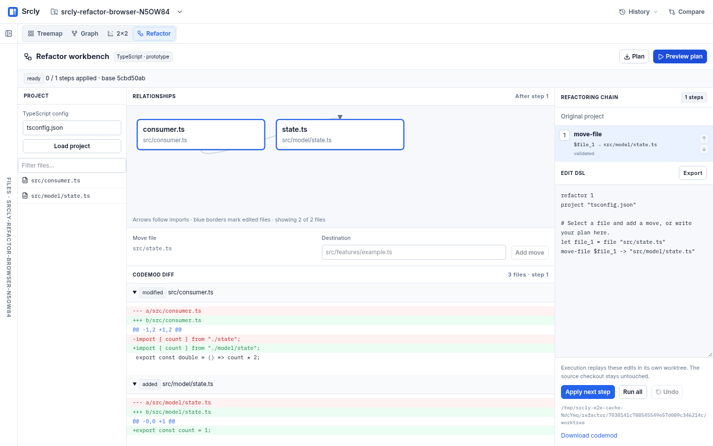
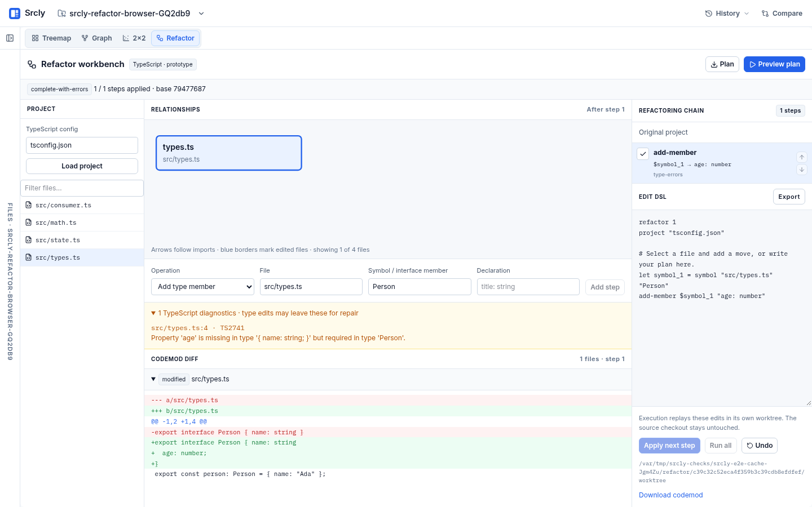
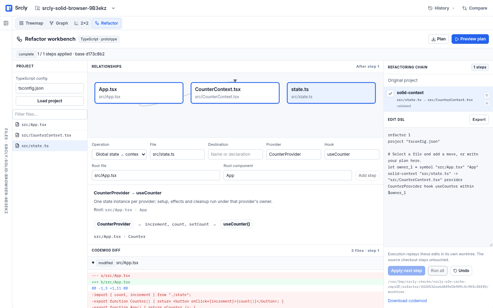
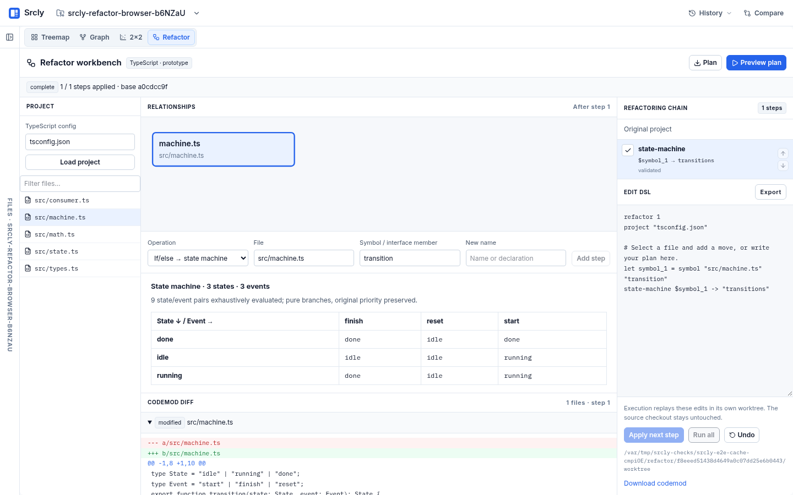
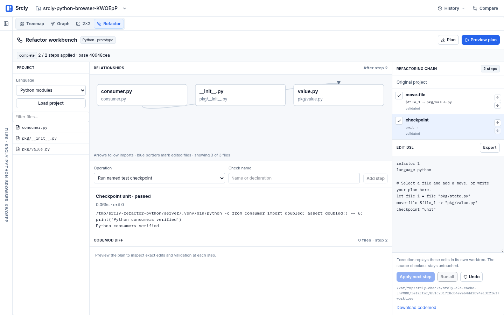

# Executable visual refactoring

The Refactor view and an agent submit the same `.srcly` plan to the same compiler.
The compiler produces exact code edits and diagnostics. Execution replays the
recorded codemod in an isolated Git worktree; it never asks an AI to rewrite code.

The design interview chose a relationship graph, ordered chain and per-step
diffs; a concise DSL; logical handles that survive moves; fail-closed operation
checks; whole-chain simulation; and persistent reversible checkpoints. The source
must be a clean commit. Editing the source or plan invalidates its preview.

## First executable slice

Open **Refactor**, load one leaf TypeScript config, select a file, supply its new
path and add the move. The form and DSL describe one plan. Preview simulates the
whole chain and checks TypeScript before and after every step. Select any step to
inspect its import graph and exact diff. Apply next step, Run all and Undo operate
on the recorded edits in the displayed worktree. The source checkout is untouched.
The last plan and run survive a browser reload, and journals survive server restarts.



```text
refactor 1
project "tsconfig.json"
let state = file "src/state.ts"
move-file $state -> "src/model/state.ts"
move-file $state -> "src/domain/session.ts"
```

Paths are relative to the scanned project. Quotes allow spaces; `#` starts a
comment. Declarations precede steps. `$state` follows its file through the chain.
The parser rejects unknown commands, duplicate or missing handles, and unsafe
paths with a line number. Up/down controls change execution order; preview checks
the resulting order. TypeScript's language service updates imports and re-exports,
including aliases, and diagnostics gate each intermediate result.

## Agent contract

1. `GET /api/refactor/project?path=<absolute root>&config=tsconfig.json` supplies the
   file/import graph and baseline compiler diagnostics.
2. `POST /api/refactor/parse` with `{path, source}` parses the DSL without changes.
   Failures return `detail: {code, message, line}`.
3. `POST /api/refactor/preview` with the same body compiles the full chain. A
   blocked run includes `diagnostics`, the failing line, completed previews and a
   reason. A ready run includes its `id`, base commit, graphs and per-step diffs.
4. `GET /api/refactor/runs/<id>/codemod` exports `srcly-codemod-1`: the plan,
   base commit, exact before/after contents and modes, validation results, and
   the execution endpoint. This artifact describes the registered run; editing
   a downloaded artifact does not change what execution applies.
5. `POST /api/refactor/runs/<id>/execute` with `{mode: "next" | "all" | "undo"}`
   replays or reverses the stored edits. `GET /api/refactor/runs/<id>` resumes
   inspection. Execution refuses changed source or worktree contents.

An agent can iterate on the DSL and diagnostics, then execute the approved
codemod. It does not have to discover or patch every import itself. The compiler
process is memory bounded and separate from the read-only data-flow worker.

## Execution and limits

Journals live beside srcly's analysis cache under `refactor/<run id>/run.json`.
The source commit, source fingerprint, execution fingerprint and every edit's
exact bytes and file mode are preconditions. An fsynced write-ahead record lets a
partially applied step restore its prior checkpoint after interruption; unknown
edits are refused. A failed preview reverses its completed steps and remains
non-executable. Preview interruption also remains non-executable.

Installed packages are linked inside ordinary `node_modules` directories in the
worktree, retaining directory-based Git ignore rules. They are never edit targets.
One tsconfig, source files up to 2 MB
per edited file, and at most 100 steps are supported initially. Project references
require choosing a leaf config. Computed dynamic imports and files observing
their own location (`import.meta`, `__dirname`, `__filename`) are refused.
TypeScript validation is a compiler check, not a proof of runtime equivalence.
Asset loading, build-tool conventions, external consumers and test commands are
outside this first operation's guarantees.

The semantic operations below cover global state → provider-owned context →
consumer hook, constrained code extraction, and finite state machines derived
from reducer-style conditional trees. Each names its supported shapes and refuses
missing evidence. Python uses the same plan and journal with a module/import
adapter. The graph currently shows file imports plus ownership/transition
evidence; it does not yet overlay the full data-flow analysis graph.

Acceptance: `server/tests/test_refactor.py` exercises real compiler edits through
aliases, re-exports and TSX, chained handle moves, stale-input refusals, failed
preview rollback and interrupted execution recovery. `client/e2e/refactor.spec.ts`
drives the real app through preview, apply, reload and undo and captures screenshots.

## Symbols, extraction and type edits

The operation picker and `srcly refactor catalog` now expose symbol moves,
symbol/interface-property renames, function and display-only component extraction,
and adding, updating or removing types and type members. Use symbol handles for
declarations (`"Props.title"` names an interface member) and selection handles for
unique exact source text. Quoted strings use JSON escapes, including `\n` for a
multiline selection. An extraction changes its handle into the generated symbol;
a nested extracted component has a qualified handle such as `Card.Details`.

```text
refactor 1
project "tsconfig.json"
let formula = selection "src/math.ts" "x * 2 + 1"
extract-function $formula -> calculate
rename $formula -> compute
move-symbol $formula -> "src/math/compute.ts"
```

Moves refuse local dependencies with the `dependencies-required` diagnostic,
listing names and suggested declarations/steps. The UI can insert a suggestion
before the blocked move. `reexport` on a named symbol move retains its old public
entry point. A move of a nested closure requires an explicit interface for its
captured variables. Initial component extraction accepts intrinsic display-only
markup with lexical reads; calls, child components, refs, directives and spreads
are named refusals. These constraints are part of the operation, not guesses made
by the agent. `server/tests/test_refactor_operations.py` covers the real compiler.

Type edits deliberately differ from structural operations. The user can add a
required member and let TypeScript enumerate the broken consumers:

```text
refactor 1
let person = symbol "src/types.ts" "Person"
add-member $person "age: number"
```

The result is `ready-with-errors`, then `complete-with-errors` when applied. Every
diagnostic is visible by file, line, code and message. These are executable type
edits and explicit repair work. `update-member $person "age?: number"` can resolve
those errors in a later step. `remove-member`, `add-type`, `update-type` and
`remove-type` use the same policy. Syntax/config errors always block. Other
operations cannot introduce new compiler errors. Default-value insertion is not
implemented; it needs a separate value-generation policy.



## Headless agent workflow

```sh
srcly refactor catalog
srcly refactor project --path /absolute/project --config tsconfig.json
srcly refactor parse plan.srcly
srcly refactor preview plan.srcly --path /absolute/project
srcly refactor codemod RUN_ID > codemod.json
srcly refactor apply RUN_ID             # next step
srcly refactor apply RUN_ID --all
srcly refactor undo RUN_ID
srcly refactor show RUN_ID
```

All output is JSON. Invalid or blocked plans exit with status 2 and structured
diagnostics. The codemod artifact includes its execution command. The CLI and
server use the same persistent runs, with an OS file lock per run so an agent and
the UI cannot apply a step simultaneously. There is no model call in execution.

## Solid ownership and finite state machines

A context step moves a whole state module into a factory evaluated inside a Solid
provider. The selected root becomes a provider facade around its original content,
so state reads in the root also run below the provider. Named consumer imports
become hook calls at the start of their owning component or hook. Signal accessors
are retained; setup order, effect bodies and cleanup bodies are copied unchanged.
This deliberately changes singleton state to one instance per provider.

```text
refactor 1
let app = symbol "src/App.tsx" "App"
solid-context "src/state.ts" -> "src/CounterContext.tsx" provider CounterProvider hook useCounter within $app
```

The prototype accepts named function components/hooks and const signal/store
modules. It checks direct component/hook reachability from the selected root and
refuses uncovered consumers, escaping callbacks, state re-exports, module-scope
reads and unsupported roots. Higher-order components, namespace imports, arrow
component owners and arbitrary provider topology require additional evidence.
Imported dependencies keep their existing module lifetimes. The preview records
the ownership change and every rewritten consumer. Runtime acceptance compiles
the emitted TSX with Solid's JSX transform and verifies independent state,
reactive effects, disposal and missing-provider errors against the reactive core.
File/symbol handles follow the factory conversion and later moves/renames.

```text
refactor 1
let reducer = symbol "src/machine.ts" "transition"
state-machine $reducer -> transitions
```

The machine operation accepts a synchronous function over two explicit finite
string unions: state and event (at most 32 values each). Its pure grammar is
if/else, blocks, returns, strict comparisons and boolean guards. It interprets all
state/event pairs without evaluating user code, preserves branch priority and
requires a total result in the state domain. Effects, unknown predicates and
missing returns block. The generated typed table lives inside the function to
preserve initialization/hoisting behavior. Computed keys preserve literal keys
such as `__proto__`. The app shows the entire transition matrix and the exact diff.
Equivalence is established over the declared TypeScript input domain; untyped
runtime inputs and effectful state machines need a separate model.




## Python adapter and named test checkpoints

The same plan model now has a Python adapter. Select the Python import root in
srcly (the repository root or its `src` directory), then choose Python modules.
Rope proposes module edits without writing them; the existing journal owns all
writes, preconditions, replay, undo and crash recovery. Moves and renames use the
same file handle. A combined move and rename is expressed as two steps.

```text
refactor 1
language python
let maths = file "pkg/math.py"
move-file $maths -> "pkg/model/math.py"
move-file $maths -> "pkg/model/arithmetic.py"
checkpoint unit
```

The initial adapter supports ordinary UTF-8 `.py` modules and existing regular
packages with inert `__init__.py` files. Aliased imports, from-imports and relative
imports are rewritten. Python parsing and local import-edge preservation gate
every step. This is not a Python type checker: configure mypy as a checkpoint when
needed. Dynamic imports/evaluation, module-identity reads, namespace packages,
package-directory moves, package initialization effects and missing destinations
are named refusals. No project code is executed to infer Python imports. Both
adapters run in bounded child processes. The catalog names the supported language
operations; `srcly refactor project --language python --path /project` is headless.

Configure test gates in a committed `.srcly-refactor.json` at the selected root:

```json
{"checks":{"unit":["pnpm","test"],"types":["pnpm","typecheck"]}}
```

A `checkpoint unit` step runs that argv in the isolated worktree during both
preview and execution, with no shell and a 120-second timeout. The journal records
the exit code, duration and bounded output. Failures stop before the next step;
earlier applied steps remain reversible. A type-edit plan can intentionally leave
compiler errors, but an explicit type-check checkpoint still fails on them.
Commands that change tracked or nonignored files are refused. Unknown command
edits are retained for inspection rather than overwritten during rollback. Test
commands can have external effects; use the repository's normal test commands.
Ignored caches and linked installed dependencies are shared conveniences, not a
security sandbox. Test checkpoints are repeatable gates, not reversible external
actions.



### Review workspace and agent handoff

The Refactor view keeps the ordered plan beside a focused review surface. **Add step** opens a target picker and operation editor. **Changes** shows one file's exact diff at a selected step; validation evidence and type-repair diagnostics expand in place. **Relationships** inspects that same step's graph. **DSL** supports direct editing, import/export, error feedback and Ctrl/⌘ Enter to preview. Step controls reorder, remove, or select the corresponding DSL line. Narrow screens expose the same plan through a Plan button and step selector.

**Agent handoff → Copy agent brief** includes the current DSL, project path, compiler feedback and catalog/parse/preview commands. An agent runs `srcly refactor preview plan.srcly --path <project>`; its JSON result now contains `reviewPath`. Open that path on the running app's origin, paste its run ID/link into the handoff panel, or select it from recent runs. CLI and app must use the same machine and cache configuration. `GET /api/refactor/runs?path=<project>` lists the latest 20 journals for that exact source root without recovering or changing their worktrees. Opening a run uses the existing recovery path.

The action bar advances from preview to apply-next/run-all, with undo for applied steps. Editing a plan invalidates its preview. Opening a different saved run or importing a plan preserves the previous draft for restoration in the DSL editor; reloading a changed local draft does not replace it with its old run. Run links identify the exact journal, not a recompiled approximation. A changed source checkout still blocks execution through the executor's existing fingerprint checks.
