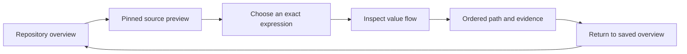

# Srcly to value-flow investigation

Build a value investigation workspace inside Srcly. Open it from a pinned source preview. Use an ordered evidence ledger for deep explanations. Keep tsx-data-flow as the semantic engine, behind one Node child that Srcly starts on demand.

This is a reviewed design proposal. It does not authorize implementation. Only Srcly and tsx-data-flow are in scope.

## Read the packet

- [Implementation plan](../../intent/data-flow-integration/implementation-plan.md): two delivery milestones and acceptance criteria.
- [Recommendations](recommendations.md): all 18 Pro recommendations and their dispositions.
- [Verification](verification.md): code checks, limits, and source references.
- [Original research conversation](https://chatgpt.com/c/6adc0a99-0844-83e9-b309-74996708456a): full report, layouts, contract examples, and downloads.
- [Submitted prompt](pro-prompt.md) and [run record](run-record.md).

## The proposed journey

Treemap, dependency, hotspot, and finding entries supply a location and a reason to inspect it. They do not identify a value automatically. A folder or aggregate edge first resolves to a concrete source occurrence.

The preview shows the source excerpt, selected expression, enclosing symbol, and initiating metric or finding. Hover keeps its current low cost. Explicit inspection starts compiler work. A missing result says **Not analyzed**, not **0 consumers**.

The investigation keeps a compact repository locator, a destination list, an ordered path, and source evidence. Each row explains an input, transfer, fallback, branch, transform, terminal, or analysis boundary. Return and browser Back restore the same overview state. Forward restores the investigation.

| Wide workspace region | Content |
| --- | --- |
| Header | Origin, selected expression, direction, content status, Return |
| Compact locator | Original focus, current file, exact consumers, unresolved boundaries |
| Main ledger | Ordered steps, explicit branches and defaults, expandable helper frames |
| Evidence inspector | Source span, types, proof records, assumptions, stopping reason |

At intermediate widths, use an evidence drawer. At narrow widths, show one ledger with persistent origin and Return controls.

## What changes the decision

**The tools answer different questions.** Srcly's import graph and metrics show where to look. They do not prove value transfer. tsx-data-flow has both render-path analysis and newer program/route/field evidence. These layers cannot share one undifferentiated proof badge.

**Current deep analysis is useful but uneven.** Imported helpers and parameter binding exist beyond the older analyzer documentation. However, the exact selected-source field lane requires a proven `node:fs/promises.readFile` source. Some carriers also recognize specific application paths. An arbitrary Srcly expression needs a bounded selection API; a deep link alone cannot supply it.

**The present canvas does not explain operation order.** Its display layout projects component surfaces and an optional field origin. Its internal evidence-node and evidence-edge arrays are empty. This source fact supports a ledger-first design. It is not a browser diagnosis or a usability test.

**Call identity is a key precision risk.** Generic collection connects arguments to shared parameters and returns to calls. Slice traversal has no invocation stack. Unrestricted reachability could mix separate invocations. Treat this as a source-based inference, not an executed failure of specialized field proof.

These findings were checked against current source. See [verification](verification.md).

## Alternatives

Scores below are Pro's design judgments on a five-point scale. They are not measured results. Weights: orientation 30%, fidelity 25%, distribution 15%, effort 15%, visual clarity 15%.

| Surface | Score | Disposition |
| --- | ---: | --- |
| Dedicated Srcly workspace consuming analyzer evidence | 4.40 | Build: preserves orientation and permits a simpler explanation |
| Embed the existing frontend or extract shared UI | 3.35 | Avoid initially: imports another navigation system and component canvas |
| Open the separate tool through a deep link | 3.05 | Defer as a diagnostic option: leaves two sessions and a weak return journey |

For the runtime, prefer one lazy Python-owned Node child over a new compiler process per selection. Reuse the existing server, worker, and cache. Start with a configured, prepared analyzer checkout. Srcly's Python installation does not supply Node or TypeScript. [uv documents its isolated tool environments](https://docs.astral.sh/uv/guides/tools/).

An evidence artifact remains useful for later saved results. It cannot alone provide live selection and expansion. Do not merge the repositories, port semantics to Python, or create a plugin platform for this proof.

## Evidence rules

Keep three answers separate: **connectivity**, **coverage**, and **value properties**. A local proven segment can coexist with an unknown upstream origin.

- Preserve valid defaults. `??` keeps zero and empty strings; `||` can replace them.
- Keep nullability separate from finiteness, schema validity, and domain constraints.
- Keep assertions separate from runtime checks.
- Keep target field identity separate from collection-membership dependencies.
- Show unsupported, stale, cancelled, and budget-limited states explicitly.
- Keep terminal occurrence and invocation identity when display nodes are grouped.

CodeQL's [path queries](https://codeql.github.com/docs/writing-codeql-queries/creating-path-queries/) require explicit sources, sinks, and connecting steps. JetBrains' [data-flow inspection](https://www.jetbrains.com/help/idea/analyzing-data-flow.html) starts from a concrete identifier and supports direction and source navigation. These principles support the design; they do not establish equivalent TypeScript coverage.

## Delivery and open questions

M1 proves the complete local journey using `HotSpotItem.tsx:135`, its distinct title occurrence, the rank fallback, and a partial metric explanation. M2 proves `HotSpotList.tsx:88` through the shared `row` helper to the name terminal. The separate N/A invocation at line 109 must remain isolated.

The hard questions are the small supported syntax set, correct target Program, actual cold/warm costs, and eventual packaging. A tiny branch graph must earn its place through a real example. None requires another broad research phase before the first proof.

Both applications, analyzers, tests, builds, and browser journeys remain unexecuted in this research run. Visual causes and call-contamination risks remain source-based inferences. No follow-up Pro message was needed.
