# Library-specific code in the data-flow engine

Byron's question: "I am worried that extending this to cover more patterns requires adding huge amounts of custom code for every library that is supported. Can we do better?"

Short answer: yes. Most library knowledge is already data (286 rows in `engine/models/*.json`). The cost does not come from the rows. It comes from the row vocabulary: each new library shape adds a new row field, a new TypeScript reader, and a new emitter. A fixed vocabulary of access paths, plus flow edges that the libraries' own `.d.ts` generics propose, would make most new library support rows-only. Two engine concepts (a state cell and a component slot) would absorb the imperative code that remains.

Read on `origin/main` at `40cd9a68` (after #417 and #418), 2026-11-22. No engine file changed. The diagrams in `diagrams/` are Draftably 0.16.0 files; each PNG carries its `.draft` source (`npx draftably@0.16.0 extract`). The spike scripts and their raw output are outside the repo, in the session notes folder `lib-model-audit/`.

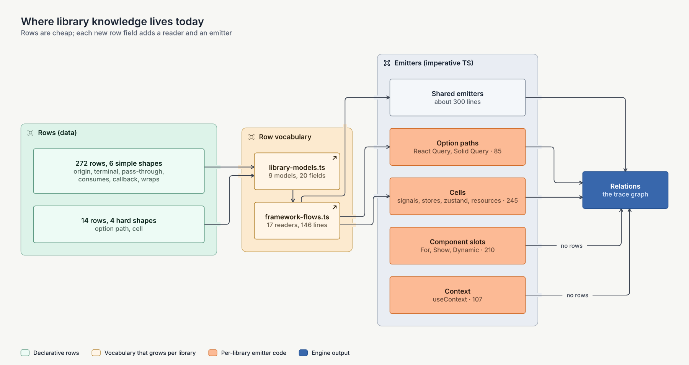

## Worked examples

These five pictures show the scope on real code. Read them before the numbers.

**What "custom code per library" means.** A Python `os.getenv` call needs one JSON row. A zustand store needs one row that only switches on 70 lines of TypeScript. Every hard library today looks like the right side.

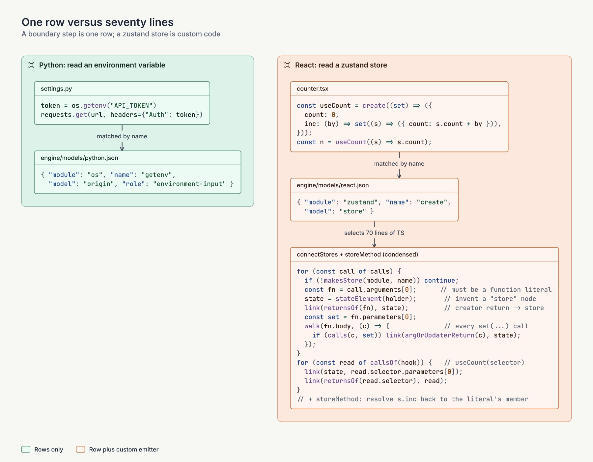

**Why the hard ones are hard.** The engine must invent a node that no line of code names (the store's state), then join every `set(...)` write to every selector read. The proposed cell row says the same thing as data. The same row shape covers `createSignal`, `useState`, `useReducer`, `createStore` and `createResource`.

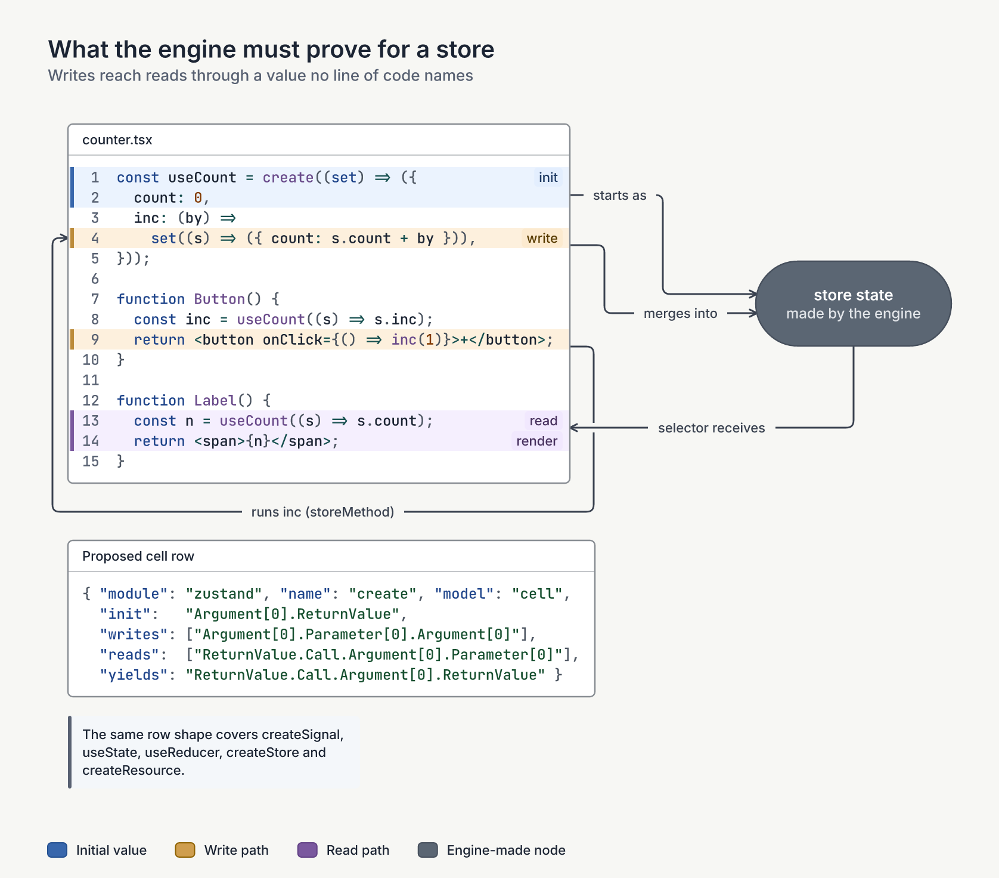

**How the vocabulary grows.** Today a row for a new library often needs a new field (`option`, `field`, `selector`, `hands`), and each field needs its own reader and emitter. With access paths, the same facts are a list of strings that one emitter reads.

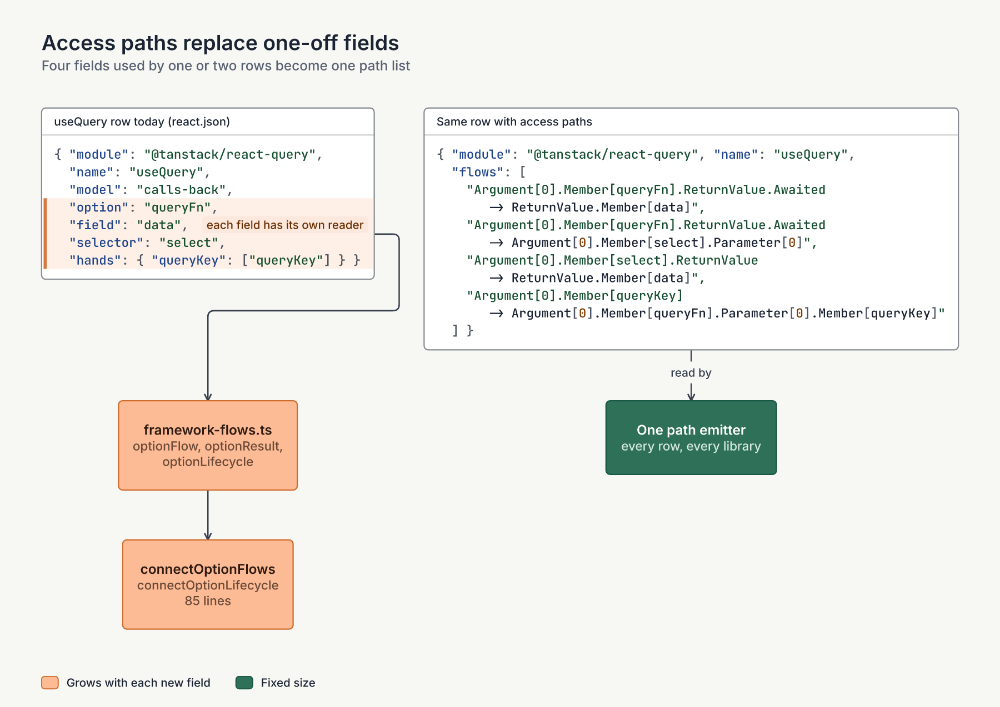

**What the types can and cannot do.** `useMemo` and `indexArray` say in their signatures that the callback's return becomes the result, so no row is needed to find the path. `useContext` ties the result only to the context object, which holds the default. Solid's source shows the value is the nearest provider's value, and the default only when no provider exists. The types see half the flow, so a type-proposed step stays `assumed`.

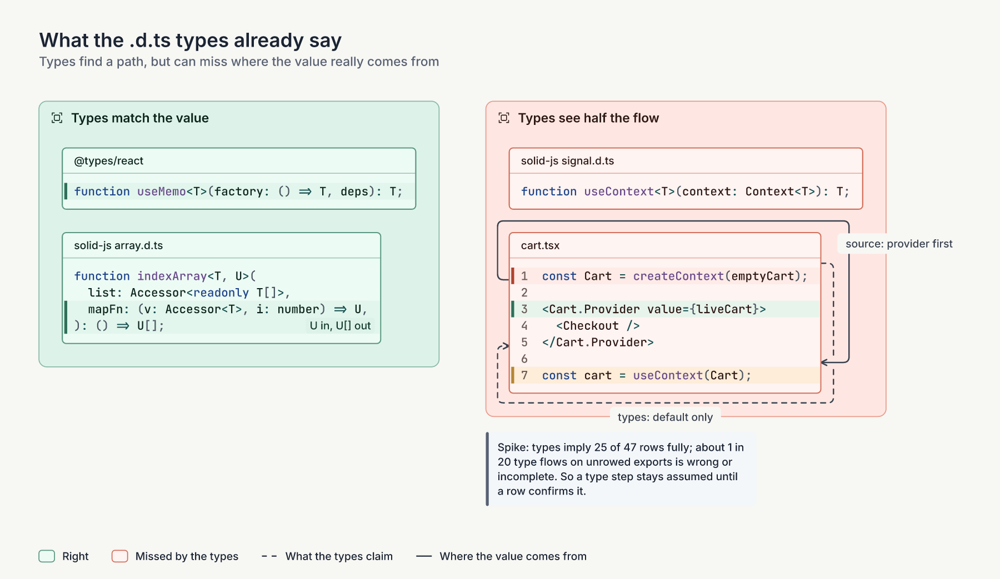

**One rule for context and caches.** Context, the React Query cache, `localStorage` and event emitters all write a value under a key and read it back elsewhere. One keyed-store rule joins them. A key that the code computes cannot prove the join, so it stays `assumed`.

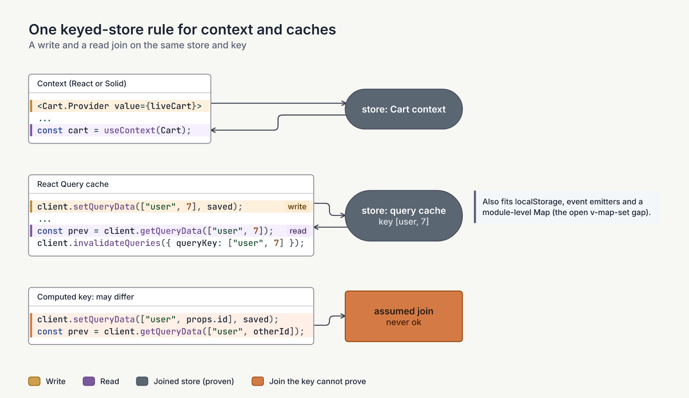

## 1. Inventory

### Declarative rows

| File | Rows | Libraries | What the rows encode |
| --- | ---: | --- | --- |
| `engine/models/python.json` | 128 | stdlib, logging, requests, httpx, sqlalchemy, sqlmodel, django, flask, starlette, pandas, rest_framework | 60 origins, 61 terminals, 7 pass-throughs |
| `engine/models/ecmascript.json` | 48 | TypeScript `lib.*.d.ts` | 30 `calls-back` (`map`, `then`, timers), 18 `consumes` |
| `engine/models/solid.json` | 38 | solid-js, solid-js/store, @solidjs/router, @tanstack/solid-query, @solid-primitives | 12 `calls-back`, 10 `wraps`, 5 query options, 5 pass-throughs, 2 state pairs, 2 terminals |
| `engine/models/node.json` | 35 | node:fs, http, https, globals | 18 origins, 17 terminals |
| `engine/models/web.json` | 17 | DOM lib, globals | 14 `consumes`, 2 origins, 1 terminal |
| `engine/models/react.json` | 14 | react, @tanstack/react-query, zustand | 4 query options, 3 `wraps`, 3 `calls-back`, 2 state pairs, 1 store, 1 pass-through |
| `engine/models/utilities.json` | 6 | lodash, lodash-es, lodash.debounce, lodash.throttle | 6 `wraps` |
| **All** | **286** | | **161 origin or terminal rows (56%)** |

Rows cost little: about 1 to 4 JSON lines each, with a `note`. The 121 Python origin and terminal rows show the good case. #403 added 368 row lines and closed most of the Python catalog's boundary patterns with no new engine code.

### The row vocabulary

The schema (`engine/models/library-models.schema.json`, `engine/src/analysis/library-models.ts`, 171 lines) has 9 models and 20 fields. Usage is very uneven:

| Field | Rows that use it |
| --- | ---: |
| `role` | 161 |
| `returns` | 44 |
| `args` | 43 |
| `parameters` | 27 |
| `option` | 9 |
| `writes` | 8 |
| `accessor` | 7 |
| `source` | 6 |
| `settles` | 4 |
| `hands`, `field` | 3 each |
| `selector`, `result`, `observers` | 2 each |
| `with`, `lazy`, `contextFrom` | 1 each |

Nine fields serve 3 rows or fewer. Each one has its own reader in `engine/src/analysis/framework-flows.ts` (146 lines, 17 exported readers) and its own emitter in the collector. The `store` model has 1 row (`zustand.create`) and 70 lines of emitter (`connectStores`, `storeMethod`).

### Imperative TypeScript

An AST scan of `engine/src` found 114 functions and top-level constants that name a package, a framework API as a string literal, or call a row reader. They hold 2,714 lines. The count is an upper bound: a large function counts in full when one line names a library (`processJsx`, 130 lines; `processVariable`, 116 lines).

| Area | Lines | Functions |
| --- | ---: | ---: |
| Trace path (`program-evidence-*`, `value-origin.ts`, `framework-flows.ts`, `library-models.ts`, `srcly/`) | 1,228 | 65 |
| Legacy route report (`route-*`, `solid-route-*`, `scope-adapters/`, `repeated-forks/`, `semantic-context.ts`, `reports/`) | 1,470 | 48 |

The legacy route report is SolidStart-specific by design (about 16,000 lines in `route-*` and `solid-*` files). It is not on the trace path that the catalog grades. This study leaves it out.

The trace-path code, by library, without the large functions that only mention one name:

| Library | Lines | Code | What it encodes |
| --- | ---: | --- | --- |
| Solid JSX components and props | 210 | `connectSolidFor` (82), `connectSolidShow` (46), `propsViews` (`splitProps`, `mergeProps`, 43), `isSolidShow`, `isSolidComponent`, `dynamicComponent` | The framework calls a child or attribute function with a value (`<For each>`, `<Show when>`); props pass through |
| Solid `createResource` | 140 | `transportCandidates` (99), `collectResourceResultCarriers` (29), `resourceFlow`, `isResourceFactory` | A loader's return becomes a cell that an accessor reads |
| React and Solid context | 107 | `contextMethodBinding`, `connectContexts`, `contextMethod`, `collectContextRead`, `contextKey`, `readsContext`, `providedContext`, `derivedStateMember` | A provider's value reaches each `useContext` read |
| React Query and Solid Query options | 85 | `connectOptionLifecycle` (47), `connectOptionFlows` (29), `optionProperty` | An options key's function return becomes a result field; observers get the result |
| zustand | 70 | `connectStores` (45), `storeMethod` (25) | A creator's return and its `set` writes become a store that a selector reads |
| State pairs (React and Solid) | 33 | `program-evidence-state-pairs.ts` | Setter writes reach getter reads |
| Shared row readers and emitters | about 300 | `framework-flows.ts`, `connectFrameworkFlow`, `connectPromiseChannels`, `value-origin.ts` readers, `accessorProp` | Turns a row's fields into relations |
| Name lists | about 60 | `FRAMEWORK_CALLS`, `STATE_CALLS` and `FRAMEWORK_PACKAGE` (`srcly/typescript-host.ts`), `URL_READS`, `FETCHER_CALLS`, `SERVER_WRAPPERS` (`srcly/scope-roles.ts`) | Names that duplicate rows, for labels and scope roles |

### Imperative Python

`engine/python/srcly_pyfacts.py` (2,850 lines) holds about 300 lines of framework code: FastAPI and Flask route discovery (`route_of`, 59), FastAPI parameter binding (`fastapi_binding`, `fastapi_markers`, about 60), about 40 lines of tables (`FASTAPI_*`, `MODEL_BASES`, `SETTINGS_BASES`, Django manager calls, `QUERY_RESULT_*`, `FORWARDING_CALLS`), and about 140 lines of uses spread through the walker. Its origins and terminals are already rows.

## 2. Shapes

What every row and every imperative rule says fits 10 shapes. The first 6 are value summaries: a fact about one call. The last 4 relate several program points.

| # | Shape | Example | Rows | Imperative code |
| --- | --- | --- | ---: | --- |
| 1 | **Origin**: the result is where a value enters | `os.getenv`, `fs.readFile` | 81 | none |
| 2 | **Terminal**: an argument leaves the program | `print`, `res.send`, `useNavigate()(…)` | 80 | none |
| 3 | **Pass-through**: the result derives from arguments or the receiver | `trim`, `unwrap`, `useDeferredValue` | 13 | none |
| 4 | **Consumes**: arguments are used; the result is unrelated, or the receiver keeps them | `push`, `Map.set` | 32 | none |
| 5 | **Callback**: argument N reaches callback parameter M, and/or the callback's return is the result | `map`, `then`, `createMemo`, `on(src, fn)`, `useEffect` | 47 | `connectPromiseChannels`, readers |
| 6 | **Wraps**: the result is a function that runs argument N | `useCallback`, `debounce`, `action` | 19 | readers in `value-origin.ts` |
| 7 | **Option path**: an options key's function return becomes a result field | `useQuery({ queryFn })` → `data` | 9 | 85 lines |
| 8 | **Cell**: writes through one handle reach reads through another | `createSignal`, `useReducer`, zustand `create`, `createResource` | 5 | about 245 lines |
| 9 | **Component slot**: the framework calls a JSX attribute or child function with a value | `<For each>`, `<Show when>`, `<Dynamic>`, `<ErrorBoundary fallback>` | 0 | about 210 lines |
| 10 | **Context**: a provided value reaches every read below it | `useContext` | 0 | 107 lines |

Shapes 1 to 6 hold 272 of the 286 rows (95%) and almost no library-specific code. Shapes 7 to 10 hold 14 rows and about 650 lines of imperative TypeScript. That is where per-library cost grows.

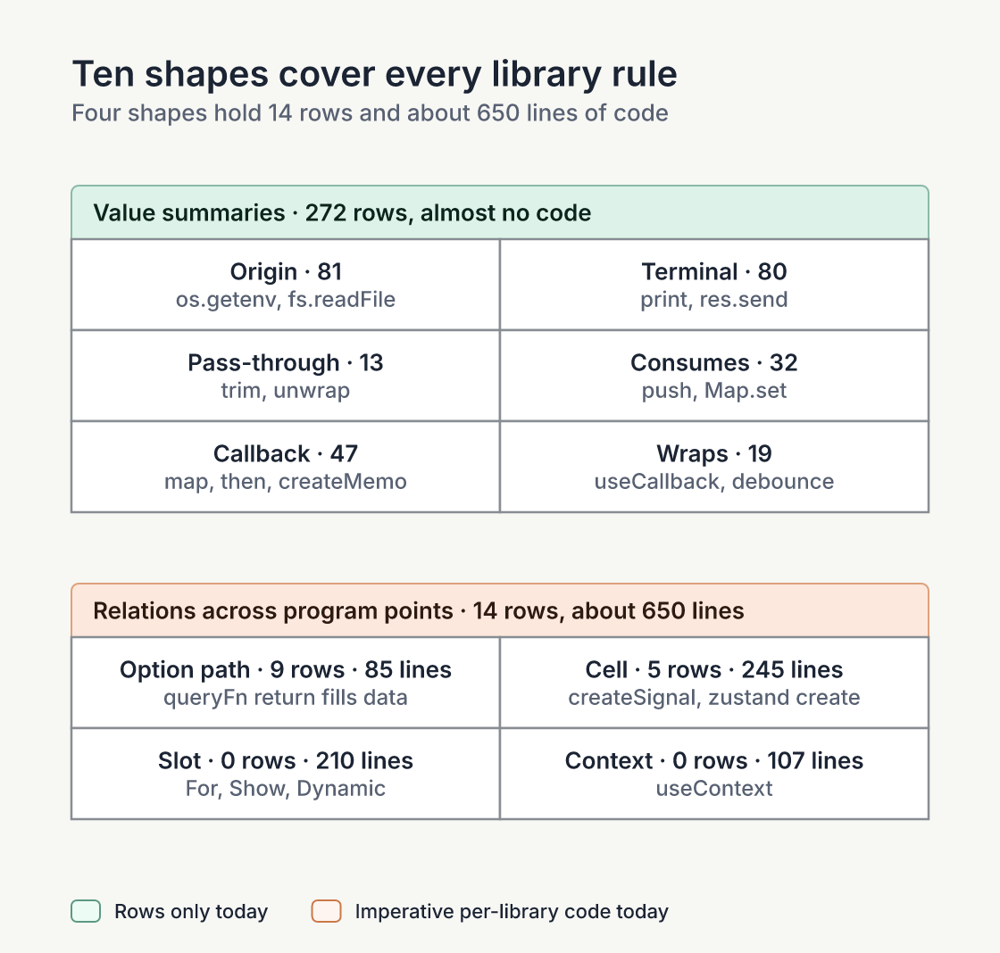

## 3. Growth

Lines added per recent catalog PR, by area. "Engine TS" includes general rules, not only library code.

| PR | Rows | Row readers | Python helper | Engine TS | Fixtures |
| --- | ---: | ---: | ---: | ---: | ---: |
| #418 Python scope, closures, partial, library rows | 49 | 0 | 411 | 0 | 0 |
| #417 props across spread, lazy, HOC, Dynamic | 0 | 0 | 0 | 273 | 113 |
| #405 a hook's result holds only what its row names | 54 | 64 | 0 | 75 | 61 |
| #404 58 Solid patterns, router ends, model rows | 57 | 10 | 0 | 90 | 118 |
| #403 Python catalog and five Python rules | 368 | 0 | 113 | 0 | 0 |
| #336 a query's data holds the fetched value | 8 | 18 | 0 | 49 | 49 |
| #331 standard callback parameters by role | 356 | 14 | 0 | 48 | 6 |
| #328 a promise's outcomes on separate channels | 32 | 24 | 0 | 82 | 95 |
| #319 each Solid call its own kind of result | 14 | 33 | 0 | 48 | 67 |
| #318 a React effect has no value | 4 | 15 | 0 | 42 | 38 |
| #304 trace a value through a zustand store | 7 | 9 | 0 | 98 | 15 |
| #276 framework calls are library-model rows | 432 | 80 | 0 | 30 | 0 |

Two patterns show:

- Where a library step fits shapes 1 to 6, the fix is rows. #403 and #331 added more than 350 row lines each and little code.
- Where a step needs a new field or shape 7 to 10, each pattern costs 40 to 100 lines of reader and emitter code. zustand (#304) took 98 lines for 1 pattern. React Query took #250, #318, #336 and #405.

### What the open workers plan

The three parked diagnoses (`zustand`, `react-query`, `solid-router`) cover 25 catalog patterns:

| Kind of fix | Patterns | Examples |
| --- | ---: | --- |
| General rule, no library name | 9 | destructured hook result, context through a custom hook, `this` in a store getter, `createRoot` return pairing, JSX child as `children` |
| Catalog anchor or `@want` fix | 4 | `q-closure` re-anchor, `s-index`, `s-filter-memo` |
| Rows only, in today's vocabulary | 5 | `indexArray`, `QueryClient` methods (about 11 rows) |
| New field or model | 3 | `useSubmission` (new `submission` model), `with: accessor-element`, `returns: parameter` |
| Imperative library code | 4 | zustand middleware, slices and `getState`/`setState`; resource `mutate`/`refetch` |

Two workers already reach for types. The zustand plan finds middleware by the `StateCreator` alias in the signature, not by a name list. The React Query plan reads a library class method's package from its `.d.ts` path. Both are type-driven rules, but each is written for one library.

## 4. Spike: what the `.d.ts` generics already say

`typeshape.cjs` (in the notes folder) builds a small Program that imports every module the TypeScript rows name, from a real app's `node_modules` (family-finances for React, bible-daily for Solid). For each export's call signatures it reports:

- `returns:N`: argument N is a function whose return type uses a type parameter that the call's return type also uses (`createMemo<T>(fn: () => T): Accessor<T>`).
- `wraps:N` or `passes:N`: argument N's type is a type parameter that the return type uses (`useCallback<T>(cb: T): T`).
- `source:K->N.M`: argument K and callback N's parameter M share a type parameter.
- `effect:N`: the call returns `void` and takes a function at N.
- `option:N.key`: a function-typed key of an options argument ties its return to the result.

It does not build a Program on a repo; it reads only library types.

### Rows the types imply

| Result | Rows | Which |
| --- | ---: | --- |
| Types imply the whole row | 25 | `useMemo`, `useDeferredValue`, `useEffect`, `useLayoutEffect`, `useCallback`, `memo`, `createMemo`, `createDeferred`, `createRoot`, `untrack`, `batch`, `mergeProps`, `createEffect`, `createRenderEffect`, `createComputed`, `onMount`, `onCleanup`, `unwrap`, `createMutable`, `createAsync`, `createAsyncStore`, `query`, `cache`, `action`, `useAction` |
| Types imply part; a cell or option row still needed | 12 | `useState`, `createSignal`, `createStore`, `useReducer` (initial value only, not setter → getter); zustand `create` (creator return only); `mapArray`, `on` (return, not source); the 4 React Query hooks (`queryFn` among 4 to 5 candidate keys); `forwardRef` |
| Types imply nothing useful | 10 | `createSelector`, `children`, `splitProps`, `useNavigate`, `useSearchParams` (terminals), the 5 Solid Query hooks (options come from an accessor) |
| Not resolved (no types installed) | 11 | `@solid-primitives/*`, `lodash*` |

So 25 of 47 resolved rows (53%) are redundant with the types, and 12 more (26%) are partly redundant.

### Exports with no row

Of 146 callable exports in these modules with no row, 57 show a type flow. Spot checks:

- Right, and useful: `indexArray` (the open `s-index-array` gap), `useSyncExternalStore`, `catchError`, `runWithOwner`, `reconcile`, zustand `useStore`, `useRef`, `createElement`.
- Incomplete: `useContext` in React and in Solid. `useContext<T>(ctx: Context<T>): T` ties the result to the context object, so only the default in `createContext` reaches it. The source (`Owner.context[context.id] ?? context.defaultValue` in Solid) shows the nearest provider's value comes first; the types miss that flow. `useSubmission` is half right: its `result` holds the action's awaited return, but the type ties the whole result to the action.
- Too wide: the option scan finds `queryFn`, but also `select`, `placeholderData`, `initialData` and `structuralSharing`, and on Solid Query every `QueryClient` method. Some of those do feed `data`; some do not.

The key result for honesty: **a shared type parameter proves the same type, not the same value.** About 1 in 20 type flows is wrong or incomplete, and `useContext` is a common call. A type-inferred step can make a trace's path right. It must never make the outcome `ok` by itself.

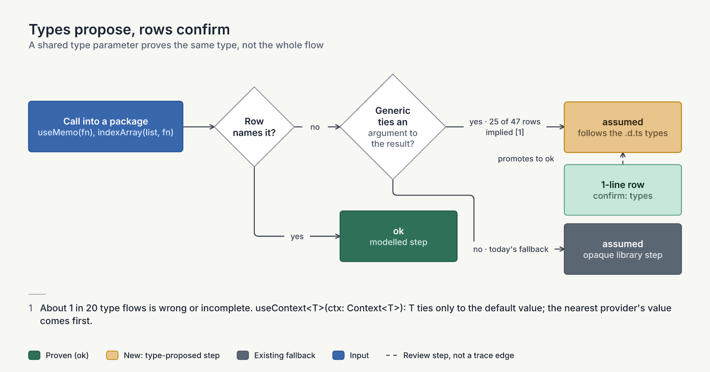

## 5. Options

Scores: coverage is patterns that work with no new row; risk is the chance of a false `ok`; deletion is existing code removed; residue is what still needs a hand row or code.

| Option | Coverage without new rows | False-`ok` risk | Code deleted | Residue |
| --- | --- | --- | --- | --- |
| **A. Access-path vocabulary.** Replace the 20 ad hoc fields with CodeQL-style paths: `Argument[0].ReturnValue → ReturnValue`, `Argument[1] → Argument[0].Parameter[0]`, `Argument[0].Member[queryFn].ReturnValue → ReturnValue.Member[data]`. One emitter interprets every path. | Same as today; new libraries in shapes 1 to 7 become rows-only | None: a row is still a claim a person reviewed | `framework-flows.ts` readers (about 110 of 146), option emitters (85), `connectFrameworkFlow`, row-specific branches in `value-origin.ts`; about 250 lines, offset by a path emitter of about 100 | Shapes 8 to 10 |
| **B. Type-proposed flow.** Derive candidate paths from generics at each unmodelled library call. Emit them with a new proof kind (`type-signature`, strength `assumed`). | High: the 25 implied rows, plus `indexArray`, `useSyncExternalStore` and other unrowed exports, gain the right path | Low if the strength stays `assumed`; about 5% of proposals are wrong or incomplete | None at first. Each implied row becomes a 1-line confirmation; its shape fields go | Terminals, origins, cells, slots, context, and choosing among option keys |
| **C. Summaries from `node_modules` JS.** Analyse library code and cache a summary per package version. | Medium for small utilities (lodash, debounce); low for React, Solid and zustand, whose behaviour lives in a scheduler or a runtime | Medium: dynamic code and bundles defeat the analysis; a wrong summary looks proven | None | Every framework; plus memory cost on top of a 2 to 3 GB Program |
| **D. Wider default rule.** Treat every unmodelled package call as an `assumed` pass-through of all arguments. | Already true for dropped calls (`connectExternalCall`) and library-typed callees (`isExternalCall`) | None (stays `assumed`) | None | Gives wrong ends: the React Query diagnosis shows `getQueryData` ending at the key literal, not the cache |
| **E. Generated rows for review.** A script prints proposed rows for a package from its types, or from the stops a survey reports. | Same as B, but only after a person merges the rows | None: a person reviews each row | None | Review time per package |
| **F. Cell and slot concepts.** Two engine concepts with row shapes: a *cell* (a call makes a value; named handles write it; named handles read it) and a *slot* (the framework calls a component's attribute or child function with named values). | zustand, signals, stores, reducers, resources, `useSubmission` and `mutate`/`refetch` become cell rows; `For`, `Index`, `Show`, `Dynamic`, `ErrorBoundary`, `Suspense` become slot rows | None: rows are claims | Most of the 245 cell lines and 210 slot lines, offset by two emitters of about 150 lines together | Context (shape 10) stays code; it is one rule for both frameworks |
| **G. Summaries down to a primitive floor.** Analyse library JS only until it reaches primitives the engine models (`useSyncExternalStore`, `createSignal`, closures, `Promise`). zustand's `vanilla.ts` is about 100 lines of closure over `setState` and `getState`. | Good for libraries built on primitives: zustand, lodash, the router's `createAsync`, and Solid's own `For`, `Index` and `Show`, which are 5 to 15 lines on `createMemo` and `mapArray` (see 5c) | Medium: a summary looks proven when the analysis misses dynamic code | None | Needs the installed library at the right version; slots stay code |
| **H. Keyed-store shape.** One rule: a write and a read join when they reach the same store identity with the same constant key. | Context (Provider to `useContext`, keyed by the context object), the query cache (`setQueryData`, `getQueryData`, `invalidateQueries`), `localStorage`, event emitters, the open `v-map-set` gap | Low if a computed key (`["items", props.listId]`) stays `assumed` | The 107 context lines, offset by one emitter | Rows that say which calls write, read or clear a keyed store |
| **I. Runtime observation.** Wrap library exports during tests or catalog runs; record which argument shows up in which callback parameter or result; propose rows. | Medium, only for code paths that run | Medium: seen on some inputs is not proven | None | Needs runnable code; review of every proposal |
| **J. Rows written by an agent, gated by fixtures.** An agent writes each row with a negative annotated fixture; the exhaustive `@reaches` and `@stop` check is the gate. | Same as today's rows | Low: the negative fixture must fail without the row's limit | None | It fills the vocabulary; it does not shrink it |

### Recommendation

Do A, B, F and H, and use E and J to write rows. Skip C and I: C analyses too much, and I needs running code. G (summaries down to a primitive floor) is the strongest later step; section 5c shows which modelled libraries it would cover.

- **A** stops vocabulary growth. Every new library step that fits shapes 1 to 7 becomes data.
- **B** makes unmodelled libraries trace along the right path, so a trace reaches its real end with an honest `assumed`. A 1-line confirmation row then promotes a proposal to `ok`. Types propose; rows confirm.
- **F** turns the cell and slot emitters into two general ones.
- **H** turns context, and the cache patterns of query libraries, into one keyed-store rule.

After these four, a new library costs rows only, unless it adds a genuinely new shape. The Python FastAPI binding stays code, because it is a rule about program structure, not a library member. G is worth one spike on zustand later, to see whether its summary matches the cell row.

## 5b. Other engines, and analysing dependency source

Constraint from Byron: decide value flow from source only, the target's code and its dependencies' code. No runtime analysis and no traces. This rules out TASER (it runs test suites) and Jelly's approximate interpretation (a dynamic pre-pass).

| Engine | What it does better than srcly | Library knowledge | Fit |
| --- | --- | --- | --- |
| [CodeQL](https://codeql.github.com/docs/codeql-language-guides/customizing-library-models-for-javascript/) | Mature models-as-data with access paths (`Member[x].Parameter[0].ReturnValue`). Type models name a type once (`mysql.Connection` = `Member[createConnection].ReturnValue`), so every later use of that type is covered. For Java, C# and Go it generates summary models from library source (provenance `df-generated`), and hand rows override them. | Rows plus generated summaries | Cannot ship inside srcly: free only for open-source code on GitHub. Weak on React flow ([ReactAppScan](https://yinzhicao.org/reactappscan/reactappscan.pdf)); its newest hook model is `useRef` (CLI 2.24.0). No Solid. |
| [Pysa](https://pyre-check.org/docs/pysa-basics/) | Infers propagation automatically for any function whose body it can see, dependencies included. Models (`.pysa`) are needed only for code it cannot see. | Inferred from bodies; hand models for stubs | Python only, taint not values, same "unseen code propagates" default srcly uses. |
| [Jelly](https://github.com/cs-au-dk/jelly) | Analyses `node_modules` packages as code (points-to plus access paths), so calls through library code resolve with no model. | None needed for call resolution | BSD. Call graphs and library usage, not value traces. |
| [Joern](https://docs.joern.io/) | One code property graph for many languages; fuzzy parsing handles partial code. | Hand "semantics"; unknown externals over-approximate | Apache-2.0. Same library problem as srcly, with weaker JS types. |
| [Graph.js](https://github.com/formalsec/graphjs) | Fast npm package scanning with multiversion dependency graphs. | None | Does not follow external modules. |
| [StubDroid](https://dx.doi.org/10.1145/2884781.2884816) (research) | Infers data-flow summaries for a whole library statically, once, and reuses them. More precise and cheaper than hand models in its evaluation. | Generated, cached per library | Android, not JS. The method is the point. |

What the engines agree on:

- **Access paths are the standard row format.** CodeQL's tokens match option A almost word for word. Adopt its vocabulary rather than invent one.
- **Analyse what you can see; model only what you cannot.** Pysa and CodeQL's generated models both do this. Hand rows exist for code with no body: native code, runtimes, schedulers.
- **Type models multiply a row.** One row that says "`useQueryClient()` returns a `QueryClient`" lets the `QueryClient.*` method rows apply everywhere that type flows.

### What dependency source shows

zustand's whole runtime is about 80 lines of plain JS (`node_modules/zustand/esm/vanilla.mjs` and `index.mjs`). `setState` merges into a closure `let state`; `getState` returns it; the hook is `useSyncExternalStoreWithSelector(api.subscribe, api.getState, …, selector)`. Source analysis of zustand would reach the store with **no zustand row**, as long as the engine has two general abilities and one row:

1. A closure variable written by one function and read by another (`let state` in `createStoreImpl`): a general rule that also helps user code.
2. Following calls into `node_modules` packages, as Jelly does, with a per-version cache of summaries (StubDroid).
3. One row for the floor: `useSyncExternalStore` yields what `getSnapshot` returns (the `WithSelector` shim is also plain JS).

Middleware (`persist`, `immer`) is plain JS too, so it would come free. The open zustand worker instead recognises middleware by the `StateCreator` type alias.

React and Solid themselves are different. `useState` in `react.development.js` calls `dispatcher.useState`, which is set by the renderer at run time; Solid's reactive core is a scheduler. No source analysis sees through those, so the framework primitives stay hand rows (the cell, slot and keyed-store shapes).

This changes option C's score. Analysing *all* of `node_modules` is still too costly, but **summarising userland libraries down to a short list of framework primitives** is source-only, needs no rows for zustand-like libraries, and matches what Pysa and CodeQL do. A summary computed from source is a proof, so it can be `ok` where the analysis is complete, and `assumed` where it meets dynamic code.

Suggested spike: summarise `zustand` from `node_modules` source down to a `useSyncExternalStore` row, and compare the edges with today's `connectStores` on the `zustand-store.tsx` fixture. It needs the closure-variable rule first.

## 5c. Library intake applied to what we model today

The intake question: does this library have a body we can read, or is it a primitive (a runtime, a renderer's dispatcher, a scheduler, I/O)? Only primitives need hand rows. I read the installed source of each modelled library (`solid-js` 1.x in bible-daily, `@tanstack/react-query` 4.44 and `zustand` in family-finances, `lodash` in recipes-modern).

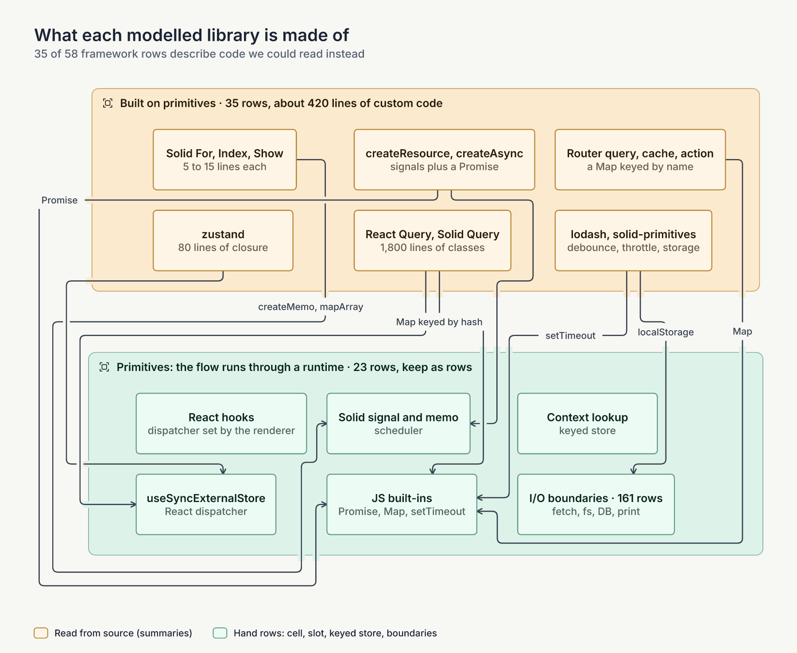

| Library | What its source is | Rows today | Custom code today | Verdict |
| --- | --- | ---: | ---: | --- |
| React hooks, `memo`, `forwardRef` | Calls into `dispatcher`, which the renderer sets at run time | 9 | state pairs 33 | Primitive: keep rows |
| Solid `createSignal`, `createMemo`, effects, `createStore`, `splitProps`, `mergeProps` | The reactive core: a scheduler and `Proxy` objects | 14 | | Primitive: keep rows |
| Context (React and Solid) | Solid: `Owner.context[context.id] ?? context.defaultValue`. React: the dispatcher | 0 | 107 | Primitive: one keyed-store row |
| I/O (fetch, fs, DB, print, Python boundaries) | Ends in native code or the network | 161 | | Primitive: keep rows |
| Solid `For`, `Index`, `Show`, `children` | 5 to 15 lines each on `createMemo` and `mapArray` | 1 | 128 | Built on primitives |
| Solid `createSelector`, `on`, `mapArray`, `createDeferred`, `onMount` | Plain JS on the reactive core | 5 | | Built on primitives |
| Router `createAsync`, `query`, `cache`, `action` | `createAsync` is `createResource(() => fn())`; `query` keeps a module `Map` keyed by name and arguments | 8 | resource 140 (shared with Solid) | Built on primitives; the `Map` is a keyed store with a computed key |
| zustand | 80 lines: a closure `let state` and `useSyncExternalStoreWithSelector` | 1 | 70 | Built on primitives |
| React Query, Solid Query | About 1,800 lines of classes in `query-core`: an observer on `useSyncExternalStore`, a cache `Map` keyed by a hash of the query key, a `Promise` retryer | 9 | options 85 | Built on primitives, but deep; the hashed key stays `assumed` |
| lodash, `@solid-primitives` | Closures on `setTimeout`; storage on `localStorage` | 11 | | Built on primitives |

What this shows:

- **23 of 58 framework rows are at the right layer.** They describe primitives that no source analysis can see through.
- **35 of 58 rows, and about 420 of the 650 hard lines, describe code we could read.** Solid's own components are the plainest case:

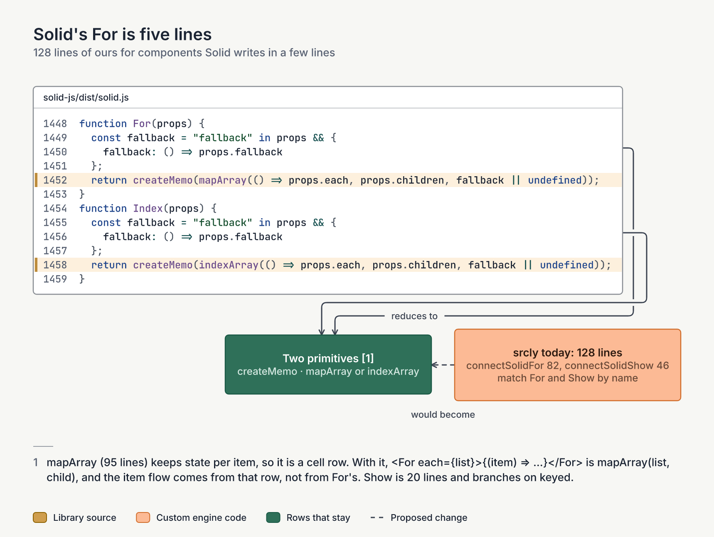

- **Reading the source corrects a claim.** The types made `useContext` look like "the default flows in". The source says the provider's value comes first and the default only when no provider exists. A hand rule written from types or from docs alone can get this wrong in either direction:

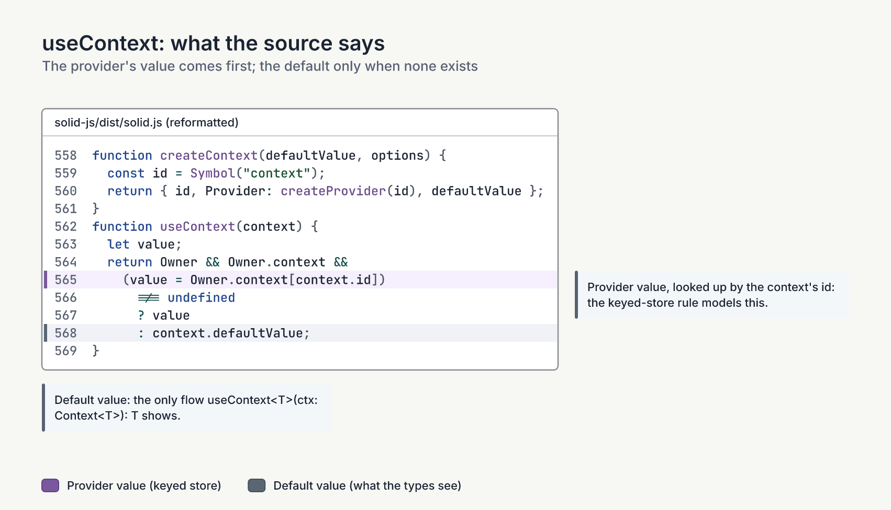

- **Computed keys are where honest `assumed` steps remain.** The router's `query` cache and React Query's cache both key a `Map` by a value computed at run time. Source analysis reaches the `Map` and stops there, which is the right answer.

## 6. Migration plan

Each stage is one PR. Each must keep `engine/test/srcly/fixture-annotations.test.ts` green and run `cd engine && pnpm survey-gate`. Run the pattern catalog (`node --import tsx scripts/pattern-catalog.ts`) before and after, and diff it.

| Stage | Change | Deletes | Proof of no regression |
| --- | --- | --- | --- |
| 1 | Add a `flows` field (access paths) to the schema. Write a converter from today's fields to paths. Add a test that, for every built-in row, the old readers and the path reader give the same answer. | Nothing yet | The equivalence test over all 286 rows; survey gate with no moves |
| 2 | One path emitter in the collector. Rows carry `flows` only. | The ad hoc fields, most of `framework-flows.ts`, `connectOptionFlows`, `connectOptionLifecycle`, `connectFrameworkFlow` | Survey gate: no moves. Catalog: same ends for every trace |
| 3 | Cell shape: `{ model: "cell", writes: [...paths], reads: [...paths] }`. Move `createSignal`, `useState`, `createStore`, `useReducer`, zustand `create`, `createResource` onto it. | `connectStores`, `storeMethod`, most of `program-evidence-state-pairs.ts`, `collectResourceResultCarriers` | Survey gate: no moves. The existing state, store, reducer and resource fixtures pass unchanged. Then add `useSubmission` and `mutate`/`refetch` as rows, with the negative cases the Solid diagnosis lists |
| 4 | Slot shape for JSX components. Move `For`, `Index`, `Show`, `Dynamic`; add `ErrorBoundary` and `Suspense`. | `connectSolidFor`, `connectSolidShow`, `isSolidShow`, `isSolidComponent`, `dynamicComponent` | Survey gate: no moves for the moved components. `solid-render-callbacks.tsx` fixtures pass unchanged |
| 4b | Keyed-store shape. Move context onto it; add `QueryClient` cache rows and `localStorage`. | `contextMethodBinding`, `connectContexts`, `contextMethod`, `collectContextRead` | Survey gate: no moves for context. Negative fixture: a computed key stays `assumed`; two contexts never cross |
| 5 | Type proposals. At an unmodelled call into a package, derive paths from the signature. Emit them with proof `type-signature` (a `PROOF_TRAITS` entry in `kinds.ts`, strength `assumed`). | Nothing | Survey gate: the `ok` list must not grow from this stage alone; the PR explains moves in `assumed` ends. Negative fixture: a `useContext` default never reaches the read. Negative fixture: a non-generic `(fn) => fn` shape gets no proposal |
| 6 | `pnpm models-propose <package>` prints proposed rows from types. Replace each implied row with a 1-line confirmation (`{ module, name, confirm: "types" }`). | The shape fields of about 25 rows | Survey gate: no moves (a confirmation must give the same edges as the row it replaces) |
| 7 | Drop name lists that duplicate rows: `FRAMEWORK_CALLS`, `STATE_CALLS`, `FETCHER_CALLS`, `SERVER_WRAPPERS`. Read the row's model instead. | About 60 lines | Survey gate; scope-role tests |

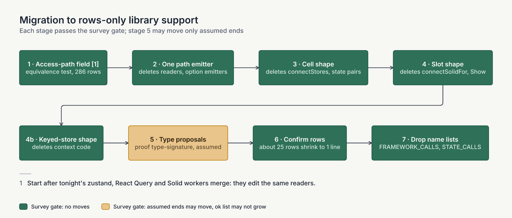

**First step:** stage 1. It changes no behaviour, it is small, and its equivalence test pins every row before stage 2 rewrites the readers. Hold it until tonight's zustand, React Query and Solid workers merge, because they edit the same readers.

## 7. Open questions

- Should a type proposal (stage 5) show in the UI as its own kind of `assumed` step ("follows the types")? It gives a better path than an opaque library step, but the outcome stays `assumed`. This study assumes yes; it needs no product decision before stage 1.
- The legacy route report (about 16,000 SolidStart-specific lines) is outside this study. If it is retired, the library-specific line count roughly halves.
